# Business Analysis Pack — Credit Pack Assessment (Dealer Credit Pack Submission)

**Document:** BA-CPA-v1.0 · **Date:** 2026-10-23 · **Status:** Draft for SME and counsel validation · **Depth:** Comprehensive

| Control item | Value |
|---|---|
| Programme | Credit Pack Assessment (discovery name: Credit Pack Submission Agent) — dealer and wholesale lending |
| Industry vertical | BFSI — motor dealer finance (franchise, wholesale, fleet, retail lending and wider onboarding) |
| Process area | Dealer credit pack assessment: onboarding, due diligence, credit application preparation and submission to Credit, post-approval handoff, periodic review |
| Jurisdiction(s) | United Kingdom (inferred, INF-01) |
| Regulatory context | UK financial crime, sanctions, data protection and FCA requirements (all items 'verify with SME/counsel'; see §L) |
| Classification | Confidential (inferred, INF-07; confirm label) |
| Inputs | Credit assessment.docx (discovery); BusinessAnalysisSME_Agent_Prompt_v1.md (meta-prompt v1.2, 2026-08-18) |
| Artefact counts | 97 requirements · 8 epics · 19 features · 19 functions · 66 user stories · 141 test cases · 44 business rules · 14 calculations · 8 value streams · 5 journeys · 21 individual business value chains |
| Source key | DS-1 to DS-7 = sections of Credit assessment.docx. DS-2 S1 to S5 = stages 1 to 5 of the process. DS-3 F1 to F4 = findings 1 to 4. DS-Exec = executive summary. 'Inferred' = no direct discovery statement. |

**Acting as:** Senior Business Analysis SME and lead business analyst for dealer and wholesale credit operations in UK motor finance, covering KYC and AML onboarding, credit pack preparation and underwriting handoff.

**Traceability line:** `CALC → REQ`; `REQ → FT → EP`; `REQ → STORY → TC`; `REQ → BR`; `REQ → LR`; `REQ → CAP → P-xx (L2)`; `IBVC → P-xx, REQ, CAP, ACT`.

## Document Map

| Volume | Section | Content |
|---|---|---|
| Front matter | 0 | Control table, inferences, Phase 0 coverage reflection, open questions |
| I — Business Analysis | A | Business Context Specification |
| I | B | Business Context Map |
| I | C | Detailed Business Requirements (L3) |
| I | D | Requirement → Business Process Map |
| I | E | Glossary, Taxonomy, Nomenclature |
| I | F | Business Architecture Specification |
| I | G | Functional Specification |
| I | H | Feature Specification |
| I | I | Requirement Catalogue (Epic → Feature → Story) |
| I | J | User Stories with Gherkin acceptance criteria |
| I | K | Business Rules Specification and decision tables |
| I | L | Regulatory and Compliance Mapping |
| I | M | TDD — Requirements to test scenarios and cases; go-live checklist |
| I | N | Calculations |
| II — Value Architecture | O | Value Chain (Porter) |
| II | P | Value Streams (TOGAF / LEAN VSM) |
| II | Q | Customer Journey Mapping |
| II | R | Individual Business Value Chains and Coverage Matrix |

## 0. Front Matter
### 0.1 Inferences (stated, not assumed silently)
| ID | Inference | Basis |
|---|---|---|
| INF-01 | Jurisdiction is the United Kingdom. | Companies House, Experian, Equifax, FCA and Consumer Duty references in the discovery. |
| INF-02 | Regulator is the FCA; PRA applicability is unknown. | Discovery cites FCA checks and FCA credit template; confirm per OQ-01. |
| INF-03 | Vertical is BFSI - motor dealer and wholesale finance, within a lender with captive-style OEM and dealer relationships. | OEM referrals, franchise lending, wholesale stocking platform, vehicle inspection supplier. |
| INF-04 | The process is the Credit Pack Assessment, also called the Credit Pack Submission Agent in the discovery. 'Agent' is a product label; this pack stays design-independent. | Discovery executive summary. |
| INF-05 | Checks are performed by an onboarding or financial crime function, an Account Manager or both (ACT-07). | Discovery says some checks use software and many are manual; performer is not named (OQ-12). |
| INF-06 | Reporting currency is GBP and examples use unlabelled amounts in the reporting currency. | UK jurisdiction. |
| INF-07 | Classification is Confidential, because the related programme paper is marked TCS Confidential. Confirm the label to use. | Related programme paper. |
| INF-08 | Legal, operations and Credit are internal teams; the discovery names activities, not teams. | Discovery section 2, stage 4 and 5. |

### 0.2 Source observations
- The discovery is explicit that this is **not a credit decisioning problem**. Credit Underwriters decide. This pack therefore specifies document assembly, due diligence and information gathering only (REQ-067, BR-G01).
- The discovery numbering moves from section 5 to section 7. Section 6 is absent (OQ-10).
- The discovery gives indicative effort (more than 90 minutes per submission) and indicative workforce (100+ colleagues) but **no validated annual volumes**. No target or benefit figure is invented in this pack.
- Fleet and Retail lending are named only as areas of duplication. Their specific differences are unknown (OQ-11).

### 0.3 Phase 0 — Brainstorm and Coverage Reflection
**Hidden dimensions considered:** exception flows (screening hit, unreadable document, data mismatch, Credit query); non-happy-path actors (OEM, referring bank, field distribution, Compliance, Data Protection Officer, regulator); cross-process dependencies (post-approval legal, mandate, funding and supplier handoffs); data privacy and residency; staleness and validity of checks; version control and unalterable snapshots; connected parties; segregation between preparer and authoriser, and between preparer and Credit; tipping-off constraints on disclosure (counsel to confirm); evidence retrieval for audit; baseline measurement because no volumes exist; the discovery finding that no happy path exists.

| Artefact | Needed? | Why a naive pass would miss it | Included |
|---|---|---|---|
| §A Business Context | Yes | Would restate the discovery without measurable objectives or boundaries | Yes |
| §B Context Map | Yes | Would omit OEMs, referrers, regulators, suppliers and the funding platform | Yes |
| §C Requirements | Yes | Would stop at the five stages and omit governance, reuse, review and measurement | Yes — 97 requirements |
| §D Requirement → Process | Yes | Would skip downstream dependencies between processes | Yes |
| §E Glossary | Yes | 'FCA' has two meanings in the source; 'agent' is a product label | Yes |
| §F Business Architecture | Yes | Would mix capabilities with systems | Yes — design-independent |
| §G Functional Spec | Yes | Would describe screens, not functions | Yes |
| §H Feature Spec | Yes | Needs grouping for planning | Yes |
| §I Requirement Catalogue | Yes | Needs IDs for traceability | Yes |
| §J User Stories | Yes | Sampling would hide error and edge paths | Yes — all 66 stories listed |
| §K Business Rules | Yes | Rules would be mixed with requirements | Yes — with 5 decision tables |
| §L Regulatory Mapping | Yes | Regulatory hooks (suspicion reporting, sanctions, privacy, accountability) are implicit in the discovery | Yes — all flagged 'verify with SME/counsel' |
| §M TDD | Yes | Needs negative and edge tests, especially for blocking controls | Yes — 141 test cases |
| §N Calculations | Yes | Financial analysis is maths-heavy but formulas are not in the discovery | Yes — standard definitions, flagged for confirmation |
| §O Porter Value Chain | Yes | Would omit supplier and buyer system | Yes |
| §P Value Streams | Yes | Streams would be named after departments | Yes — actor-centric |
| §Q Customer Journeys | Yes | Would omit emotion, moments of truth and recovery paths | Yes — happy and recovery journeys |
| §R Individual Business Value Chains | Yes | Would list only the seven case types and miss cross-cutting and exception chains | Yes — 21 chains with coverage matrix |

**Included beyond the ask:** inference register (0.1), open-question register (0.4), source observations (0.2), data validity decision table (DT-5), manual-fallback and exception requirements, go-live checklist, coverage proof for §R.

### 0.4 Open Questions Register
| ID | Question | Affects | Impact |
|---|---|---|---|
| OQ-01 | What does 'FCA' mean in 'FCA credit template', 'FCA credit application pack' and 'FCA regulatory checks'? The discovery uses it both as a template name and as a check type. | REQ-030, REQ-046, LR-09 | Scope of FCA checks; template ownership |
| OQ-02 | What are the escalation criteria to Financial Crime Compliance, and who receives them? | REQ-037, DT-3 | Escalation behaviour |
| OQ-03 | Confirm the case-type-to-activity applicability matrix (DT-1). | REQ-007, DT-1 | Requirement set content |
| OQ-04 | What is the definition of ROTE in the template, whose return is measured, and when is it required? | REQ-045, CALC-010 | Calculation and trigger |
| OQ-05 | What is the policy table that maps dealer risk profile and lifecycle stage to review cadence? | REQ-074, DT-4, CALC-012 | Review schedule |
| OQ-06 | What are the validity periods per information class? | REQ-036, REQ-082, DT-5 | Staleness and re-performance |
| OQ-07 | Which data residency and transfer constraints apply to external data and storage? | REQ-089, LR-04 | Storage constraints |
| OQ-08 | Does any ESG obligation apply to the commentary beyond the template requirement? | REQ-051, LR-13 | Commentary scope |
| OQ-09 | Which borrowing, security haircut and stock-day definitions does Credit policy use? | CALC-001, CALC-008, CALC-009 | Measure definitions |
| OQ-10 | Section 6 is absent from the discovery document (numbering moves from 5 to 7). Was content removed? | Whole pack | Possible missing requirements |
| OQ-11 | How do Fleet and Retail lending differ from Franchise and Wholesale in credit pack content and checks? The discovery names them only as areas of duplication. | BA-03, BA-04, section R | Area-specific variance |
| OQ-12 | Who performs the checks today (Account Manager, a central onboarding team, or another)? | ACT-07, section D | Actor responsibilities |
| OQ-13 | What is the annual case volume by request type and lending line? The discovery gives none. | REQ-094 | Sizing and benefits |
| OQ-14 | Does the Credit system interface with this process, or is the pack sent by email only? | REQ-063, REQ-066 | Submission and outcome capture |
| OQ-15 | Do OEM partners and referring banks receive outcome feedback, and under what permission? | IBVC-17 | Referral loop |
| OQ-16 | Is Consumer Duty or other conduct regulation applicable to the dealer relationship? | LR-08 | Obligation set |
| OQ-17 | Which accessibility standard applies to dealer-facing communication and internal workspaces? | §Q accessibility | Experience requirements |

# VOLUME I — BUSINESS ANALYSIS
## A. Business Context Specification
### A.1 Purpose
Specify the business needs for a reusable capability that gathers information, coordinates due-diligence checks and produces a **decision-ready credit pack** for Credit Underwriters, for dealer onboarding, dealer changes and periodic reviews. The capability supports the people who prepare the pack. It does not decide credit.
### A.2 Business problem
- No happy path exists: every submission needs human work (DS-3 F1).
- The same dealer information is gathered several times by different teams across franchise, wholesale, fleet, retail and wider onboarding (DS-3 F2).
- Data are fragmented across structured data, Excel, email, PDF, images, reports and notes (DS-3 F3).
- Information gathering, checks, coordination, narrative writing and template completion dominate effort. The decision sits elsewhere (DS-3 F4).
- Indicative average effort is more than 90 minutes per submission, with 100+ colleagues involved across the wider process (DS-5). Annual volumes are not validated.

### A.3 Measurable objectives
No target values are set, because the discovery gives no validated baseline. Each objective has a measure and a baseline route.

| ID | Objective | Measure | Known baseline | Target |
|---|---|---|---|---|
| OBJ-01 | Reduce effort to prepare a decision-ready pack | Elapsed effort per case by stage (CALC-013) | More than 90 minutes per submission (indicative, DS-5) | Set after baseline (REQ-093) |
| OBJ-02 | Gather dealer information once | Repeated information requests per dealer across lending lines | Not baselined (REQ-079) | Set after baseline |
| OBJ-03 | Raise first-time-complete submissions | Pack completeness at first submission (CALC-011); Credit queries per pack | Not baselined (REQ-095) | Set after baseline |
| OBJ-04 | Keep all mandatory checks evidenced and current | Share of cases with complete check records and no expired check | Not baselined (REQ-033, REQ-036) | 100% of submitted cases (control objective) |
| OBJ-05 | Keep reviews on schedule | Overdue periodic reviews (REQ-077) | Not baselined | Zero overdue without recorded reason |
| OBJ-06 | Keep Credit independent | Packs containing a decision statement | Not baselined | Zero (REQ-067) |
| OBJ-07 | Baseline the volume of work | Cases by request type, lending line and source (REQ-094) | Not available (OQ-13) | Baseline in place |

### A.4 Scope
| In scope | Out of scope |
|---|---|
| Intake, information gathering, verification, due diligence, financial analysis, template preparation, lending request, terms and pricing record, submission, Credit queries and outcome recording, post-approval handoff tracking, periodic and event-driven reviews, data reuse, governance and measurement | The credit decision and Credit's own assessment systems and policy; execution of legal documentation, mandates and funding set-up (only handoff tracking is in scope); changes to Credit policy; technology design |

### A.5 Stakeholders and actors
| ID | Actor | Type | Role in process | Basis |
|---|---|---|---|---|
| ACT-01 | Dealer Principal / Director | Human - external | Provides director, entity and financial information; takes part in dealer-director discussions; receives outcome | Stated |
| ACT-02 | Dealer Shareholder / Beneficial Owner | Human - external | Provides shareholder and ownership information; is subject to ID&V, sanctions and adverse media checks | Stated |
| ACT-03 | Account Manager | Human - internal | Gathers information, builds the credit template, owns the case and authorises submission to Credit | Stated |
| ACT-04 | Wholesale Manager | Human - internal | Builds the credit template for wholesale lending; owns the case; authorises submission | Stated |
| ACT-05 | Field Distribution Team Member | Human - internal | Refers dealers and relays dealer contact information | Stated |
| ACT-06 | Credit Underwriter | Human - internal | Performs independent credit assessment and approval using Credit systems; raises queries | Stated |
| ACT-07 | Onboarding / Financial Crime Compliance Analyst | Human - internal | Performs or reviews KYC, AML, sanctions, ID&V, CRA and adverse media checks and disposes hits | Inferred |
| ACT-08 | Legal Documentation Team | Human - internal | Prepares legal documentation after approval | Inferred |
| ACT-09 | Operations and Funding Set-up Team | Human - internal | Establishes direct debit mandates, operational set-up and funding system configuration | Inferred |
| ACT-10 | OEM Partner | Organisation - external | Refers dealers; supplies OEM application forms and channel information | Stated |
| ACT-11 | Referring Bank | Organisation - external | Refers dealers (bank referral) | Stated |
| ACT-12 | Credit Reference and Registry Data Providers (Experian, Equifax, Companies House) | System / organisation - external | Supply credit, entity, director, shareholder and structure data | Stated |
| ACT-13 | Audit and Inspection Supplier (Auxiga Smart3) | Organisation - external | Performs audit and vehicle inspection activity | Stated |
| ACT-14 | Regulator (FCA) | Organisation - external | Supervises regulated activity; may request evidence | Inferred |
| ACT-15 | Compliance and Internal Audit Oversight | Human - internal | Oversees control operation; receives escalations; retrieves evidence | Inferred |
| ACT-16 | Data Protection Officer / Privacy Office | Human - internal | Oversees personal data handling, subject requests and retention | Inferred |
| ACT-17 | Wholesale Funding Platform (SOPRA Apak) | System - internal | Holds funding, charging and payment set-up for vehicle stocking | Stated |
| ACT-18 | Business Management / Process Owner | Human - internal | Owns performance baseline and improvement decisions | Inferred |

### A.6 Assumptions and dependencies
| ID | Assumption or dependency | Source |
|---|---|---|
| AS-01 | Credit continues to assess independently in its own systems. | DS-2 S4 |
| AS-02 | Existing tools (Excel template, Experian, Equifax, Companies House, SOPRA Apak, Auxiga Smart3, email) remain sources and destinations. | DS-4, DS-7 |
| AS-03 | Policy owners supply parameters: validity periods, review cadence, escalation criteria (BR-G05). | OQ-02, OQ-05, OQ-06 |
| AS-04 | Provider contracts allow the retention and reuse in REQ-079 and REQ-081 (LR-10). | Inferred |
| DEP-01 | Credit policy table for review cadence. | OQ-05 |
| DEP-02 | Definition of 'FCA' checks and template. | OQ-01 |
| DEP-03 | Counsel view on disclosure limits when a sanctions or suspicion hit occurs. | LR-02 |

## B. Business Context Map
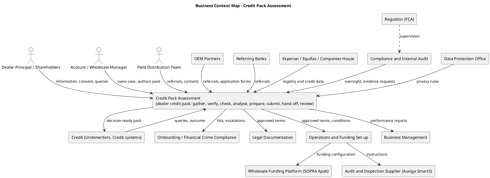

## C. Detailed Business Requirements (L3)
Tags: MoSCoW (M Must, S Should); Flags: REG regulatory, DATA data, HITL human decision point, AUD audit evidence, EXC exception flow, NFR non-functional, INF inferred. Each requirement is atomic, testable and design-independent.

### SA-01 Request Intake and Triage (P-01)
| ID | Requirement | MoSCoW | Flags | Source | Feature |
|---|---|---|---|---|---|
| REQ-001 | The business shall record every dealer credit request as a uniquely identified case at the point of receipt, capturing request type, source channel, receipt date and time, and originating party. | M | AUD | DS-1 | FT-01 |
| REQ-002 | The business shall classify each case as one or more of: new dealer relationship; new franchise application; increased borrowing request; dealer acquisition; dealer disposal; director or shareholder change; periodic dealer credit review. | M | - | DS-1 | FT-01 |
| REQ-003 | The business shall record the origination source of each case as one of: OEM partner, field distribution team, dealer contact, bank referral, existing relationship. | M | - | DS-1 | FT-01 |
| REQ-004 | The business shall show, at case creation, the lending lines (franchise, wholesale, fleet, retail) affected and the dealer information already held. | S | DATA | DS-3 F2 | FT-02 |
| REQ-005 | The business shall assign every case to one accountable Account Manager or Wholesale Manager and keep that assignment visible to all case participants. | M | - | DS-2 S3 | FT-01 |
| REQ-006 | The business shall alert the case owner when an open or recent case exists for the same dealer entity, before the new case progresses. | S | EXC | DS-3 F2 | FT-02 |
| REQ-007 | The business shall determine at case creation the applicable requirement set (information, checks and documents) for the case type and show it as a checklist. | M | - | DS-2 | FT-02 |

### SA-02 Information Gathering (P-02)
| ID | Requirement | MoSCoW | Flags | Source | Feature |
|---|---|---|---|---|---|
| REQ-008 | The business shall capture dealer legal entity details: legal name, registered number, registered address, trading names and legal form. | M | DATA | DS-2 S1 | FT-03 |
| REQ-009 | The business shall capture director information: name, role, appointment details and the personal identifiers needed for ID&V. | M | DATA REG | DS-2 S1 | FT-03 |
| REQ-010 | The business shall capture shareholder information, including ownership percentage and any ultimate beneficial owner. | M | DATA REG | DS-2 S1 | FT-03 |
| REQ-011 | The business shall capture financial information supplied by the dealer: annual accounts, management information and financial statements. | M | DATA | DS-2 S1 | FT-03 |
| REQ-012 | The business shall capture authority and consent documentation, including the dealer's consent to searches and checks. | M | REG DATA | DS-2 S1 | FT-03 |
| REQ-013 | The business shall capture data protection documentation for each case. | M | REG | DS-2 S1 | FT-03 |
| REQ-014 | The business shall accept information from application forms, OEM channels, dealer discussions and external sources in any of these formats: structured data, application forms, Excel templates, emails, PDFs and scans, images, unstructured reports and notes. | M | DATA | DS-3 F3, DS-7 | FT-03 |
| REQ-015 | The business shall record the source, provider, date received and date of information for every information item (provenance). | M | AUD | DS-2 | FT-04 |
| REQ-016 | The business shall identify missing, inconsistent or stale information against the applicable requirement set and notify the case owner. | M | - | DS-2 | FT-04 |
| REQ-017 | The business shall capture qualitative information from dealer meetings and telephone discussions as notes linked to the case, the author and the date. | M | DATA | DS-7 | FT-05 |
| REQ-018 | The business shall record each request for outstanding information with owner, recipient and due date, and track it until the information is received or the request is closed with a reason. | M | EXC | DS-2 S1 | FT-04 |
| REQ-019 | The business shall retrieve and show existing dealer relationship, franchise, acquisition and disposal information before that information is requested again. | S | DATA | DS-3 F2 | FT-04 |

### SA-03 Entity and Ownership Verification (P-03)
| ID | Requirement | MoSCoW | Flags | Source | Feature |
|---|---|---|---|---|---|
| REQ-020 | The business shall verify dealer legal entity details against the Companies House record and show every discrepancy. | M | REG | DS-4, DS-7 | FT-06 |
| REQ-021 | The business shall compare directors and shareholders supplied by the dealer with the registry record and show every difference. | M | REG | DS-4, DS-7 | FT-06 |
| REQ-022 | The business shall present the ownership and control structure of the dealer, including group affiliations, to the case owner. | S | DATA | DS-7 | FT-06 |
| REQ-023 | The business shall identify directors and shareholders who are linked to other entities or dealers already known to the business, and show the link to the case owner. | S | INF | Inferred | FT-06 |
| REQ-024 | The business shall record the verification outcome and the evidence for each entity and individual verified. | M | AUD | DS-2 | FT-06 |

### SA-04 Onboarding and Risk Checks (P-04)
| ID | Requirement | MoSCoW | Flags | Source | Feature |
|---|---|---|---|---|---|
| REQ-025 | The business shall perform or obtain a Know Your Customer (KYC) check for the dealer entity and each relevant individual, as required by the applicable requirement set. | M | REG | DS-2 S2 | FT-07 |
| REQ-026 | The business shall perform or obtain Anti-Money Laundering (AML) checks for the dealer entity and each relevant individual, as required by the applicable requirement set. | M | REG | DS-2 S2 | FT-07 |
| REQ-027 | The business shall screen the dealer entity, directors, shareholders and beneficial owners against sanctions lists before submission to Credit. | M | REG | DS-2 S2 | FT-07 |
| REQ-028 | The business shall perform identity and verification (ID&V) checks for each individual required by the applicable requirement set. | M | REG | DS-2 S2 | FT-07 |
| REQ-029 | The business shall produce a Customer Risk Assessment (CRA) outcome for the dealer relationship and record its basis. | M | REG HITL | DS-2 S2 | FT-08 |
| REQ-030 | The business shall perform the FCA regulatory checks required for the case; the scope of these checks is defined by SME confirmation (OQ-01). | M | REG | DS-2 S2 | FT-07 |
| REQ-031 | The business shall perform an adverse media review for the dealer entity and each relevant individual, and record the sources searched and the findings. | M | REG | DS-2 S2 | FT-07 |
| REQ-032 | The business shall present each potential match or adverse finding to an authorised person for disposition; no match or finding shall be cleared without a recorded disposition. | M | REG HITL EXC | DS-2 S2 | FT-08 |
| REQ-033 | The business shall record, for each check, who or what performed it, date and time, tool or source, scope, result, disposition and evidence, whether the check was automated or manual. | M | AUD REG | DS-2 S2 | FT-08 |
| REQ-034 | The business shall prevent submission to Credit while any mandatory check is outstanding or any hit is undispositioned, unless an authorised exception is recorded. | M | EXC HITL | DS-2 | FT-08 |
| REQ-035 | The business shall support manually driven checks by letting the user record the check performed, with its evidence. | M | - | DS-2 S2 | FT-07 |
| REQ-036 | The business shall require checks to be performed again when a trigger event occurs or the validity period of a check ends, as set by policy. | M | REG | DS-5 | FT-08 |
| REQ-037 | The business shall escalate to Financial Crime Compliance, as set by policy, when a check result meets an escalation criterion (criteria to be confirmed: OQ-02). | M | EXC REG INF | Inferred | FT-08 |

### SA-05 Financial Information and Analysis (P-05)
| ID | Requirement | MoSCoW | Flags | Source | Feature |
|---|---|---|---|---|---|
| REQ-038 | The business shall capture the financial statement data supplied and normalise it into standard credit analysis fields, keeping the link to the source document. | M | DATA | DS-2 S3 | FT-09 |
| REQ-039 | The business shall calculate the financial analysis measures defined in section N from the captured data. | M | - | DS-2 S3 | FT-09 |
| REQ-040 | The business shall present financial trends across all periods available. | M | - | DS-2 S3 | FT-09 |
| REQ-041 | The business shall present trading performance and profitability analysis for the dealer. | M | - | DS-2 S3 | FT-09 |
| REQ-042 | The business shall present cashflow analysis for the dealer. | M | - | DS-2 S3 | FT-09 |
| REQ-043 | The business shall present the dealer's borrowing profile across all lending lines where the dealer has borrowing with the business, and any borrowing disclosed by the dealer. | M | DATA | DS-2 S3 | FT-09 |
| REQ-044 | The business shall flag financial data quality issues: missing periods, unaudited statements, unreconciled totals and inconsistent values. | M | EXC | Inferred from DS-3 F3 | FT-09 |
| REQ-045 | The business shall include ROTE information where the case type or policy requires it (definition to be confirmed: OQ-04). | M | - | DS-7 | FT-09 |

### SA-06 Credit Application Preparation (P-06)
| ID | Requirement | MoSCoW | Flags | Source | Feature |
|---|---|---|---|---|---|
| REQ-046 | The business shall populate the FCA credit template with captured quantitative data without re-keying, and record the template version used. | M | DATA | DS-2 S3 | FT-10 |
| REQ-047 | The business shall support the authoring of business background commentary, with each factual assertion linked to evidence or to a named author. | M | HITL | DS-2 S3 | FT-10 |
| REQ-048 | The business shall support the authoring of management assessment commentary, including management capability. | M | HITL | DS-2 S3 | FT-10 |
| REQ-049 | The business shall support the authoring of conduct and performance assessment commentary for the dealer. | M | HITL | DS-2 S3 | FT-10 |
| REQ-050 | The business shall support the security review, recording the security held or proposed and the assessment of it. | M | - | DS-2 S3 | FT-10 |
| REQ-051 | The business shall support the authoring of ESG commentary where the template requires it. | M | - | DS-2 S3 | FT-10 |
| REQ-052 | The business shall require the case owner to accept, amend or reject every narrative statement before it is included in the pack, and record the author and reviewer. | M | HITL AUD | DS-2 S3, DS-3 F1 | FT-10 |
| REQ-053 | The business shall validate the template: all mandatory sections and fields present, and numeric values consistent between sections. | M | - | Inferred | FT-10 |
| REQ-054 | The business shall keep each version of the template and show the differences between versions. | S | AUD | Inferred | FT-10 |

### SA-07 Lending Request, Terms and Pricing (P-07)
| ID | Requirement | MoSCoW | Flags | Source | Feature |
|---|---|---|---|---|---|
| REQ-055 | The business shall record the lending request: facility type, amount, purpose and, for existing facilities, the change requested. | M | - | DS-2 S4 | FT-11 |
| REQ-056 | The business shall record the terms and parameters proposed for the lending request. | M | - | DS-2 S4 | FT-11 |
| REQ-057 | The business shall record the pricing information for the lending request. | M | HITL | DS-2 S4 | FT-11 |
| REQ-058 | The business shall require pricing and terms to be authorised by an authorised role and record the authoriser. | M | HITL REG | Inferred | FT-11 |
| REQ-059 | The business shall record request-type-specific content, including acquisition or disposal impact and director or shareholder change detail. | M | - | DS-1 | FT-11 |

### SA-08 Submission to Credit (P-08)
| ID | Requirement | MoSCoW | Flags | Source | Feature |
|---|---|---|---|---|---|
| REQ-060 | The business shall assemble the credit pack from the FCA template, lending request, terms and parameters, pricing information and supporting evidence. | M | - | DS-2 S4 | FT-12 |
| REQ-061 | The business shall run a completeness check before submission and report each gap as blocking or advisory. | M | - | Inferred | FT-12 |
| REQ-062 | The business shall require the case owner to authorise the submission and record who authorised it and when. | M | HITL AUD | DS-2 S4 | FT-12 |
| REQ-063 | The business shall transmit the authorised pack to Credit and record confirmation of receipt. | M | - | DS-2 S4 | FT-12 |
| REQ-064 | The business shall keep an unalterable snapshot of the pack as submitted. | M | AUD | Inferred | FT-12 |
| REQ-065 | The business shall record each Credit query, assign it to an owner, track it to resolution and create a new pack version for each amended submission. | M | EXC | Inferred from DS-2 S4 | FT-13 |
| REQ-066 | The business shall record the outcome received from Credit (approved, declined, approved with conditions, referred) with its date and the Credit reference. | M | - | DS-2 S4 | FT-13 |
| REQ-067 | The business shall not record, state or imply a credit decision within the pack; independent assessment and approval remain with Credit. | M | REG | DS-Exec | FT-13 |

### SA-09 Post-Approval Handoffs (P-09)
| ID | Requirement | MoSCoW | Flags | Source | Feature |
|---|---|---|---|---|---|
| REQ-068 | The business shall initiate the post-approval tasks only after the approval is recorded: legal documentation, direct debit mandates, operational set-up, funding system configuration and third-party supplier activity. | M | - | DS-2 S5 | FT-14 |
| REQ-069 | The business shall track each post-approval handoff with owner, status, due date and dependency, and show case status to the case owner at any time. | M | - | DS-2 S5 | FT-14 |
| REQ-070 | The business shall transfer the approved terms to legal documentation, operations and funding without re-keying, and flag any mismatch with the approved terms. | M | DATA | DS-2 S5 | FT-14 |
| REQ-071 | The business shall notify the case owner of each completed handoff milestone. | S | - | Inferred | FT-14 |
| REQ-072 | The business shall track each condition of approval to a recorded satisfaction before any dependent step proceeds. | M | EXC | Inferred | FT-14 |
| REQ-073 | The business shall close a case only when all handoffs are complete or closed with a recorded reason. | M | AUD | Inferred | FT-14 |

### SA-10 Periodic and Event-Driven Review (P-10)
| ID | Requirement | MoSCoW | Flags | Source | Feature |
|---|---|---|---|---|---|
| REQ-074 | The business shall schedule periodic dealer credit reviews at monthly, quarterly, half-yearly or annual intervals, as set by dealer risk profile and lifecycle stage under policy. | M | REG | DS-5 | FT-15 |
| REQ-075 | The business shall create an event-driven case when a trigger event occurs: director or shareholder change, acquisition, disposal, new franchise or increased borrowing. | M | - | DS-1, DS-5 | FT-15 |
| REQ-076 | The business shall prepare a periodic review pack from the information held, and show what changed since the previous review. | S | DATA | Inferred | FT-15 |
| REQ-077 | The business shall notify the case owner of each review that is due or overdue. | M | - | Inferred | FT-15 |
| REQ-078 | The business shall retain the history of every review for each dealer. | M | AUD | Inferred | FT-15 |

### SA-11 Dealer Data and Evidence Reuse (P-11)
| ID | Requirement | MoSCoW | Flags | Source | Feature |
|---|---|---|---|---|---|
| REQ-079 | The business shall gather each dealer information item once and make it available for reuse across lending lines, within the permitted use of the data. | M | DATA | DS-3 F2 | FT-16 |
| REQ-080 | The business shall keep one consistent dealer identity across lending lines, sources and cases. | M | DATA | DS-3 F2 | FT-16 |
| REQ-081 | The business shall retain results from external data providers (Experian, Equifax, Companies House) with their date, within the provider's contractual terms (verify with SME and counsel). | M | DATA REG | DS-4, DS-7 | FT-16 |
| REQ-082 | The business shall flag any information item used after its validity period, as set by policy. | M | DATA | Inferred | FT-16 |
| REQ-083 | The business shall flag any document that cannot be read, and let the user supply a readable alternative or record a manual transcription. | M | EXC DATA | DS-7 | FT-16 |

### SA-12 Governance, Audit and Control (P-12)
| ID | Requirement | MoSCoW | Flags | Source | Feature |
|---|---|---|---|---|---|
| REQ-084 | The business shall restrict access to case data by role and need, and apply data minimisation. | M | REG | Inferred | FT-17 |
| REQ-085 | The business shall keep a complete audit trail of every action on a case, by person or system, with date and time. | M | AUD REG | Inferred | FT-17 |
| REQ-086 | The business shall retain records for the period set by the retention schedule and apply legal hold when required. | M | REG | Inferred | FT-17 |
| REQ-087 | The business shall handle personal data of directors, shareholders and individuals with a recorded lawful basis, and support data subject requests. | M | REG | Inferred | FT-17 |
| REQ-088 | The business shall keep the preparer of pricing and terms separate from the authoriser, and keep Credit independent from the preparing function. | M | REG | DS-Exec | FT-18 |
| REQ-089 | The business shall apply data residency and cross-border transfer constraints to external data and storage (constraints to be confirmed: OQ-07). | S | REG INF | Inferred | FT-17 |
| REQ-090 | The business shall label any content that is generated or populated by a non-human means, show its source, and require review before use. | M | REG HITL | DS-3 F1 (design-independent) | FT-18 |
| REQ-091 | The business shall record each exception or override with the approver and the reason. | M | AUD EXC | DS-3 F1 | FT-18 |
| REQ-092 | The business shall let users continue with a manual alternative when an automated source is unavailable, and record that the alternative was used. | M | NFR EXC | DS-2 S2 | FT-18 |

### SA-13 Performance Measurement (P-12)
| ID | Requirement | MoSCoW | Flags | Source | Feature |
|---|---|---|---|---|---|
| REQ-093 | The business shall record elapsed time and effort per case, by stage, to baseline against the indicative figure of more than 90 minutes per submission. | M | - | DS-5 | FT-19 |
| REQ-094 | The business shall record case volumes by request type, lending line and source, because annual volumes are not validated in the discovery. | M | - | DS-5 | FT-19 |
| REQ-095 | The business shall record rework: Credit queries, returned packs and post-submission amendments. | M | - | Inferred | FT-19 |
| REQ-096 | The business shall record manual interventions and exceptions per case, with reasons. | M | - | DS-3 F1 | FT-19 |
| REQ-097 | The business shall provide operational reports on volume, effort, rework, exceptions, overdue reviews and open handoffs to Business Management. | S | - | Inferred | FT-19 |

## D. Requirement → Business Process Map
L1: **Dealer Credit Pack Assessment**. L2 processes, L3 activities, requirements and downstream dependencies.

| L2 | Process | L3 activities | Requirements | Upstream dependency | Downstream dependency |
|---|---|---|---|---|---|
| P-01 | Receive and Triage Request | Register case; Classify request type; Assign owner; Build applicable requirement set; Detect duplicate or related cases | REQ-001..007 | Periodic/event trigger (P-10); referrals | P-02, P-04 (requirement set) |
| P-02 | Gather Dealer Information | Capture entity, director, shareholder data; Capture financial documents; Capture authority, consent, data protection documents; Record dealer discussions; Chase missing information | REQ-008..019 | P-01 | P-03, P-05, P-11 |
| P-03 | Verify Entities and Ownership | Verify entity against registry; Verify directors and shareholders; Build ownership structure; Identify connected parties; Record verification evidence | REQ-020..024 | P-02, P-11 | P-04, P-06 |
| P-04 | Perform Onboarding and Risk Checks | KYC and AML; Sanctions screening; ID&V; Customer Risk Assessment; FCA regulatory checks; Adverse media review; Dispose hits; Escalate | REQ-025..037 | P-01, P-02, P-03 | P-08 (check gate) |
| P-05 | Analyse Dealer Financials | Normalise financial data; Calculate measures; Analyse trend, trading, cashflow; Build borrowing profile; Flag data quality issues | REQ-038..045 | P-02 | P-06, P-07 |
| P-06 | Prepare Credit Application (FCA Template) | Populate template; Draft and review narrative; Management and conduct assessment; Security review; ESG commentary; Validate template | REQ-046..054 | P-05, P-04 | P-08 |
| P-07 | Compile Lending Request, Terms and Pricing | Record lending request; Record terms and parameters; Record pricing; Authorise pricing and terms | REQ-055..059 | P-05, P-06 | P-08 |
| P-08 | Submit to Credit and Manage Queries | Assemble pack; Check completeness; Authorise and transmit; Snapshot pack; Manage Credit queries; Record Credit outcome | REQ-060..067 | P-04, P-06, P-07 | P-09, P-10 |
| P-09 | Execute Post-Approval Handoffs | Initiate handoffs; Track legal documentation, mandates, set-up, funding, supplier activity; Verify approved terms; Track conditions; Close case | REQ-068..073 | P-08 (approval) | P-10 (review schedule) |
| P-10 | Conduct Periodic and Event-Driven Review | Schedule reviews; Detect trigger events; Prepare review pack; Track overdue reviews; Retain review history | REQ-074..078 | P-09, events | P-01 (event-driven case) |
| P-11 | Manage Dealer Data and Evidence | Resolve dealer identity; Reuse information across lending lines; Retain external data with currency; Handle unreadable sources | REQ-079..083 | P-02, external data | P-02, P-03, all lending lines |
| P-12 | Govern, Audit and Measure | Control access; Maintain audit trail; Retain records and handle personal data; Control exceptions and segregation; Baseline and report performance | REQ-084..097 | All | All |

## E. Glossary, Taxonomy, Nomenclature and Term Engineering
### E.1 Canonical terms
| Term | Definition | Synonyms | Class |
|---|---|---|---|
| Account Manager | Relationship manager who gathers dealer information, builds the credit template and owns the case. | Relationship Manager (RM) | Role |
| Wholesale Manager | Manager who builds the credit template for wholesale lending and owns the case. | - | Role |
| Credit Underwriter | Person in Credit who independently assesses and approves or declines the request. | Underwriter, Credit | Role |
| Dealer | Motor retailer or group that is the customer of the lender for franchise, wholesale, fleet or retail lending. | Customer, Counterparty | Party |
| OEM | Original equipment manufacturer; refers dealers and supplies application forms. | Manufacturer, Brand | Party |
| Franchise | Right granted by an OEM to a dealer to sell a brand; a new franchise application is a case type. | Brand franchise | Concept |
| Lending line | One of franchise, wholesale, fleet or retail lending. | Business line | Concept |
| Wholesale (stocking) funding | Funding of dealer vehicle stock, managed on the wholesale funding platform. | Stocking finance, floorplan | Product |
| Case | Unit of work created for one request, with one owner and one dealer. | Submission, Application | Concept |
| FCA credit application pack | Completed credit application submitted to Credit. Named in the discovery; the meaning of 'FCA' in this name is open (OQ-01). | Credit pack, credit submission | Artefact |
| FCA credit template | Excel template used to build the credit application, with quantitative and narrative content. | FCA template | Artefact |
| Decision-ready pack | A pack complete enough for Credit to assess without further gathering; contains no decision. | - | Concept |
| Applicable requirement set | Information, checks and documents required for a given case type. | Checklist | Concept |
| KYC | Know Your Customer: identify and understand the customer. | - | Control |
| AML | Anti-Money Laundering checks. | - | Control |
| Sanctions screening | Comparison of parties with sanctions lists. | Sanctions check | Control |
| ID&V | Identity and verification of an individual. | IDV | Control |
| CRA | Customer Risk Assessment of the relationship. | Customer risk rating | Control |
| FCA regulatory checks | Checks named in the discovery; scope open (OQ-01). | - | Control |
| Adverse media review | Search of public sources for negative information on a subject. | Negative news | Control |
| Hit | A potential match or finding returned by a check. | Alert, match | Concept |
| Disposition | Recorded decision on a hit, with rationale. | Adjudication | Concept |
| Provenance | Source, provider and dates for an information item. | Lineage | Concept |
| Stale information | Information older than its validity period. | Out of date | Concept |
| Connected party | Person or entity linked to the dealer or to another known dealer through ownership or directorship. | Related party | Concept |
| Ultimate beneficial owner (UBO) | Natural person who ultimately owns or controls the dealer. | Beneficial owner, PSC | Party |
| Handoff | Transfer of work to a downstream team after approval. | - | Concept |
| Periodic review | Scheduled review of a dealer's credit position. | Annual review, monthly review | Process |
| Event-driven review | Case created by a trigger event. | - | Process |
| ROTE | Return on tangible equity; definition and owner open (OQ-04). | - | Measure |
| MI | Management information. | - | Data |
| ESG | Environmental, social and governance commentary in the template. | - | Concept |
| Non-human means | Any automated or machine-based way of populating or generating content, stated without naming a technology. | - | Concept |

### E.2 Acronym register
| Acronym | Meaning |
|---|---|
| AML | Anti-Money Laundering |
| BA | Business area |
| BR | Business rule |
| CRA | Customer Risk Assessment |
| DT | Decision table |
| DS | Discovery source (Credit assessment.docx) |
| EBIT | Earnings before interest and tax |
| ESG | Environmental, social and governance |
| FCA | As used in the discovery (OQ-01); also the UK Financial Conduct Authority |
| ID&V | Identity and verification |
| KYC | Know Your Customer |
| MI | Management information |
| MoSCoW | Must, Should, Could, Won't |
| OEM | Original equipment manufacturer |
| OQ | Open question |
| PSC | Person with significant control |
| ROTE | Return on tangible equity |
| SME | Subject-matter expert |
| UBO | Ultimate beneficial owner |
| VSM | Value stream mapping |

### E.3 Classification taxonomy
| Dimension | Values |
|---|---|
| Request type | New dealer relationship; New franchise application; Increased borrowing request; Dealer acquisition; Dealer disposal; Director or shareholder change; Periodic dealer credit review |
| Origination source | OEM partner; Field distribution team; Dealer contact; Bank referral; Existing relationship |
| Lending line | Franchise; Wholesale; Fleet; Retail |
| Check type | KYC; AML; Sanctions screening; ID&V; CRA; FCA regulatory check; Adverse media review |
| Check outcome | Clear; Potential match; Confirmed match; Unavailable; Expired; Failed |
| Information class | Entity; Director; Shareholder or UBO; Financial; Authority and consent; Data protection; Qualitative note; Security; Pricing and terms |
| Data format | Structured system data; Database field; Application form; Excel template; Email or free text; PDF or scan; Image; Unstructured report; Unstructured note |
| Credit outcome | Approved; Declined; Approved with conditions; Referred |
| Review cadence | Event-driven; Monthly; Quarterly; Half-yearly; Annual |

### E.4 Nomenclature rules
- Use 'case' for the unit of work; 'pack' for the submitted credit application; 'dealer' for the customer.
- Use 'non-human means' instead of a technology name in requirements, to keep the pack design-independent.
- Use 'Credit' for the underwriting function and 'Credit Underwriter' for the person.
- 'FCA' is used only as the discovery uses it, until OQ-01 is closed.
- ID prefixes: REQ, FR, FT, EP, STORY, BR, DT, TC, CALC, VCH, VST, CJM, IBVC, CAP, ACT, OQ, INF, LR.

## F. Business Architecture Specification
### F.1 Capability model (L0 → C1..Cn)
**L0: Dealer Credit Pack Assessment** — capability to turn a dealer request into a decision-ready, evidenced pack and to keep the dealer's credit view current.

| ID | Capability (L1) | Realises process | Requirements |
|---|---|---|---|
| CAP-01 | Request Intake and Case Management | P-01 | REQ-001..007 |
| CAP-02 | Party and Dealer Information Management | P-02 | REQ-008..019 |
| CAP-03 | Entity and Ownership Verification | P-03 | REQ-020..024 |
| CAP-04 | Due Diligence and Screening | P-04 | REQ-025..037 |
| CAP-05 | Financial Spreading and Analysis | P-05 | REQ-038..045 |
| CAP-06 | Credit Application Authoring | P-06 | REQ-046..054 |
| CAP-07 | Lending Request, Terms and Pricing Assembly | P-07 | REQ-055..059 |
| CAP-08 | Pack Assembly and Submission | P-08 | REQ-060..064 |
| CAP-09 | Credit Interaction Management | P-08 | REQ-065..067 |
| CAP-10 | Post-Approval Handoff Coordination | P-09 | REQ-068..073 |
| CAP-11 | Review and Event Management | P-10 | REQ-074..078 |
| CAP-12 | Evidence, Provenance and Data Reuse | P-11 | REQ-079..083 |
| CAP-13 | Governance, Audit and Privacy Control | P-12 | REQ-084..092 |
| CAP-14 | Performance Measurement | P-12 | REQ-093..097 |

### F.2 Principles
| ID | Principle | Rationale | Implication |
|---|---|---|---|
| PR-01 | Gather once, reuse many times | DS-3 F2 duplication | REQ-079, REQ-080 |
| PR-02 | Autonomy for gathering and drafting; authority for deciding stays human | DS-Exec; DS-3 F4 | REQ-052, REQ-067, REQ-090 |
| PR-03 | Design for exceptions, not for a straight-through path | DS-3 F1 | REQ-032, REQ-091, REQ-092, REQ-096 |
| PR-04 | Evidence and provenance for every fact | Regulatory and audit need | REQ-015, REQ-033, REQ-085 |
| PR-05 | Policy parameters are governed, not embedded | Policy changes | BR-G05 |
| PR-06 | Credit remains independent | Control integrity | REQ-067, REQ-088 |
| PR-07 | Measure before promising benefit | DS-5 no validated volumes | REQ-093..REQ-097 |
| PR-08 | Accept every data format | DS-3 F3 | REQ-014, REQ-083 |

### F.3 Logical component and actor view
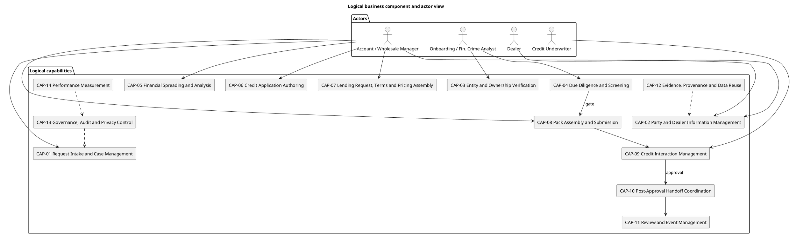

## G. Functional Specification
One function per feature. Functions describe business behaviour and are independent of design.

| ID | Function | Trigger | Inputs | Processing | Outputs | Requirements |
|---|---|---|---|---|---|---|
| FR-01 | Case Registration and Classification | A credit request is received | Request details, source channel, originating party | Create case; assign unique ID; classify type(s) and source; assign accountable owner | Registered case with type, source, owner and receipt timestamp | REQ-001..003, REQ-005 |
| FR-02 | Applicable Requirement Set and Duplicate Detection | Case is created | Case type, dealer identity, information and cases already held | Derive applicable requirement set (DT-1); show lending lines and held information; test for open or recent related cases | Checklist; held-information view; duplicate alert | REQ-004, REQ-006..007 |
| FR-03 | Dealer and Party Information Capture | Dealer information is received or entered | Forms, OEM data, emails, PDFs, Excel, images, notes | Capture entity, director, shareholder, financial, authority, consent and data protection items in any format | Structured case information items linked to source documents | REQ-008..014 |
| FR-04 | Provenance and Gap Management | Item captured or checklist evaluated | Information items, checklist, information already held | Record provenance; find missing, inconsistent or stale items; create and track information requests; show held relationship data | Provenance record; gap list; request log | REQ-015..016, REQ-018..019 |
| FR-05 | Qualitative Information Capture | Dealer meeting or call takes place | Notes from meetings or calls | Record notes with author, date and linked case | Linked qualitative notes | REQ-017 |
| FR-06 | Entity and Ownership Verification | Entity or party information captured | Dealer-supplied entity data; registry data | Compare with registry; compare directors and shareholders; build ownership structure; find connected parties; record outcome | Discrepancy list; ownership structure; connected-party list; verification record | REQ-020..024 |
| FR-07 | Dealer Data Reuse and Currency | Information requested or received for any lending line | Dealer identity; information already held; external results | Resolve single dealer identity; reuse held items; retain external results with dates; flag stale items; flag unreadable documents | Reusable dealer information set; staleness and readability flags | REQ-079..083 |
| FR-08 | Due Diligence Checks | Applicable checks identified | Parties; applicable requirement set; check tools or manual evidence | Perform or obtain KYC, AML, sanctions, ID&V, FCA checks and adverse media review; accept manual check records | Check results with evidence | REQ-025..028, REQ-030..031, REQ-035 |
| FR-09 | Hit Disposition, Risk Assessment and Escalation | A check result is returned or recorded | Check results; policy criteria | Present hits for disposition; produce CRA; record check details; block submission when checks are open; re-perform on trigger; escalate | Dispositions; CRA outcome; check record; block or release status; escalation | REQ-029, REQ-032..034, REQ-036..037 |
| FR-10 | Financial Spreading and Analysis | Financial information captured | Annual accounts, MI, statements, borrowing data | Normalise; calculate measures (section N); analyse trend, trading and cashflow; build borrowing profile; flag data quality; add ROTE where required | Financial analysis set with quality flags | REQ-038..045 |
| FR-11 | Credit Template Population and Narrative Authoring | Analysis and information available | Captured data; analysis set; template | Populate template; support narrative sections; require review of every statement; validate; version | Reviewed, versioned FCA credit template | REQ-046..054 |
| FR-12 | Lending Request, Terms and Pricing | Template in progress or request detail known | Request detail; terms; pricing; policy | Record request, terms and pricing; apply request-type content; require authorisation by authorised role | Authorised lending request, terms and pricing | REQ-055..059 |
| FR-13 | Pack Assembly, Completeness and Submission | Template and lending request are ready | Template; lending request; terms; pricing; evidence | Assemble pack; check completeness; require submission authorisation; transmit; confirm receipt; snapshot | Submitted pack, receipt record, snapshot | REQ-060..064 |
| FR-14 | Credit Query and Outcome Management | Credit responds to the submission | Credit queries; Credit outcome | Record and track queries; version amended packs; record outcome; refuse recording of any decision inside the pack | Query log; versions; recorded outcome | REQ-065..067 |
| FR-15 | Post-Approval Handoff Tracking | Approval is recorded | Approved terms; conditions; handoff owners | Create handoffs; track status; transfer terms; detect mismatch; track conditions; notify; close | Handoff tracker; closed case | REQ-068..073 |
| FR-16 | Periodic Review and Event Triggers | Schedule date reached or trigger event recorded | Review policy table; dealer events; held information | Schedule reviews; create event-driven cases; prepare review pack with change view; notify; retain history | Review schedule; review packs; history | REQ-074..078 |
| FR-17 | Access, Audit, Privacy and Retention | Any user or system acts on case data | Roles; policy; records | Enforce role access and minimisation; log every action; apply retention and legal hold; support data subject requests; apply residency | Access decisions; audit trail; retention actions | REQ-084..087, REQ-089 |
| FR-18 | Controls, Exceptions and Resilience | A control point is reached | Roles; content labels; exceptions | Separate preparer and authoriser; label non-human content; record exceptions; allow manual fallback | Control evidence; exception log | REQ-088, REQ-090..092 |
| FR-19 | Performance Baselining and Reporting | Case activity occurs or reporting date reached | Timings; volumes; rework; exceptions | Record effort by stage; volumes; rework; exceptions; produce reports | Baseline and operational reports | REQ-093..097 |

## H. Feature Specification
| ID | Feature | Function | Requirements | Priority | Vertical classification | Capability | Epic |
|---|---|---|---|---|---|---|---|
| FT-01 | Case Registration and Classification | FR-01 | REQ-001..003, REQ-005 | Must | Core process - intake | CAP-01 | EP-01 |
| FT-02 | Applicable Requirement Set and Duplicate Detection | FR-02 | REQ-004, REQ-006..007 | Must | Core process - intake | CAP-01 | EP-01 |
| FT-03 | Dealer and Party Information Capture | FR-03 | REQ-008..014 | Must | Core process - information gathering | CAP-02 | EP-02 |
| FT-04 | Provenance and Gap Management | FR-04 | REQ-015..016, REQ-018..019 | Must | Core process - information gathering | CAP-02 | EP-02 |
| FT-05 | Qualitative Information Capture | FR-05 | REQ-017 | Must | Core process - information gathering | CAP-02 | EP-02 |
| FT-06 | Entity and Ownership Verification | FR-06 | REQ-020..024 | Must | Control - due diligence | CAP-03 | EP-02 |
| FT-16 | Dealer Data Reuse and Currency | FR-07 | REQ-079..083 | Must | Data foundation | CAP-12 | EP-02 |
| FT-07 | Due Diligence Checks | FR-08 | REQ-025..028, REQ-030..031, REQ-035 | Must | Control - financial crime | CAP-04 | EP-03 |
| FT-08 | Hit Disposition, Risk Assessment and Escalation | FR-09 | REQ-029, REQ-032..034, REQ-036..037 | Must | Control - financial crime | CAP-04 | EP-03 |
| FT-09 | Financial Spreading and Analysis | FR-10 | REQ-038..045 | Must | Core process - credit analysis | CAP-05 | EP-04 |
| FT-10 | Credit Template Population and Narrative Authoring | FR-11 | REQ-046..054 | Must | Core process - credit analysis | CAP-06 | EP-04 |
| FT-11 | Lending Request, Terms and Pricing | FR-12 | REQ-055..059 | Must | Core process - credit analysis | CAP-07 | EP-04 |
| FT-12 | Pack Assembly, Completeness and Submission | FR-13 | REQ-060..064 | Must | Core process - submission | CAP-08 | EP-05 |
| FT-13 | Credit Query and Outcome Management | FR-14 | REQ-065..067 | Must | Core process - submission | CAP-09 | EP-05 |
| FT-14 | Post-Approval Handoff Tracking | FR-15 | REQ-068..073 | Must | Core process - post-approval | CAP-10 | EP-06 |
| FT-15 | Periodic Review and Event Triggers | FR-16 | REQ-074..078 | Must | Core process - monitoring | CAP-11 | EP-07 |
| FT-17 | Access, Audit, Privacy and Retention | FR-17 | REQ-084..087, REQ-089 | Must | Governance | CAP-13 | EP-08 |
| FT-18 | Controls, Exceptions and Resilience | FR-18 | REQ-088, REQ-090..092 | Must | Governance | CAP-13 | EP-08 |
| FT-19 | Performance Baselining and Reporting | FR-19 | REQ-093..097 | Must | Management information | CAP-14 | EP-08 |

## I. Requirement Catalogue (Epic → Feature → User Story)
### EP-01 Case Intake and Management
Receive, classify, assign and scope every dealer credit request.

| Feature | Name | User stories | Requirements |
|---|---|---|---|
| FT-01 | Case Registration and Classification | STORY-001, STORY-002 | REQ-001..003, REQ-005 |
| FT-02 | Applicable Requirement Set and Duplicate Detection | STORY-003, STORY-004 | REQ-004, REQ-006..007 |

### EP-02 Information, Entity Verification and Data Reuse
Gather dealer information once, verify entities and ownership, and reuse validated data.

| Feature | Name | User stories | Requirements |
|---|---|---|---|
| FT-03 | Dealer and Party Information Capture | STORY-005, STORY-006, STORY-007, STORY-008 | REQ-008..014 |
| FT-04 | Provenance and Gap Management | STORY-009, STORY-010, STORY-011 | REQ-015..016, REQ-018..019 |
| FT-05 | Qualitative Information Capture | STORY-012 | REQ-017 |
| FT-06 | Entity and Ownership Verification | STORY-013, STORY-014, STORY-015 | REQ-020..024 |
| FT-16 | Dealer Data Reuse and Currency | STORY-052, STORY-053, STORY-054 | REQ-079..083 |

### EP-03 Onboarding and Risk Checks
Run, evidence and disposition the due-diligence checks.

| Feature | Name | User stories | Requirements |
|---|---|---|---|
| FT-07 | Due Diligence Checks | STORY-016, STORY-017, STORY-018, STORY-019, STORY-020, STORY-021 | REQ-025..028, REQ-030..031, REQ-035 |
| FT-08 | Hit Disposition, Risk Assessment and Escalation | STORY-022, STORY-023, STORY-024, STORY-025, STORY-026, STORY-027 | REQ-029, REQ-032..034, REQ-036..037 |

### EP-04 Financial Analysis and Credit Pack Preparation
Analyse financials, build the FCA credit template, and compile lending request, terms and pricing.

| Feature | Name | User stories | Requirements |
|---|---|---|---|
| FT-09 | Financial Spreading and Analysis | STORY-028, STORY-029, STORY-030, STORY-031 | REQ-038..045 |
| FT-10 | Credit Template Population and Narrative Authoring | STORY-032, STORY-033, STORY-034, STORY-035, STORY-036 | REQ-046..054 |
| FT-11 | Lending Request, Terms and Pricing | STORY-037, STORY-038 | REQ-055..059 |

### EP-05 Submission and Credit Interaction
Assemble, authorise and submit the pack; manage Credit queries and outcome.

| Feature | Name | User stories | Requirements |
|---|---|---|---|
| FT-12 | Pack Assembly, Completeness and Submission | STORY-039, STORY-040, STORY-041 | REQ-060..064 |
| FT-13 | Credit Query and Outcome Management | STORY-042, STORY-043 | REQ-065..067 |

### EP-06 Post-Approval Handoffs
Coordinate the handoffs that follow approval.

| Feature | Name | User stories | Requirements |
|---|---|---|---|
| FT-14 | Post-Approval Handoff Tracking | STORY-044, STORY-045, STORY-046, STORY-047 | REQ-068..073 |

### EP-07 Review and Event Monitoring
Run periodic and event-driven reviews.

| Feature | Name | User stories | Requirements |
|---|---|---|---|
| FT-15 | Periodic Review and Event Triggers | STORY-048, STORY-049, STORY-050, STORY-051 | REQ-074..078 |

### EP-08 Governance, Control and Measurement
Control access, audit, privacy, exceptions and baseline performance.

| Feature | Name | User stories | Requirements |
|---|---|---|---|
| FT-17 | Access, Audit, Privacy and Retention | STORY-055, STORY-056, STORY-057, STORY-058 | REQ-084..087, REQ-089 |
| FT-18 | Controls, Exceptions and Resilience | STORY-059, STORY-060, STORY-061, STORY-062 | REQ-088, REQ-090..092 |
| FT-19 | Performance Baselining and Reporting | STORY-063, STORY-064, STORY-065, STORY-066 | REQ-093..097 |

## J. User Stories
All 66 user stories are listed. Each has Gherkin acceptance criteria with at least one happy scenario and one error or edge scenario, and is traced to requirements.

### STORY-001 — Case Registration and Classification
**Trace:** REQ-001, REQ-003 · FT-01 · EP-01 · Priority Must

**As an** Account Manager, **I want** to register each credit request as a case with its source, **so that** every request is tracked from receipt.

```gherkin
Scenario: [Happy] Register case from OEM referral (TC-001)
  Given a credit request arrives from an OEM partner
  When I register the request and select source OEM partner
  Then a case with a unique ID, receipt date and time, source and originating party is created

Scenario: [Error] Source not selected (TC-002)
  Given I have not selected an origination source
  When I save the case
  Then the case is not saved and the message names the missing source

```

### STORY-002 — Case Registration and Classification
**Trace:** REQ-002, REQ-005 · FT-01 · EP-01 · Priority Must

**As an** Account Manager, **I want** to classify the case type and be shown as accountable owner, **so that** the right requirement set applies and ownership is clear.

```gherkin
Scenario: [Happy] Classify combined request (TC-003)
  Given a request is for a new franchise and increased borrowing
  When I select both case types
  Then both types are recorded and I am shown as accountable owner

Scenario: [Edge] Reassign owner (TC-004)
  Given a case has an owner who is absent
  When a manager assigns another Account Manager
  Then the new owner is shown to all participants and the change is logged with who and when

```

### STORY-003 — Applicable Requirement Set and Duplicate Detection
**Trace:** REQ-004, REQ-007 · FT-02 · EP-01 · Priority Must

**As an** Account Manager, **I want** to see the applicable requirement set and the information already held at case creation, **so that** I only ask the dealer for what is missing.

```gherkin
Scenario: [Happy] Checklist shown for acquisition (TC-005)
  Given a case of type dealer acquisition is created
  When the case is saved
  Then a checklist for that type is shown and lending lines and held information are listed

Scenario: [Edge] No held information (TC-006)
  Given the dealer has no prior information held
  When the case is saved
  Then the held-information view states that no information is held and the full checklist is shown

```

### STORY-004 — Applicable Requirement Set and Duplicate Detection
**Trace:** REQ-006 · FT-02 · EP-01 · Priority Should

**As an** Account Manager, **I want** to be alerted to open or recent cases for the same dealer, **so that** I avoid duplicate work.

```gherkin
Scenario: [Happy] Alert on open case (TC-007)
  Given an open case exists for the same dealer entity
  When I create a new case for that dealer
  Then an alert names the open case and its owner before I continue

Scenario: [Edge] Closed old case (TC-008)
  Given the last case for the dealer was closed beyond the recency window set by policy
  When I create a new case
  Then no duplicate alert is shown

```

### STORY-005 — Dealer and Party Information Capture
**Trace:** REQ-008 · FT-03 · EP-02 · Priority Must

**As an** Account Manager, **I want** to capture dealer legal entity details, **so that** the credit pack identifies the dealer exactly.

```gherkin
Scenario: [Happy] Capture entity details (TC-009)
  Given I hold the dealer application form
  When I enter or load the entity details
  Then legal name, registered number, address, trading names and legal form are stored with the form as source

Scenario: [Error] Missing registered number (TC-010)
  Given the registered number is blank
  When I mark the entity details complete
  Then completion is refused and the missing field is named

```

### STORY-006 — Dealer and Party Information Capture
**Trace:** REQ-009..010 · FT-03 · EP-02 · Priority Must

**As an** Account Manager, **I want** to capture director and shareholder information, **so that** verification and checks can run on every relevant person.

```gherkin
Scenario: [Happy] Capture parties (TC-011)
  Given the dealer lists two directors and one shareholder
  When I enter their details
  Then each person is stored with role, ownership percentage where applicable and ID&V identifiers

Scenario: [Edge] Corporate shareholder (TC-012)
  Given a shareholder is a company
  When I record it
  Then the system prompts for the beneficial owners of that shareholder

```

### STORY-007 — Dealer and Party Information Capture
**Trace:** REQ-011, REQ-014 · FT-03 · EP-02 · Priority Must

**As an** Account Manager, **I want** to capture financial documents in any format, **so that** I do not have to convert documents before use.

```gherkin
Scenario: [Happy] Capture mixed formats (TC-013)
  Given the dealer sends accounts as PDF, MI as Excel and notes by email
  When I add all items to the case
  Then each item is stored, typed by format and linked to the case

Scenario: [Error] Unsupported or corrupt file (TC-014)
  Given a file cannot be stored
  When I add it
  Then I am told the file failed and the case shows an open item for a usable copy

```

### STORY-008 — Dealer and Party Information Capture
**Trace:** REQ-012..013 · FT-03 · EP-02 · Priority Must

**As an** Account Manager, **I want** to capture authority, consent and data protection documents, **so that** checks are made with proper authority.

```gherkin
Scenario: [Happy] Consent captured (TC-015)
  Given the dealer returns signed consent
  When I add the document
  Then the consent is linked to the case with its date and signatory

Scenario: [Error] Consent missing (TC-016)
  Given no consent is recorded
  When I request a credit search
  Then the search is blocked and the message states that consent is required

```

### STORY-009 — Provenance and Gap Management
**Trace:** REQ-015 · FT-04 · EP-02 · Priority Must

**As an** Account Manager, **I want** to see the source and date of every information item, **so that** I can trust and defend each value.

```gherkin
Scenario: [Happy] Show provenance (TC-017)
  Given an item was supplied by the dealer on a stated date
  When I select the item
  Then its source, provider, date received and date of information are shown

Scenario: [Error] Item without source (TC-018)
  Given an item has no recorded source
  When I try to include it in the pack
  Then it is marked unverified and cannot be shown as fact

```

### STORY-010 — Provenance and Gap Management
**Trace:** REQ-016, REQ-018 · FT-04 · EP-02 · Priority Must

**As an** Account Manager, **I want** to be told what is missing, inconsistent or stale and to track requests for it, **so that** gaps are closed before submission.

```gherkin
Scenario: [Happy] Request and receive (TC-019)
  Given the checklist shows missing director ID
  When I raise an information request with a due date
  Then the request is tracked and closes on receipt of the item

Scenario: [Edge] Close with reason (TC-020)
  Given the dealer cannot supply an item
  When I close the request
  Then a reason is required and the gap stays visible in the completeness check

```

### STORY-011 — Provenance and Gap Management
**Trace:** REQ-019 · FT-04 · EP-02 · Priority Should

**As an** Account Manager, **I want** to see existing relationship, franchise, acquisition and disposal information first, **so that** I do not request what the business already holds.

```gherkin
Scenario: [Happy] Existing data shown (TC-021)
  Given the dealer has an existing relationship
  When I open the case
  Then existing relationship, franchise, acquisition and disposal records are shown with dates

Scenario: [Edge] Conflicting held data (TC-022)
  Given held data conflicts with dealer-supplied data
  When I open the case
  Then both values are shown with sources and the case is marked for resolution

```

### STORY-012 — Qualitative Information Capture
**Trace:** REQ-017 · FT-05 · EP-02 · Priority Must

**As an** Account Manager, **I want** to record dealer meeting and call notes against the case, **so that** qualitative insight is kept with the evidence.

```gherkin
Scenario: [Happy] Record notes (TC-023)
  Given I held a call with the dealer director
  When I save notes
  Then the notes are stored with author, date, participants and case link

Scenario: [Error] Unlinked note (TC-024)
  Given a note has no case selected
  When I save it
  Then the save is refused until a case is selected

```

### STORY-013 — Entity and Ownership Verification
**Trace:** REQ-020..021 · FT-06 · EP-02 · Priority Must

**As an** Account Manager, **I want** to compare dealer-supplied entity, director and shareholder data with the registry, **so that** discrepancies are known before checks and credit analysis.

```gherkin
Scenario: [Happy] Registry match (TC-025)
  Given dealer data matches the Companies House record
  When verification runs
  Then a match is recorded for each entity and person with the registry date

Scenario: [Error] Registry mismatch (TC-026)
  Given the dealer lists a director who is absent from the registry
  When verification runs
  Then the difference is shown, the item is marked discrepancy and the case owner must resolve it

```

### STORY-014 — Entity and Ownership Verification
**Trace:** REQ-022..023 · FT-06 · EP-02 · Priority Should

**As an** Account Manager, **I want** to see the ownership structure and links to known entities, **so that** Credit sees the full control picture.

```gherkin
Scenario: [Happy] Structure shown (TC-027)
  Given verification is complete
  When I open the structure view
  Then owners, percentages and group affiliations are shown, with linked known entities listed

Scenario: [Edge] Linked to another dealer (TC-028)
  Given a director is also a director of a known dealer
  When I open the structure view
  Then the link is shown and flagged for disclosure to Credit

```

### STORY-015 — Entity and Ownership Verification
**Trace:** REQ-024 · FT-06 · EP-02 · Priority Must

**As an** Onboarding Analyst, **I want** to record the verification outcome and evidence per entity and person, **so that** the audit can see what was verified.

```gherkin
Scenario: [Happy] Outcome recorded (TC-029)
  Given verification is finished
  When I record the outcome
  Then outcome, evidence reference, date and verifier are stored for each entity and person

Scenario: [Error] No evidence (TC-030)
  Given no evidence is attached
  When I record the outcome as verified
  Then the record is refused until evidence is attached

```

### STORY-016 — Due Diligence Checks
**Trace:** REQ-025..026 · FT-07 · EP-03 · Priority Must

**As an** Onboarding Analyst, **I want** to perform or obtain KYC and AML checks per the requirement set, **so that** every required party is checked.

```gherkin
Scenario: [Happy] KYC and AML run (TC-031)
  Given the requirement set lists the entity and two directors
  When I initiate the checks
  Then a KYC and AML result is recorded for each listed party

Scenario: [Error] Party omitted (TC-032)
  Given a listed party has no KYC result
  When I request submission
  Then submission is blocked and the party is named

```

### STORY-017 — Due Diligence Checks
**Trace:** REQ-027 · FT-07 · EP-03 · Priority Must

**As an** Onboarding Analyst, **I want** to screen entity, directors, shareholders and beneficial owners against sanctions lists, **so that** no sanctioned party reaches Credit unseen.

```gherkin
Scenario: [Happy] No match (TC-033)
  Given all parties are screened
  When screening completes with no match
  Then a no-match result with list version and date is recorded for each party

Scenario: [Edge] Late party added (TC-034)
  Given a director is added after screening
  When the party is saved
  Then screening is required for the new party before submission

```

### STORY-018 — Due Diligence Checks
**Trace:** REQ-028 · FT-07 · EP-03 · Priority Must

**As an** Onboarding Analyst, **I want** to perform ID&V for required individuals, **so that** identities are confirmed.

```gherkin
Scenario: [Happy] ID&V passed (TC-035)
  Given an individual supplies identity evidence
  When ID&V completes
  Then the method, evidence reference and result are recorded

Scenario: [Error] ID&V failed (TC-036)
  Given evidence does not verify
  When ID&V completes
  Then the result is failed, the individual is marked unverified and the case owner is notified

```

### STORY-019 — Due Diligence Checks
**Trace:** REQ-030 · FT-07 · EP-03 · Priority Must

**As an** Onboarding Analyst, **I want** to perform the FCA regulatory checks required for the case, **so that** regulatory status requirements are met.

```gherkin
Scenario: [Happy] FCA check recorded (TC-037)
  Given the requirement set includes FCA checks
  When I perform and record them
  Then scope, source, result and date are stored (scope per OQ-01)

Scenario: [Error] Scope undefined (TC-038)
  Given the scope of FCA checks is not configured
  When I open the check
  Then the check is shown as not configurable and cannot be completed until scope is set

```

### STORY-020 — Due Diligence Checks
**Trace:** REQ-031 · FT-07 · EP-03 · Priority Must

**As an** Onboarding Analyst, **I want** to perform and record adverse media review, **so that** reputational risk is visible to Credit.

```gherkin
Scenario: [Happy] Review recorded (TC-039)
  Given the entity and individuals are in scope
  When I complete the review
  Then sources searched, findings and date are recorded for each subject

Scenario: [Edge] Finding returned (TC-040)
  Given a relevant article is found
  When I record the finding
  Then the finding is routed to disposition under REQ-032

```

### STORY-021 — Due Diligence Checks
**Trace:** REQ-035 · FT-07 · EP-03 · Priority Must

**As an** Onboarding Analyst, **I want** to record a manually driven check with its evidence, **so that** checks without a tool are still evidenced.

```gherkin
Scenario: [Happy] Manual check logged (TC-041)
  Given a check has no tool
  When I record it as manual with evidence
  Then the record shows method manual, performer, date and evidence

Scenario: [Error] Manual without evidence (TC-042)
  Given no evidence is attached
  When I save the manual check
  Then the save is refused

```

### STORY-022 — Hit Disposition, Risk Assessment and Escalation
**Trace:** REQ-032 · FT-08 · EP-03 · Priority Must

**As an** Onboarding Analyst, **I want** to dispose every potential match or adverse finding, **so that** no hit is cleared without a decision.

```gherkin
Scenario: [Happy] Dispose false positive (TC-043)
  Given a potential match is presented
  When I record disposition false positive with rationale
  Then the disposition, rationale, disposer and time are stored

Scenario: [Error] Auto-clear attempt (TC-044)
  Given a hit has no disposition
  When a user or process tries to clear it
  Then the clear is refused and the hit stays open

```

### STORY-023 — Hit Disposition, Risk Assessment and Escalation
**Trace:** REQ-033 · FT-08 · EP-03 · Priority Must

**As an** Onboarding Analyst, **I want** to have a complete record of each check, **so that** an auditor can reconstruct every check.

```gherkin
Scenario: [Happy] Record complete (TC-045)
  Given a check is complete
  When I open its record
  Then performer, date and time, tool or source, scope, result, disposition and evidence are shown

Scenario: [Error] Incomplete record (TC-046)
  Given a record lacks result
  When I close the check
  Then closure is refused until all fields are present

```

### STORY-024 — Hit Disposition, Risk Assessment and Escalation
**Trace:** REQ-034 · FT-08 · EP-03 · Priority Must

**As an** Account Manager, **I want** to be prevented from submitting while checks are open or hits are undispositioned, **so that** Credit never receives an unchecked pack.

```gherkin
Scenario: [Happy] Release when complete (TC-047)
  Given all mandatory checks are complete and hits dispositioned
  When I request submission
  Then the control passes

Scenario: [Error] Open hit (TC-048)
  Given one hit is undispositioned
  When I request submission
  Then submission is blocked and the hit and corrective action are named

Scenario: [Edge] Authorised exception (TC-049)
  Given an authorised role approves an exception with reason
  When I request submission
  Then submission proceeds and the exception is logged

```

### STORY-025 — Hit Disposition, Risk Assessment and Escalation
**Trace:** REQ-029 · FT-08 · EP-03 · Priority Must

**As an** Onboarding Analyst, **I want** to produce the Customer Risk Assessment outcome and its basis, **so that** the relationship risk is evidenced.

```gherkin
Scenario: [Happy] CRA produced (TC-050)
  Given checks are complete
  When I record the CRA outcome
  Then the outcome, basis, assessor and date are stored

Scenario: [Error] CRA missing at submission (TC-051)
  Given no CRA is recorded
  When I request submission
  Then submission is blocked

```

### STORY-026 — Hit Disposition, Risk Assessment and Escalation
**Trace:** REQ-036 · FT-08 · EP-03 · Priority Must

**As an** Account Manager, **I want** to have checks re-performed when a trigger event occurs or validity ends, **so that** stale checks are never relied on.

```gherkin
Scenario: [Happy] Trigger event (TC-052)
  Given a director change is recorded
  When the event is saved
  Then checks for the changed party are required again

Scenario: [Edge] Validity ends (TC-053)
  Given a prior check passes its policy validity period
  When the case is opened
  Then the check is shown as expired and must be re-performed

```

### STORY-027 — Hit Disposition, Risk Assessment and Escalation
**Trace:** REQ-037 · FT-08 · EP-03 · Priority Must

**As an** Onboarding Analyst, **I want** to escalate to Financial Crime Compliance when criteria are met, **so that** serious findings are handled by the right function.

```gherkin
Scenario: [Happy] Escalate (TC-054)
  Given a result meets an escalation criterion
  When I escalate
  Then an escalation record with reason, time and receiver is created and the case is held

Scenario: [Error] Criteria not set (TC-055)
  Given escalation criteria are not configured
  When a check completes
  Then the case is flagged for manual escalation review and the gap is logged (OQ-02)

```

### STORY-028 — Financial Spreading and Analysis
**Trace:** REQ-038, REQ-044 · FT-09 · EP-04 · Priority Must

**As an** Account Manager, **I want** to normalise supplied financials and see data quality flags, **so that** analysis is built on reliable data.

```gherkin
Scenario: [Happy] Normalise (TC-056)
  Given annual accounts are captured
  When I run normalisation
  Then values populate standard fields with link to the source page or document

Scenario: [Error] Unreconciled totals (TC-057)
  Given statement totals do not reconcile
  When normalisation completes
  Then a quality flag lists the unreconciled totals and the case owner must accept or correct

Scenario: [Edge] Missing period (TC-058)
  Given one period is absent
  When normalisation completes
  Then the missing period is flagged and trend analysis excludes it with a visible note

```

### STORY-029 — Financial Spreading and Analysis
**Trace:** REQ-039, REQ-045 · FT-09 · EP-04 · Priority Must

**As an** Account Manager, **I want** to have the defined measures calculated, including ROTE where required, **so that** analysis is consistent and repeatable.

```gherkin
Scenario: [Happy] Calculate measures (TC-059)
  Given normalised data exist
  When I run the calculation
  Then each measure in section N is shown with inputs and result

Scenario: [Error] Zero denominator (TC-060)
  Given a denominator is zero
  When the calculation runs
  Then the result is shown as not calculable with reason; no value is invented

Scenario: [Edge] ROTE not required (TC-061)
  Given the case type does not require ROTE
  When I run the calculation
  Then ROTE is not shown

```

### STORY-030 — Financial Spreading and Analysis
**Trace:** REQ-040..042 · FT-09 · EP-04 · Priority Must

**As an** Account Manager, **I want** to see financial trends, trading performance and cashflow analysis, **so that** I can explain the dealer's performance.

```gherkin
Scenario: [Happy] Trend view (TC-062)
  Given three periods are available
  When I open the analysis
  Then trend, trading performance, profitability and cashflow are shown across periods

Scenario: [Edge] One period only (TC-063)
  Given only one period is available
  When I open the analysis
  Then trend is shown as not available and a limitation note is added

```

### STORY-031 — Financial Spreading and Analysis
**Trace:** REQ-043 · FT-09 · EP-04 · Priority Must

**As an** Account Manager, **I want** to see the dealer's borrowing profile across lending lines and disclosed borrowing, **so that** Credit sees total exposure context.

```gherkin
Scenario: [Happy] Profile shown (TC-064)
  Given the dealer has borrowing in two lending lines
  When I open the profile
  Then borrowing per line and dealer-disclosed external borrowing are shown with dates

Scenario: [Error] Line data unavailable (TC-065)
  Given one line's data is unavailable
  When I open the profile
  Then the line is shown as unavailable and a manual entry with evidence is allowed

```

### STORY-032 — Credit Template Population and Narrative Authoring
**Trace:** REQ-046, REQ-053..054 · FT-10 · EP-04 · Priority Must

**As an** Account Manager, **I want** to populate and validate the FCA credit template without re-keying and keep its versions, **so that** the template is accurate and traceable.

```gherkin
Scenario: [Happy] Populate and validate (TC-066)
  Given analysis data exist
  When I populate the template
  Then quantitative fields are filled, the version is recorded and validation shows all mandatory sections present

Scenario: [Error] Inconsistent numbers (TC-067)
  Given a value differs between two sections
  When I validate
  Then the inconsistency is listed and submission is blocked until resolved

Scenario: [Edge] Compare versions (TC-068)
  Given two versions exist
  When I compare them
  Then differences are shown field by field

```

### STORY-033 — Credit Template Population and Narrative Authoring
**Trace:** REQ-047, REQ-051 · FT-10 · EP-04 · Priority Must

**As an** Account Manager, **I want** to author business background and ESG commentary with evidence links, **so that** commentary is supported.

```gherkin
Scenario: [Happy] Evidence-linked statement (TC-069)
  Given I write a background statement
  When I link it to evidence
  Then the statement is stored with its evidence link and my authorship

Scenario: [Error] Unsupported assertion (TC-070)
  Given a factual assertion has no evidence or named author
  When I mark the section complete
  Then completion is refused and the assertion is listed

```

### STORY-034 — Credit Template Population and Narrative Authoring
**Trace:** REQ-048..049 · FT-10 · EP-04 · Priority Must

**As a** Wholesale Manager, **I want** to author management assessment and conduct and performance commentary, **so that** Credit sees my informed judgement.

```gherkin
Scenario: [Happy] Author assessment (TC-071)
  Given I have held dealer discussions
  When I write the management assessment and conduct commentary
  Then both are stored as authored by me with date and linked notes

Scenario: [Edge] Non-human draft present (TC-072)
  Given a draft was generated by a non-human means
  When I open the section
  Then the draft is labelled with its source and is unusable until I accept or amend it

```

### STORY-035 — Credit Template Population and Narrative Authoring
**Trace:** REQ-050 · FT-10 · EP-04 · Priority Must

**As an** Account Manager, **I want** to record the security review, **so that** Credit can assess security.

```gherkin
Scenario: [Happy] Security recorded (TC-073)
  Given security is held or proposed
  When I record it with assessment
  Then security type, value basis, date and assessment are stored

Scenario: [Error] No security data (TC-074)
  Given no security information exists
  When I complete the review
  Then the section requires either security data or a recorded reason

```

### STORY-036 — Credit Template Population and Narrative Authoring
**Trace:** REQ-052 · FT-10 · EP-04 · Priority Must

**As an** Account Manager, **I want** to accept, amend or reject every narrative statement before inclusion, **so that** nothing enters the pack unreviewed.

```gherkin
Scenario: [Happy] Accept statement (TC-075)
  Given a statement is drafted
  When I accept it
  Then it is included and author and reviewer are recorded

Scenario: [Error] Unreviewed statement (TC-076)
  Given a statement has not been reviewed
  When I request submission
  Then submission is blocked and the statement is listed

```

### STORY-037 — Lending Request, Terms and Pricing
**Trace:** REQ-055, REQ-059 · FT-11 · EP-04 · Priority Must

**As an** Account Manager, **I want** to record the lending request with request-type-specific detail, **so that** Credit sees exactly what is requested.

```gherkin
Scenario: [Happy] Record request (TC-077)
  Given a case is increased borrowing
  When I record facility type, amount, purpose and change requested
  Then the request is stored with type-specific detail

Scenario: [Error] Missing amount (TC-078)
  Given the amount is blank
  When I save the request
  Then the save is refused and the field is named

```

### STORY-038 — Lending Request, Terms and Pricing
**Trace:** REQ-056..058 · FT-11 · EP-04 · Priority Must

**As an** Account Manager, **I want** to record terms, parameters and pricing and have them authorised, **so that** terms and pricing are controlled.

```gherkin
Scenario: [Happy] Authorised terms (TC-079)
  Given I record terms and pricing
  When an authorised role approves them
  Then the authoriser, time and approved values are stored

Scenario: [Error] Self-authorisation (TC-080)
  Given I prepared the pricing and I am not an authorised role
  When I try to authorise it
  Then authorisation is refused

Scenario: [Edge] Change after authorisation (TC-081)
  Given pricing changes after authorisation
  When I amend it
  Then authorisation is withdrawn and required again

```

### STORY-039 — Pack Assembly, Completeness and Submission
**Trace:** REQ-060..061 · FT-12 · EP-05 · Priority Must

**As an** Account Manager, **I want** to assemble the pack and see blocking and advisory gaps, **so that** I submit a complete pack.

```gherkin
Scenario: [Happy] Complete pack (TC-082)
  Given all sections and evidence are present
  When I run the completeness check
  Then the check reports no blocking gap

Scenario: [Error] Blocking gap (TC-083)
  Given a mandatory item is missing
  When I run the completeness check
  Then each gap is listed as blocking with corrective action

Scenario: [Edge] Advisory gap (TC-084)
  Given an optional item is empty
  When I run the completeness check
  Then the gap is listed as advisory and does not block

```

### STORY-040 — Pack Assembly, Completeness and Submission
**Trace:** REQ-062 · FT-12 · EP-05 · Priority Must

**As an** Account Manager, **I want** to authorise submission explicitly, **so that** accountability is clear.

```gherkin
Scenario: [Happy] Authorise (TC-085)
  Given the completeness check passes
  When I authorise submission
  Then my identity, role, date and time are recorded

Scenario: [Error] Unauthorised role (TC-086)
  Given a user without authority tries
  When they authorise
  Then the action is refused

```

### STORY-041 — Pack Assembly, Completeness and Submission
**Trace:** REQ-063..064 · FT-12 · EP-05 · Priority Must

**As an** Account Manager, **I want** to transmit the pack to Credit with receipt confirmation and an unalterable snapshot, **so that** the submitted content is provable.

```gherkin
Scenario: [Happy] Transmit (TC-087)
  Given submission is authorised
  When I transmit
  Then receipt confirmation is recorded and a snapshot is stored

Scenario: [Error] Transmission fails (TC-088)
  Given transmission fails
  When I transmit
  Then the case remains not submitted and I am told the reason

Scenario: [Edge] Edit after submit (TC-089)
  Given the pack is submitted
  When a user edits a section
  Then the snapshot is unchanged and the edit creates a new version

```

### STORY-042 — Credit Query and Outcome Management
**Trace:** REQ-065 · FT-13 · EP-05 · Priority Must

**As an** Account Manager, **I want** to record and resolve Credit queries and version each amended submission, **so that** rework is controlled.

```gherkin
Scenario: [Happy] Resolve query (TC-090)
  Given Credit raises a query
  When I assign it, respond and resubmit
  Then the query is closed and a new pack version is submitted

Scenario: [Edge] Unanswered query (TC-091)
  Given a query passes its due date
  When the date passes
  Then the case owner is notified and the query is flagged overdue

```

### STORY-043 — Credit Query and Outcome Management
**Trace:** REQ-066..067 · FT-13 · EP-05 · Priority Must

**As a** Credit Underwriter, **I want** to record my outcome while the pack carries no decision, **so that** my assessment stays independent.

```gherkin
Scenario: [Happy] Record outcome (TC-092)
  Given I complete my assessment in Credit systems
  When the outcome is recorded against the case
  Then outcome, date and Credit reference are stored

Scenario: [Error] Decision in pack (TC-093)
  Given a pack section states an approval or recommended decision
  When I submit or the owner submits
  Then the content is flagged and submission is blocked until it is removed

```

### STORY-044 — Post-Approval Handoff Tracking
**Trace:** REQ-068..069, REQ-071 · FT-14 · EP-06 · Priority Must

**As an** Account Manager, **I want** to start and track post-approval handoffs only after approval, **so that** downstream work starts correctly.

```gherkin
Scenario: [Happy] Initiate (TC-094)
  Given approval is recorded
  When handoffs are initiated
  Then tasks for legal documentation, mandates, operational set-up, funding configuration and supplier activity are created with owner, due date and dependency

Scenario: [Error] No approval (TC-095)
  Given no approval is recorded
  When a user initiates handoffs
  Then initiation is refused

Scenario: [Happy] Milestone notice (TC-096)
  Given a handoff completes
  When status changes to complete
  Then the case owner is notified

```

### STORY-045 — Post-Approval Handoff Tracking
**Trace:** REQ-070 · FT-14 · EP-06 · Priority Must

**As an** Operations Analyst, **I want** to receive approved terms without re-keying and be warned of mismatch, **so that** funding and documents match approval.

```gherkin
Scenario: [Happy] Terms transferred (TC-097)
  Given approved terms exist
  When handoffs start
  Then terms populate the downstream tasks unchanged

Scenario: [Error] Mismatch (TC-098)
  Given downstream values differ from approved terms
  When the difference is detected
  Then the handoff is blocked and the difference is shown

```

### STORY-046 — Post-Approval Handoff Tracking
**Trace:** REQ-072 · FT-14 · EP-06 · Priority Must

**As an** Account Manager, **I want** to track conditions of approval to satisfaction, **so that** funding steps wait for conditions.

```gherkin
Scenario: [Happy] Condition satisfied (TC-099)
  Given a condition is recorded satisfied with evidence
  When a dependent step is due
  Then the step proceeds

Scenario: [Error] Condition open (TC-100)
  Given a condition is open
  When a dependent step is due
  Then the step is blocked and the condition is named

```

### STORY-047 — Post-Approval Handoff Tracking
**Trace:** REQ-073 · FT-14 · EP-06 · Priority Must

**As an** Account Manager, **I want** to close a case only when all handoffs are complete or closed with reason, **so that** no handoff is lost.

```gherkin
Scenario: [Happy] Close (TC-101)
  Given all handoffs are complete
  When I close the case
  Then the case is closed with date and closer

Scenario: [Error] Open handoff (TC-102)
  Given a handoff is open
  When I close the case
  Then closure is refused and the handoff is named

```

### STORY-048 — Periodic Review and Event Triggers
**Trace:** REQ-074, REQ-077 · FT-15 · EP-07 · Priority Must

**As an** Account Manager, **I want** to have periodic reviews scheduled by cadence and be notified when due or overdue, **so that** reviews are never missed.

```gherkin
Scenario: [Happy] Schedule (TC-103)
  Given a dealer has a policy cadence of quarterly
  When a review completes
  Then the next review date is set per CALC-012 and appears in my queue

Scenario: [Error] Overdue (TC-104)
  Given a review date passes
  When the date passes
  Then I am notified and the review is flagged overdue

Scenario: [Edge] Cadence not set (TC-105)
  Given the dealer has no cadence in the policy table
  When a review completes
  Then a configuration alert is raised and no date is guessed

```

### STORY-049 — Periodic Review and Event Triggers
**Trace:** REQ-075 · FT-15 · EP-07 · Priority Must

**As an** Account Manager, **I want** to have a case created when a trigger event occurs, **so that** events are handled promptly.

```gherkin
Scenario: [Happy] Event case (TC-106)
  Given a shareholder change is recorded
  When the event is saved
  Then an event-driven case of that type is created and assigned

Scenario: [Error] Duplicate event (TC-107)
  Given an open case exists for the same event
  When the event is saved
  Then the existing case is shown and no duplicate is created

```

### STORY-050 — Periodic Review and Event Triggers
**Trace:** REQ-076 · FT-15 · EP-07 · Priority Should

**As an** Account Manager, **I want** to receive a review pack that shows changes since the previous review, **so that** I focus on what changed.

```gherkin
Scenario: [Happy] Change view (TC-108)
  Given a previous review exists
  When I open the review pack
  Then changed values are highlighted with previous and current values

Scenario: [Edge] First review (TC-109)
  Given no previous review exists
  When I open the review pack
  Then the pack states that no comparison is available

```

### STORY-051 — Periodic Review and Event Triggers
**Trace:** REQ-078 · FT-15 · EP-07 · Priority Must

**As a** Credit Underwriter, **I want** to see the history of every review for a dealer, **so that** I understand the trend of the relationship.

```gherkin
Scenario: [Happy] History (TC-110)
  Given several reviews exist
  When I open the history
  Then all reviews are listed with date, owner and outcome

Scenario: [Error] Deletion attempt (TC-111)
  Given a user tries to delete a review
  When they delete
  Then the deletion is refused and the attempt is logged

```

### STORY-052 — Dealer Data Reuse and Currency
**Trace:** REQ-079..080 · FT-16 · EP-02 · Priority Must

**As an** Account Manager, **I want** to gather information once and reuse it across lending lines under one dealer identity, **so that** the dealer is not asked twice.

```gherkin
Scenario: [Happy] Reuse across lines (TC-112)
  Given director data were captured for a franchise case
  When a wholesale case starts for the same dealer
  Then the data are offered for reuse with their source and date

Scenario: [Error] Duplicate identity (TC-113)
  Given two dealer records match the same registered number
  When a case is created
  Then the records are flagged for merge review and no new identity is created

```

### STORY-053 — Dealer Data Reuse and Currency
**Trace:** REQ-081..082 · FT-16 · EP-02 · Priority Must

**As an** Account Manager, **I want** to retain external results with dates and be warned of stale items, **so that** I do not rely on out-of-date data.

```gherkin
Scenario: [Happy] Retained (TC-114)
  Given a registry result is obtained
  When I save it
  Then the result is stored with its date and provider

Scenario: [Error] Stale item (TC-115)
  Given an item is older than its validity period
  When I include it in the pack
  Then a stale flag shows and the item must be refreshed or an exception recorded

```

### STORY-054 — Dealer Data Reuse and Currency
**Trace:** REQ-083 · FT-16 · EP-02 · Priority Must

**As an** Account Manager, **I want** to be told when a document cannot be read, **so that** unreadable evidence is not ignored.

```gherkin
Scenario: [Happy] Alternative supplied (TC-116)
  Given a scan is unreadable
  When I upload a readable copy
  Then the item is linked to the new document and the old one is kept

Scenario: [Edge] Manual transcription (TC-117)
  Given no readable copy exists
  When I transcribe values
  Then the values are marked manually transcribed with my name and evidence of the original

```

### STORY-055 — Access, Audit, Privacy and Retention
**Trace:** REQ-084 · FT-17 · EP-08 · Priority Must

**As a** Compliance Officer, **I want** to restrict case data by role and need, **so that** personal and commercial data are protected.

```gherkin
Scenario: [Happy] Role access (TC-118)
  Given a user has the Account Manager role for the case
  When they open the case
  Then only data permitted for the role are shown

Scenario: [Error] No access (TC-119)
  Given a user has no role on the case
  When they open the case
  Then access is denied and logged

```

### STORY-056 — Access, Audit, Privacy and Retention
**Trace:** REQ-085 · FT-17 · EP-08 · Priority Must

**As an** Internal Auditor, **I want** to see a complete audit trail of every action, **so that** I can reconstruct any case.

```gherkin
Scenario: [Happy] Trail (TC-120)
  Given a case has history
  When I open the audit trail
  Then every action is listed with actor, date and time

Scenario: [Error] Alter trail (TC-121)
  Given a user tries to alter an entry
  When they edit
  Then the edit is refused

```

### STORY-057 — Access, Audit, Privacy and Retention
**Trace:** REQ-086..087 · FT-17 · EP-08 · Priority Must

**As a** Data Protection Officer, **I want** to apply retention, legal hold and data subject rights to personal data, **so that** the business meets its privacy duties.

```gherkin
Scenario: [Happy] Subject request (TC-122)
  Given a data subject request is received
  When I search the data
  Then all personal data for the person are found and reported

Scenario: [Edge] Legal hold (TC-123)
  Given a record reaches its retention end and a legal hold applies
  When retention runs
  Then the record is kept and the hold is logged

```

### STORY-058 — Access, Audit, Privacy and Retention
**Trace:** REQ-089 · FT-17 · EP-08 · Priority Should

**As a** Data Protection Officer, **I want** to apply residency and transfer constraints to external data and storage, **so that** data stay within permitted locations.

```gherkin
Scenario: [Happy] Constraint applied (TC-124)
  Given a residency constraint is configured
  When data are stored
  Then storage is only in permitted locations

Scenario: [Error] Constraint unset (TC-125)
  Given no constraint is configured
  When external data are stored
  Then a configuration alert is raised (OQ-07)

```

### STORY-059 — Controls, Exceptions and Resilience
**Trace:** REQ-088 · FT-18 · EP-08 · Priority Must

**As a** Compliance Officer, **I want** to keep preparers separate from authorisers and Credit independent, **so that** control integrity holds.

```gherkin
Scenario: [Happy] Separation (TC-126)
  Given a user prepared pricing
  When another authorised role is asked
  Then only the other role can authorise

Scenario: [Error] Credit prepare (TC-127)
  Given a Credit user tries to prepare the pack
  When they edit the pack
  Then the action is refused

```

### STORY-060 — Controls, Exceptions and Resilience
**Trace:** REQ-090 · FT-18 · EP-08 · Priority Must

**As an** Account Manager, **I want** to see labels on any content generated or populated by a non-human means, **so that** I know what to review.

```gherkin
Scenario: [Happy] Label shown (TC-128)
  Given a value or text was generated by a non-human means
  When I view it
  Then a label shows its source and the content needs my review

Scenario: [Error] Unlabelled content (TC-129)
  Given content has no label and no human author
  When I try to include it
  Then inclusion is refused

```

### STORY-061 — Controls, Exceptions and Resilience
**Trace:** REQ-091 · FT-18 · EP-08 · Priority Must

**As a** Compliance Officer, **I want** to see every exception and override with approver and reason, **so that** exceptions are controlled.

```gherkin
Scenario: [Happy] Record exception (TC-130)
  Given an authorised role approves an exception
  When they record it
  Then approver, reason, scope and time are stored

Scenario: [Error] No reason (TC-131)
  Given no reason is given
  When they save the exception
  Then the save is refused

```

### STORY-062 — Controls, Exceptions and Resilience
**Trace:** REQ-092 · FT-18 · EP-08 · Priority Must

**As an** Account Manager, **I want** to continue with a manual alternative when a source is unavailable, **so that** work is not stopped.

```gherkin
Scenario: [Happy] Manual path (TC-132)
  Given a data provider is unavailable
  When I choose manual entry with evidence
  Then the item is stored and marked manual alternative

Scenario: [Edge] Source returns (TC-133)
  Given the provider is available again
  When I open the item
  Then a prompt offers to confirm the manual item against the source

```

### STORY-063 — Performance Baselining and Reporting
**Trace:** REQ-093 · FT-19 · EP-08 · Priority Must

**As a** Business Manager, **I want** to see elapsed time and effort per case by stage, **so that** I can baseline against the indicative 90+ minutes.

```gherkin
Scenario: [Happy] Effort recorded (TC-134)
  Given a case passes through stages
  When stages complete
  Then effort per stage and total are recorded

Scenario: [Edge] Interrupted work (TC-135)
  Given a stage is paused
  When work resumes
  Then paused time is excluded and the pause is recorded

```

### STORY-064 — Performance Baselining and Reporting
**Trace:** REQ-094 · FT-19 · EP-08 · Priority Must

**As a** Business Manager, **I want** to see case volumes by type, lending line and source, **so that** volume is baselined.

```gherkin
Scenario: [Happy] Volume report (TC-136)
  Given cases exist
  When I run the volume report
  Then counts by request type, lending line and source are shown

Scenario: [Edge] No cases (TC-137)
  Given no cases exist in the period
  When I run the report
  Then the report shows zero counts

```

### STORY-065 — Performance Baselining and Reporting
**Trace:** REQ-095..096 · FT-19 · EP-08 · Priority Must

**As a** Business Manager, **I want** to see rework and manual interventions with reasons, **so that** I understand where effort is lost.

```gherkin
Scenario: [Happy] Rework report (TC-138)
  Given queries and exceptions were recorded
  When I run the report
  Then counts and reasons are shown

Scenario: [Edge] Reason missing (TC-139)
  Given an intervention has no reason
  When I run the report
  Then it is listed under reason not recorded

```

### STORY-066 — Performance Baselining and Reporting
**Trace:** REQ-097 · FT-19 · EP-08 · Priority Should

**As a** Business Manager, **I want** to receive operational reports on volume, effort, rework, exceptions, overdue reviews and open handoffs, **so that** I can manage the process.

```gherkin
Scenario: [Happy] Report (TC-140)
  Given data exist
  When I run the report
  Then all six report areas are shown for the period

Scenario: [Error] Insufficient access (TC-141)
  Given I lack access
  When I run the report
  Then access is denied

```

## K. Business Rules Specification
### K.1 Rules — Global
| ID | Rule | Requirements |
|---|---|---|
| BR-G01 | Only a Credit Underwriter decides on credit. No other function, and no non-human means, records or implies a credit decision in the pack. | REQ-066..067, REQ-088 |
| BR-G02 | Every action on a case is attributable to a person or system and to a date and time. | REQ-001, REQ-085 |
| BR-G03 | A value without a recorded source is marked unverified and is never presented as fact. | REQ-015, REQ-047 |
| BR-G04 | Personal data are accessed only for the stated purpose and only by roles that need them. | REQ-084, REQ-087 |
| BR-G05 | Every regulated or policy-set threshold, period or criterion (validity periods, review cadence, escalation criteria, recency window) is a governed, versioned parameter owned by the policy owner. No value is fixed inside a rule or story. | REQ-006, REQ-036..037, REQ-074, REQ-082 |
| BR-G06 | Content generated or populated by a non-human means is labelled with its source and is used only after human review. | REQ-052, REQ-090 |

### K.2 Rules — Enterprise
| ID | Rule | Requirements |
|---|---|---|
| BR-E01 | Only the accountable Account Manager or Wholesale Manager authorises submission of a pack to Credit. | REQ-062 |
| BR-E02 | The preparer of pricing and terms is not the sole authoriser of them. | REQ-058, REQ-088 |
| BR-E03 | Records are kept for the period in the retention schedule, and legal hold overrides deletion. | REQ-086 |
| BR-E04 | Every exception or override has a named approver with authority and a recorded reason. | REQ-034, REQ-091 |
| BR-E05 | External provider data are used and retained only within the provider's contractual terms (verify with SME and counsel). | REQ-081 |
| BR-E06 | Information already held and valid is reused and not requested from the dealer again. | REQ-019, REQ-079 |

### K.3 Rules — Process
| ID | Rule | Requirements |
|---|---|---|
| BR-P01 | The case type decides the applicable requirement set (DT-1). | REQ-007 |
| BR-P02 | Submission is blocked while a mandatory check is outstanding or a hit is undispositioned, unless an authorised exception exists (DT-3). | REQ-034 |
| BR-P03 | No hit or adverse finding is cleared without a recorded disposition by an authorised person. | REQ-032 |
| BR-P04 | The completeness gate (DT-2) shall pass before the submission can be authorised. | REQ-061..062 |
| BR-P05 | A submitted pack snapshot is unalterable. Any later change creates a new pack version. | REQ-064..065 |
| BR-P06 | Post-approval handoffs start only after Credit's approval is recorded. | REQ-068 |
| BR-P07 | Approved terms pass to downstream tasks unchanged. A mismatch blocks the handoff. | REQ-070 |
| BR-P08 | A condition of approval is recorded satisfied, with evidence, before any dependent step proceeds. | REQ-072 |
| BR-P09 | Review cadence follows the policy table by risk profile and lifecycle stage (DT-4). | REQ-074 |
| BR-P10 | A case closes only when every handoff is complete or closed with a recorded reason. | REQ-073 |
| BR-P11 | A check is performed again when a trigger event occurs for a party or when its validity period ends. | REQ-036 |
| BR-P12 | Each information request has an owner and a due date. Closing a request without receipt requires a reason. | REQ-018 |
| BR-P13 | Each Credit query is tracked to closure. Each response that changes the pack creates a new version. | REQ-065 |

### K.4 Rules — Domain
| ID | Rule | Requirements |
|---|---|---|
| BR-D01 | Dealer entity details reconcile with the registry record, or the discrepancy is recorded and resolved by the case owner. | REQ-020..021 |
| BR-D02 | Entity, directors, shareholders and beneficial owners are sanction-screened before submission. A party added later is screened before submission. | REQ-027 |
| BR-D03 | A CRA outcome is recorded before submission. | REQ-029 |
| BR-D04 | Each financial statement records period, audited status and currency. | REQ-038, REQ-044 |
| BR-D05 | Measures follow the definitions and edge rules of section N. A measure with an invalid denominator is shown as not calculable. | REQ-039 |
| BR-D06 | The borrowing profile covers every lending line in which the dealer has borrowing with the business. | REQ-043 |
| BR-D07 | Each narrative statement traces to evidence or to a named human author. | REQ-047, REQ-052 |
| BR-D08 | ESG commentary is completed where the template requires it. | REQ-051 |
| BR-D09 | ROTE is included only where the case type or policy requires it. | REQ-045 |
| BR-D10 | The ownership structure shows percentages. Where they do not reconcile within the policy tolerance, a discrepancy is flagged. | REQ-022 |
| BR-D11 | A director or shareholder linked to another known dealer is disclosed to Credit. | REQ-023 |
| BR-D12 | A pack never states or implies a credit decision, recommendation of approval or probability of approval. | REQ-067 |

### K.5 Rules — Usability and end-user control
| ID | Rule | Requirements |
|---|---|---|
| BR-U01 | The user can accept, amend or reject any populated or drafted content. No such content is final without user action. | REQ-052, REQ-090 |
| BR-U02 | The user can see the source of any populated value in one action. | REQ-015 |
| BR-U03 | The user can leave and resume a partly completed case without data loss. | REQ-046 |
| BR-U04 | Every blocking message states the reason and the corrective action. | REQ-034, REQ-061 |
| BR-U05 | The user can record a manual alternative when an automated source is unavailable. | REQ-083, REQ-092 |
| BR-U06 | Notifications are actionable, state the case and the action required, and are not duplicated. | REQ-016, REQ-071, REQ-077 |
| BR-U07 | The user can see case status and all outstanding items at any time. | REQ-069 |

### K.6 Decision tables
**DT-1 Case type → activity applicability (REQ-007, BR-P01).** Legend: ● required · ◐ conditional or delta only (confirm what is unchanged, refresh if expired) · ○ not applicable · PROPOSED baseline: confirm each cell with the SME (OQ-03).

| Case type | Entity verification | Director/shareholder verification | KYC, AML, sanctions, ID&V on parties | CRA | Adverse media | Financial analysis | Security review | Lending request and pricing |
|---|---|---|---|---|---|---|---|---|
| New dealer relationship | ● | ● | ● | ● | ● | ● | ● | ● |
| New franchise application | ◐ | ◐ | ◐ | ◐ | ◐ | ● | ● | ● |
| Increased borrowing request | ◐ | ◐ | ◐ | ◐ | ◐ | ● | ● | ● |
| Dealer acquisition | ● | ● | ● (new or affected parties) | ● | ● | ● | ● | ● |
| Dealer disposal | ◐ | ◐ | ◐ | ◐ | ◐ | ● | ● | ● |
| Director or shareholder change | ◐ | ● (changed persons) | ● (changed persons) | ● | ● | ◐ | ○ | ◐ |
| Periodic dealer credit review | ◐ | ◐ | ◐ (re-perform when expired) | ● (refresh) | ● | ● | ● | ◐ |

**DT-2 Pack completeness gate (REQ-061, BR-P04).** Y = condition true, N = false, - = not relevant. Rules are evaluated top to bottom; the first BLOCK result wins.

| Rule | Mandatory section or field missing | Mandatory check outstanding | Hit undispositioned | Narrative unreviewed | Numbers inconsistent between sections | Information past validity | Optional item empty | Result |
|---|---|---|---|---|---|---|---|---|
| R1 | Y | - | - | - | - | - | - | BLOCK |
| R2 | - | Y | - | - | - | - | - | BLOCK |
| R3 | - | - | Y | - | - | - | - | BLOCK |
| R4 | - | - | - | Y | - | - | - | BLOCK |
| R5 | - | - | - | - | Y | - | - | BLOCK |
| R6 | - | - | - | - | - | Y | - | BLOCK unless authorised exception (BR-E04) |
| R7 | N | N | N | N | N | N | Y | ADVISORY - submission may proceed |
| R8 | N | N | N | N | N | N | N | PASS - submission may be authorised |

**DT-3 Check outcome → action (REQ-032, REQ-034, BR-P02, BR-P03).**

| Check outcome | Required action | Case effect |
|---|---|---|
| Clear - no match | Record result, source, list or data version and date | Check complete |
| Potential match or adverse finding | Present to authorised person for disposition; record rationale | Hold - submission blocked until dispositioned |
| Confirmed match or sanctions hit | Escalate per policy (OQ-02); apply any restriction on onward disclosure required by law - verify with counsel | Hold - case halted pending Financial Crime Compliance |
| Check unavailable | Use manual alternative with evidence (REQ-092) or hold | Check open until evidenced |
| Result expired | Re-perform (BR-P11) | Check open |
| ID&V failed | Record failure; notify case owner; request alternative evidence | Check open |

**DT-4 Review cadence (REQ-074, BR-P09).** The mapping is a governed policy table (BR-G05); no mapping is assumed here.

| Dealer risk profile and lifecycle stage | Cadence | Source of mapping |
|---|---|---|
| Profile / stage set A (to be defined by Credit policy) | Monthly | Policy table - OQ-05 |
| Profile / stage set B (to be defined by Credit policy) | Quarterly | Policy table - OQ-05 |
| Profile / stage set C (to be defined by Credit policy) | Half-yearly | Policy table - OQ-05 |
| Profile / stage set D (to be defined by Credit policy) | Annual | Policy table - OQ-05 |
| Trigger event (director/shareholder change, acquisition, disposal, new franchise, increased borrowing) | Event-driven case | Discovery DS-1, DS-5 |

**DT-5 Information validity (REQ-082, BR-G05).**

| Information class | Validity period | Action when exceeded |
|---|---|---|
| Registry result (Companies House) | Policy parameter (OQ-06) | Flag stale; refresh or authorised exception |
| Credit reference result (Experian, Equifax) | Policy parameter (OQ-06) | Flag stale; refresh or authorised exception |
| Sanctions screening result | Policy parameter (OQ-06) | Re-screen |
| ID&V result | Policy parameter (OQ-06) | Re-perform |
| Adverse media review | Policy parameter (OQ-06) | Re-perform |
| Financial statements | Policy parameter (OQ-06) | Request updated statements |

## L. Regulatory and Compliance Mapping
Every row is **verify with SME/counsel**. Obligations are summarised at a high level; no regulated figure or period is stated.

| ID | Regulation | Obligation (summary) | Requirements | Stories | Business rules | Evidence at go-live |
|---|---|---|---|---|---|---|
| LR-01 | UK Money Laundering Regulations 2017 (as amended) | Customer due diligence, beneficial ownership identification, risk-based approach, ongoing monitoring, record keeping | REQ-009..010, REQ-025..026, REQ-028..029, REQ-033, REQ-036, REQ-074 | STORY-006, STORY-016, STORY-018, STORY-023, STORY-025, STORY-026, STORY-048 | BR-P11, BR-D02, BR-D03 | Check records for a sample of cases; CRA records; re-perform evidence; MLRO or compliance sign-off (verify role) |
| LR-02 | Proceeds of Crime Act 2002 and Terrorism Act 2000 | Reporting of suspicion through internal channels; constraints on disclosure that could prejudice an investigation | REQ-032, REQ-037 | STORY-022, STORY-027 | BR-P03 | Escalation records; DT-3 configuration reviewed by counsel |
| LR-03 | UK financial sanctions regime (Sanctions and Anti-Money Laundering Act 2018; OFSI guidance) | Screening against designated persons; no dealing with designated persons | REQ-027, REQ-032 | STORY-017, STORY-022 | BR-D02, BR-P02 | Screening records with list version and date; block test evidence |
| LR-04 | UK GDPR and Data Protection Act 2018 | Lawful basis, minimisation, transparency, data subject rights, retention, transfer restrictions | REQ-012..013, REQ-084, REQ-086..087, REQ-089 | STORY-008, STORY-055, STORY-057, STORY-058 | BR-G04, BR-E03 | Record of processing entry; DPIA outcome (verify need); retention schedule; access test evidence |
| LR-05 | Companies Act 2006 (including persons with significant control information held by Companies House) | Use of registry information on directors, shareholders and control to verify ownership | REQ-020..022 | STORY-013, STORY-014 | BR-D01, BR-D10 | Registry comparison records |
| LR-06 | FCA Handbook - SYSC (systems and controls; record keeping) | Adequate systems and controls; records of activity (applicability to be confirmed) | REQ-085..086, REQ-088, REQ-091 | STORY-056, STORY-057, STORY-059, STORY-061 | BR-G02, BR-E03, BR-E04 | Audit trail test; exception log |
| LR-07 | FCA Senior Managers and Certification Regime | Clear individual accountability for controls and decisions (applicability to be confirmed) | REQ-062, REQ-088 | STORY-040, STORY-059 | BR-E01, BR-E02 | Role-to-accountability map; authorisation evidence |
| LR-08 | FCA Consumer Duty (PRIN 2A) | Good outcomes for customers - applicability to business dealers is NOT established in the discovery; confirm with counsel before use | REQ-018, REQ-065 | STORY-010, STORY-042 | BR-P12, BR-P13 | Counsel opinion on applicability |
| LR-09 | FCA regulatory checks (term used in discovery) | Scope not defined in the discovery (OQ-01) | REQ-030 | STORY-019 | BR-D03 | Scope definition signed off by SME |
| LR-10 | Credit reference and data provider contractual terms (Experian, Equifax, Companies House terms of use) | Permitted purpose, retention and onward use of provider data (contractual, not statutory) | REQ-079, REQ-081 | STORY-052, STORY-053 | BR-E05, BR-E06 | Contract review note |
| LR-11 | Operational resilience requirements (FCA SYSC 15A and, if applicable, PRA rules) | Continuity of important business services (applicability to be confirmed) | REQ-092 | STORY-062 | BR-U05 | Manual fallback test evidence |
| LR-12 | Model risk and AI governance frameworks (SR 11-7, DORA, SMCR and EU AI Act are cited in the programme's agentic architecture paper; applicability to be confirmed) | Identification, review and control of content produced by non-human means | REQ-052, REQ-090 | STORY-036, STORY-060 | BR-G06, BR-U01 | Label test evidence; governance sign-off |
| LR-13 | ESG commentary obligations | No ESG obligation is stated in the discovery; template requires commentary (OQ-08) | REQ-051 | STORY-033 | BR-D08 | Template requirement confirmation |

## M. TDD — Requirements → Test Scenarios and Cases
### M.1 Test cases
| TC | Story | Requirements | Type | Scenario | Expected result |
|---|---|---|---|---|---|
| TC-001 | STORY-001 | REQ-001, REQ-003 | Happy | Register case from OEM referral | a case with a unique ID, receipt date and time, source and originating party is created |
| TC-002 | STORY-001 | REQ-001, REQ-003 | Error | Source not selected | the case is not saved and the message names the missing source |
| TC-003 | STORY-002 | REQ-002, REQ-005 | Happy | Classify combined request | both types are recorded and I am shown as accountable owner |
| TC-004 | STORY-002 | REQ-002, REQ-005 | Edge | Reassign owner | the new owner is shown to all participants and the change is logged with who and when |
| TC-005 | STORY-003 | REQ-004, REQ-007 | Happy | Checklist shown for acquisition | a checklist for that type is shown and lending lines and held information are listed |
| TC-006 | STORY-003 | REQ-004, REQ-007 | Edge | No held information | the held-information view states that no information is held and the full checklist is shown |
| TC-007 | STORY-004 | REQ-006 | Happy | Alert on open case | an alert names the open case and its owner before I continue |
| TC-008 | STORY-004 | REQ-006 | Edge | Closed old case | no duplicate alert is shown |
| TC-009 | STORY-005 | REQ-008 | Happy | Capture entity details | legal name, registered number, address, trading names and legal form are stored with the form as source |
| TC-010 | STORY-005 | REQ-008 | Error | Missing registered number | completion is refused and the missing field is named |
| TC-011 | STORY-006 | REQ-009..010 | Happy | Capture parties | each person is stored with role, ownership percentage where applicable and ID&V identifiers |
| TC-012 | STORY-006 | REQ-009..010 | Edge | Corporate shareholder | the system prompts for the beneficial owners of that shareholder |
| TC-013 | STORY-007 | REQ-011, REQ-014 | Happy | Capture mixed formats | each item is stored, typed by format and linked to the case |
| TC-014 | STORY-007 | REQ-011, REQ-014 | Error | Unsupported or corrupt file | I am told the file failed and the case shows an open item for a usable copy |
| TC-015 | STORY-008 | REQ-012..013 | Happy | Consent captured | the consent is linked to the case with its date and signatory |
| TC-016 | STORY-008 | REQ-012..013 | Error | Consent missing | the search is blocked and the message states that consent is required |
| TC-017 | STORY-009 | REQ-015 | Happy | Show provenance | its source, provider, date received and date of information are shown |
| TC-018 | STORY-009 | REQ-015 | Error | Item without source | it is marked unverified and cannot be shown as fact |
| TC-019 | STORY-010 | REQ-016, REQ-018 | Happy | Request and receive | the request is tracked and closes on receipt of the item |
| TC-020 | STORY-010 | REQ-016, REQ-018 | Edge | Close with reason | a reason is required and the gap stays visible in the completeness check |
| TC-021 | STORY-011 | REQ-019 | Happy | Existing data shown | existing relationship, franchise, acquisition and disposal records are shown with dates |
| TC-022 | STORY-011 | REQ-019 | Edge | Conflicting held data | both values are shown with sources and the case is marked for resolution |
| TC-023 | STORY-012 | REQ-017 | Happy | Record notes | the notes are stored with author, date, participants and case link |
| TC-024 | STORY-012 | REQ-017 | Error | Unlinked note | the save is refused until a case is selected |
| TC-025 | STORY-013 | REQ-020..021 | Happy | Registry match | a match is recorded for each entity and person with the registry date |
| TC-026 | STORY-013 | REQ-020..021 | Error | Registry mismatch | the difference is shown, the item is marked discrepancy and the case owner must resolve it |
| TC-027 | STORY-014 | REQ-022..023 | Happy | Structure shown | owners, percentages and group affiliations are shown, with linked known entities listed |
| TC-028 | STORY-014 | REQ-022..023 | Edge | Linked to another dealer | the link is shown and flagged for disclosure to Credit |
| TC-029 | STORY-015 | REQ-024 | Happy | Outcome recorded | outcome, evidence reference, date and verifier are stored for each entity and person |
| TC-030 | STORY-015 | REQ-024 | Error | No evidence | the record is refused until evidence is attached |
| TC-031 | STORY-016 | REQ-025..026 | Happy | KYC and AML run | a KYC and AML result is recorded for each listed party |
| TC-032 | STORY-016 | REQ-025..026 | Error | Party omitted | submission is blocked and the party is named |
| TC-033 | STORY-017 | REQ-027 | Happy | No match | a no-match result with list version and date is recorded for each party |
| TC-034 | STORY-017 | REQ-027 | Edge | Late party added | screening is required for the new party before submission |
| TC-035 | STORY-018 | REQ-028 | Happy | ID&V passed | the method, evidence reference and result are recorded |
| TC-036 | STORY-018 | REQ-028 | Error | ID&V failed | the result is failed, the individual is marked unverified and the case owner is notified |
| TC-037 | STORY-019 | REQ-030 | Happy | FCA check recorded | scope, source, result and date are stored (scope per OQ-01) |
| TC-038 | STORY-019 | REQ-030 | Error | Scope undefined | the check is shown as not configurable and cannot be completed until scope is set |
| TC-039 | STORY-020 | REQ-031 | Happy | Review recorded | sources searched, findings and date are recorded for each subject |
| TC-040 | STORY-020 | REQ-031 | Edge | Finding returned | the finding is routed to disposition under REQ-032 |
| TC-041 | STORY-021 | REQ-035 | Happy | Manual check logged | the record shows method manual, performer, date and evidence |
| TC-042 | STORY-021 | REQ-035 | Error | Manual without evidence | the save is refused |
| TC-043 | STORY-022 | REQ-032 | Happy | Dispose false positive | the disposition, rationale, disposer and time are stored |
| TC-044 | STORY-022 | REQ-032 | Error | Auto-clear attempt | the clear is refused and the hit stays open |
| TC-045 | STORY-023 | REQ-033 | Happy | Record complete | performer, date and time, tool or source, scope, result, disposition and evidence are shown |
| TC-046 | STORY-023 | REQ-033 | Error | Incomplete record | closure is refused until all fields are present |
| TC-047 | STORY-024 | REQ-034 | Happy | Release when complete | the control passes |
| TC-048 | STORY-024 | REQ-034 | Error | Open hit | submission is blocked and the hit and corrective action are named |
| TC-049 | STORY-024 | REQ-034 | Edge | Authorised exception | submission proceeds and the exception is logged |
| TC-050 | STORY-025 | REQ-029 | Happy | CRA produced | the outcome, basis, assessor and date are stored |
| TC-051 | STORY-025 | REQ-029 | Error | CRA missing at submission | submission is blocked |
| TC-052 | STORY-026 | REQ-036 | Happy | Trigger event | checks for the changed party are required again |
| TC-053 | STORY-026 | REQ-036 | Edge | Validity ends | the check is shown as expired and must be re-performed |
| TC-054 | STORY-027 | REQ-037 | Happy | Escalate | an escalation record with reason, time and receiver is created and the case is held |
| TC-055 | STORY-027 | REQ-037 | Error | Criteria not set | the case is flagged for manual escalation review and the gap is logged (OQ-02) |
| TC-056 | STORY-028 | REQ-038, REQ-044 | Happy | Normalise | values populate standard fields with link to the source page or document |
| TC-057 | STORY-028 | REQ-038, REQ-044 | Error | Unreconciled totals | a quality flag lists the unreconciled totals and the case owner must accept or correct |
| TC-058 | STORY-028 | REQ-038, REQ-044 | Edge | Missing period | the missing period is flagged and trend analysis excludes it with a visible note |
| TC-059 | STORY-029 | REQ-039, REQ-045 | Happy | Calculate measures | each measure in section N is shown with inputs and result |
| TC-060 | STORY-029 | REQ-039, REQ-045 | Error | Zero denominator | the result is shown as not calculable with reason; no value is invented |
| TC-061 | STORY-029 | REQ-039, REQ-045 | Edge | ROTE not required | ROTE is not shown |
| TC-062 | STORY-030 | REQ-040..042 | Happy | Trend view | trend, trading performance, profitability and cashflow are shown across periods |
| TC-063 | STORY-030 | REQ-040..042 | Edge | One period only | trend is shown as not available and a limitation note is added |
| TC-064 | STORY-031 | REQ-043 | Happy | Profile shown | borrowing per line and dealer-disclosed external borrowing are shown with dates |
| TC-065 | STORY-031 | REQ-043 | Error | Line data unavailable | the line is shown as unavailable and a manual entry with evidence is allowed |
| TC-066 | STORY-032 | REQ-046, REQ-053..054 | Happy | Populate and validate | quantitative fields are filled, the version is recorded and validation shows all mandatory sections present |
| TC-067 | STORY-032 | REQ-046, REQ-053..054 | Error | Inconsistent numbers | the inconsistency is listed and submission is blocked until resolved |
| TC-068 | STORY-032 | REQ-046, REQ-053..054 | Edge | Compare versions | differences are shown field by field |
| TC-069 | STORY-033 | REQ-047, REQ-051 | Happy | Evidence-linked statement | the statement is stored with its evidence link and my authorship |
| TC-070 | STORY-033 | REQ-047, REQ-051 | Error | Unsupported assertion | completion is refused and the assertion is listed |
| TC-071 | STORY-034 | REQ-048..049 | Happy | Author assessment | both are stored as authored by me with date and linked notes |
| TC-072 | STORY-034 | REQ-048..049 | Edge | Non-human draft present | the draft is labelled with its source and is unusable until I accept or amend it |
| TC-073 | STORY-035 | REQ-050 | Happy | Security recorded | security type, value basis, date and assessment are stored |
| TC-074 | STORY-035 | REQ-050 | Error | No security data | the section requires either security data or a recorded reason |
| TC-075 | STORY-036 | REQ-052 | Happy | Accept statement | it is included and author and reviewer are recorded |
| TC-076 | STORY-036 | REQ-052 | Error | Unreviewed statement | submission is blocked and the statement is listed |
| TC-077 | STORY-037 | REQ-055, REQ-059 | Happy | Record request | the request is stored with type-specific detail |
| TC-078 | STORY-037 | REQ-055, REQ-059 | Error | Missing amount | the save is refused and the field is named |
| TC-079 | STORY-038 | REQ-056..058 | Happy | Authorised terms | the authoriser, time and approved values are stored |
| TC-080 | STORY-038 | REQ-056..058 | Error | Self-authorisation | authorisation is refused |
| TC-081 | STORY-038 | REQ-056..058 | Edge | Change after authorisation | authorisation is withdrawn and required again |
| TC-082 | STORY-039 | REQ-060..061 | Happy | Complete pack | the check reports no blocking gap |
| TC-083 | STORY-039 | REQ-060..061 | Error | Blocking gap | each gap is listed as blocking with corrective action |
| TC-084 | STORY-039 | REQ-060..061 | Edge | Advisory gap | the gap is listed as advisory and does not block |
| TC-085 | STORY-040 | REQ-062 | Happy | Authorise | my identity, role, date and time are recorded |
| TC-086 | STORY-040 | REQ-062 | Error | Unauthorised role | the action is refused |
| TC-087 | STORY-041 | REQ-063..064 | Happy | Transmit | receipt confirmation is recorded and a snapshot is stored |
| TC-088 | STORY-041 | REQ-063..064 | Error | Transmission fails | the case remains not submitted and I am told the reason |
| TC-089 | STORY-041 | REQ-063..064 | Edge | Edit after submit | the snapshot is unchanged and the edit creates a new version |
| TC-090 | STORY-042 | REQ-065 | Happy | Resolve query | the query is closed and a new pack version is submitted |
| TC-091 | STORY-042 | REQ-065 | Edge | Unanswered query | the case owner is notified and the query is flagged overdue |
| TC-092 | STORY-043 | REQ-066..067 | Happy | Record outcome | outcome, date and Credit reference are stored |
| TC-093 | STORY-043 | REQ-066..067 | Error | Decision in pack | the content is flagged and submission is blocked until it is removed |
| TC-094 | STORY-044 | REQ-068..069, REQ-071 | Happy | Initiate | tasks for legal documentation, mandates, operational set-up, funding configuration and supplier activity are created with owner, due date and dependency |
| TC-095 | STORY-044 | REQ-068..069, REQ-071 | Error | No approval | initiation is refused |
| TC-096 | STORY-044 | REQ-068..069, REQ-071 | Happy | Milestone notice | the case owner is notified |
| TC-097 | STORY-045 | REQ-070 | Happy | Terms transferred | terms populate the downstream tasks unchanged |
| TC-098 | STORY-045 | REQ-070 | Error | Mismatch | the handoff is blocked and the difference is shown |
| TC-099 | STORY-046 | REQ-072 | Happy | Condition satisfied | the step proceeds |
| TC-100 | STORY-046 | REQ-072 | Error | Condition open | the step is blocked and the condition is named |
| TC-101 | STORY-047 | REQ-073 | Happy | Close | the case is closed with date and closer |
| TC-102 | STORY-047 | REQ-073 | Error | Open handoff | closure is refused and the handoff is named |
| TC-103 | STORY-048 | REQ-074, REQ-077 | Happy | Schedule | the next review date is set per CALC-012 and appears in my queue |
| TC-104 | STORY-048 | REQ-074, REQ-077 | Error | Overdue | I am notified and the review is flagged overdue |
| TC-105 | STORY-048 | REQ-074, REQ-077 | Edge | Cadence not set | a configuration alert is raised and no date is guessed |
| TC-106 | STORY-049 | REQ-075 | Happy | Event case | an event-driven case of that type is created and assigned |
| TC-107 | STORY-049 | REQ-075 | Error | Duplicate event | the existing case is shown and no duplicate is created |
| TC-108 | STORY-050 | REQ-076 | Happy | Change view | changed values are highlighted with previous and current values |
| TC-109 | STORY-050 | REQ-076 | Edge | First review | the pack states that no comparison is available |
| TC-110 | STORY-051 | REQ-078 | Happy | History | all reviews are listed with date, owner and outcome |
| TC-111 | STORY-051 | REQ-078 | Error | Deletion attempt | the deletion is refused and the attempt is logged |
| TC-112 | STORY-052 | REQ-079..080 | Happy | Reuse across lines | the data are offered for reuse with their source and date |
| TC-113 | STORY-052 | REQ-079..080 | Error | Duplicate identity | the records are flagged for merge review and no new identity is created |
| TC-114 | STORY-053 | REQ-081..082 | Happy | Retained | the result is stored with its date and provider |
| TC-115 | STORY-053 | REQ-081..082 | Error | Stale item | a stale flag shows and the item must be refreshed or an exception recorded |
| TC-116 | STORY-054 | REQ-083 | Happy | Alternative supplied | the item is linked to the new document and the old one is kept |
| TC-117 | STORY-054 | REQ-083 | Edge | Manual transcription | the values are marked manually transcribed with my name and evidence of the original |
| TC-118 | STORY-055 | REQ-084 | Happy | Role access | only data permitted for the role are shown |
| TC-119 | STORY-055 | REQ-084 | Error | No access | access is denied and logged |
| TC-120 | STORY-056 | REQ-085 | Happy | Trail | every action is listed with actor, date and time |
| TC-121 | STORY-056 | REQ-085 | Error | Alter trail | the edit is refused |
| TC-122 | STORY-057 | REQ-086..087 | Happy | Subject request | all personal data for the person are found and reported |
| TC-123 | STORY-057 | REQ-086..087 | Edge | Legal hold | the record is kept and the hold is logged |
| TC-124 | STORY-058 | REQ-089 | Happy | Constraint applied | storage is only in permitted locations |
| TC-125 | STORY-058 | REQ-089 | Error | Constraint unset | a configuration alert is raised (OQ-07) |
| TC-126 | STORY-059 | REQ-088 | Happy | Separation | only the other role can authorise |
| TC-127 | STORY-059 | REQ-088 | Error | Credit prepare | the action is refused |
| TC-128 | STORY-060 | REQ-090 | Happy | Label shown | a label shows its source and the content needs my review |
| TC-129 | STORY-060 | REQ-090 | Error | Unlabelled content | inclusion is refused |
| TC-130 | STORY-061 | REQ-091 | Happy | Record exception | approver, reason, scope and time are stored |
| TC-131 | STORY-061 | REQ-091 | Error | No reason | the save is refused |
| TC-132 | STORY-062 | REQ-092 | Happy | Manual path | the item is stored and marked manual alternative |
| TC-133 | STORY-062 | REQ-092 | Edge | Source returns | a prompt offers to confirm the manual item against the source |
| TC-134 | STORY-063 | REQ-093 | Happy | Effort recorded | effort per stage and total are recorded |
| TC-135 | STORY-063 | REQ-093 | Edge | Interrupted work | paused time is excluded and the pause is recorded |
| TC-136 | STORY-064 | REQ-094 | Happy | Volume report | counts by request type, lending line and source are shown |
| TC-137 | STORY-064 | REQ-094 | Edge | No cases | the report shows zero counts |
| TC-138 | STORY-065 | REQ-095..096 | Happy | Rework report | counts and reasons are shown |
| TC-139 | STORY-065 | REQ-095..096 | Edge | Reason missing | it is listed under reason not recorded |
| TC-140 | STORY-066 | REQ-097 | Happy | Report | all six report areas are shown for the period |
| TC-141 | STORY-066 | REQ-097 | Error | Insufficient access | access is denied |

### M.2 Requirement → Story → Test matrix
| Requirement | Stories | Test cases | Types covered |
|---|---|---|---|
| REQ-001 | STORY-001 | TC-001, TC-002 | Error, Happy |
| REQ-002 | STORY-002 | TC-003, TC-004 | Edge, Happy |
| REQ-003 | STORY-001 | TC-001, TC-002 | Error, Happy |
| REQ-004 | STORY-003 | TC-005, TC-006 | Edge, Happy |
| REQ-005 | STORY-002 | TC-003, TC-004 | Edge, Happy |
| REQ-006 | STORY-004 | TC-007, TC-008 | Edge, Happy |
| REQ-007 | STORY-003 | TC-005, TC-006 | Edge, Happy |
| REQ-008 | STORY-005 | TC-009, TC-010 | Error, Happy |
| REQ-009 | STORY-006 | TC-011, TC-012 | Edge, Happy |
| REQ-010 | STORY-006 | TC-011, TC-012 | Edge, Happy |
| REQ-011 | STORY-007 | TC-013, TC-014 | Error, Happy |
| REQ-012 | STORY-008 | TC-015, TC-016 | Error, Happy |
| REQ-013 | STORY-008 | TC-015, TC-016 | Error, Happy |
| REQ-014 | STORY-007 | TC-013, TC-014 | Error, Happy |
| REQ-015 | STORY-009 | TC-017, TC-018 | Error, Happy |
| REQ-016 | STORY-010 | TC-019, TC-020 | Edge, Happy |
| REQ-017 | STORY-012 | TC-023, TC-024 | Error, Happy |
| REQ-018 | STORY-010 | TC-019, TC-020 | Edge, Happy |
| REQ-019 | STORY-011 | TC-021, TC-022 | Edge, Happy |
| REQ-020 | STORY-013 | TC-025, TC-026 | Error, Happy |
| REQ-021 | STORY-013 | TC-025, TC-026 | Error, Happy |
| REQ-022 | STORY-014 | TC-027, TC-028 | Edge, Happy |
| REQ-023 | STORY-014 | TC-027, TC-028 | Edge, Happy |
| REQ-024 | STORY-015 | TC-029, TC-030 | Error, Happy |
| REQ-025 | STORY-016 | TC-031, TC-032 | Error, Happy |
| REQ-026 | STORY-016 | TC-031, TC-032 | Error, Happy |
| REQ-027 | STORY-017 | TC-033, TC-034 | Edge, Happy |
| REQ-028 | STORY-018 | TC-035, TC-036 | Error, Happy |
| REQ-029 | STORY-025 | TC-050, TC-051 | Error, Happy |
| REQ-030 | STORY-019 | TC-037, TC-038 | Error, Happy |
| REQ-031 | STORY-020 | TC-039, TC-040 | Edge, Happy |
| REQ-032 | STORY-022 | TC-043, TC-044 | Error, Happy |
| REQ-033 | STORY-023 | TC-045, TC-046 | Error, Happy |
| REQ-034 | STORY-024 | TC-047, TC-048, TC-049 | Edge, Error, Happy |
| REQ-035 | STORY-021 | TC-041, TC-042 | Error, Happy |
| REQ-036 | STORY-026 | TC-052, TC-053 | Edge, Happy |
| REQ-037 | STORY-027 | TC-054, TC-055 | Error, Happy |
| REQ-038 | STORY-028 | TC-056, TC-057, TC-058 | Edge, Error, Happy |
| REQ-039 | STORY-029 | TC-059, TC-060, TC-061 | Edge, Error, Happy |
| REQ-040 | STORY-030 | TC-062, TC-063 | Edge, Happy |
| REQ-041 | STORY-030 | TC-062, TC-063 | Edge, Happy |
| REQ-042 | STORY-030 | TC-062, TC-063 | Edge, Happy |
| REQ-043 | STORY-031 | TC-064, TC-065 | Error, Happy |
| REQ-044 | STORY-028 | TC-056, TC-057, TC-058 | Edge, Error, Happy |
| REQ-045 | STORY-029 | TC-059, TC-060, TC-061 | Edge, Error, Happy |
| REQ-046 | STORY-032 | TC-066, TC-067, TC-068 | Edge, Error, Happy |
| REQ-047 | STORY-033 | TC-069, TC-070 | Error, Happy |
| REQ-048 | STORY-034 | TC-071, TC-072 | Edge, Happy |
| REQ-049 | STORY-034 | TC-071, TC-072 | Edge, Happy |
| REQ-050 | STORY-035 | TC-073, TC-074 | Error, Happy |
| REQ-051 | STORY-033 | TC-069, TC-070 | Error, Happy |
| REQ-052 | STORY-036 | TC-075, TC-076 | Error, Happy |
| REQ-053 | STORY-032 | TC-066, TC-067, TC-068 | Edge, Error, Happy |
| REQ-054 | STORY-032 | TC-066, TC-067, TC-068 | Edge, Error, Happy |
| REQ-055 | STORY-037 | TC-077, TC-078 | Error, Happy |
| REQ-056 | STORY-038 | TC-079, TC-080, TC-081 | Edge, Error, Happy |
| REQ-057 | STORY-038 | TC-079, TC-080, TC-081 | Edge, Error, Happy |
| REQ-058 | STORY-038 | TC-079, TC-080, TC-081 | Edge, Error, Happy |
| REQ-059 | STORY-037 | TC-077, TC-078 | Error, Happy |
| REQ-060 | STORY-039 | TC-082, TC-083, TC-084 | Edge, Error, Happy |
| REQ-061 | STORY-039 | TC-082, TC-083, TC-084 | Edge, Error, Happy |
| REQ-062 | STORY-040 | TC-085, TC-086 | Error, Happy |
| REQ-063 | STORY-041 | TC-087, TC-088, TC-089 | Edge, Error, Happy |
| REQ-064 | STORY-041 | TC-087, TC-088, TC-089 | Edge, Error, Happy |
| REQ-065 | STORY-042 | TC-090, TC-091 | Edge, Happy |
| REQ-066 | STORY-043 | TC-092, TC-093 | Error, Happy |
| REQ-067 | STORY-043 | TC-092, TC-093 | Error, Happy |
| REQ-068 | STORY-044 | TC-094, TC-095, TC-096 | Error, Happy |
| REQ-069 | STORY-044 | TC-094, TC-095, TC-096 | Error, Happy |
| REQ-070 | STORY-045 | TC-097, TC-098 | Error, Happy |
| REQ-071 | STORY-044 | TC-094, TC-095, TC-096 | Error, Happy |
| REQ-072 | STORY-046 | TC-099, TC-100 | Error, Happy |
| REQ-073 | STORY-047 | TC-101, TC-102 | Error, Happy |
| REQ-074 | STORY-048 | TC-103, TC-104, TC-105 | Edge, Error, Happy |
| REQ-075 | STORY-049 | TC-106, TC-107 | Error, Happy |
| REQ-076 | STORY-050 | TC-108, TC-109 | Edge, Happy |
| REQ-077 | STORY-048 | TC-103, TC-104, TC-105 | Edge, Error, Happy |
| REQ-078 | STORY-051 | TC-110, TC-111 | Error, Happy |
| REQ-079 | STORY-052 | TC-112, TC-113 | Error, Happy |
| REQ-080 | STORY-052 | TC-112, TC-113 | Error, Happy |
| REQ-081 | STORY-053 | TC-114, TC-115 | Error, Happy |
| REQ-082 | STORY-053 | TC-114, TC-115 | Error, Happy |
| REQ-083 | STORY-054 | TC-116, TC-117 | Edge, Happy |
| REQ-084 | STORY-055 | TC-118, TC-119 | Error, Happy |
| REQ-085 | STORY-056 | TC-120, TC-121 | Error, Happy |
| REQ-086 | STORY-057 | TC-122, TC-123 | Edge, Happy |
| REQ-087 | STORY-057 | TC-122, TC-123 | Edge, Happy |
| REQ-088 | STORY-059 | TC-126, TC-127 | Error, Happy |
| REQ-089 | STORY-058 | TC-124, TC-125 | Error, Happy |
| REQ-090 | STORY-060 | TC-128, TC-129 | Error, Happy |
| REQ-091 | STORY-061 | TC-130, TC-131 | Error, Happy |
| REQ-092 | STORY-062 | TC-132, TC-133 | Edge, Happy |
| REQ-093 | STORY-063 | TC-134, TC-135 | Edge, Happy |
| REQ-094 | STORY-064 | TC-136, TC-137 | Edge, Happy |
| REQ-095 | STORY-065 | TC-138, TC-139 | Edge, Happy |
| REQ-096 | STORY-065 | TC-138, TC-139 | Edge, Happy |
| REQ-097 | STORY-066 | TC-140, TC-141 | Error, Happy |

### M.3 Go-live and exit checklist
- [ ] All requirements with MoSCoW Must have passing happy and error or edge test cases (M.2).
- [ ] No open Open Question marked as affecting a Must requirement without a recorded decision (§0.4: OQ-01, OQ-02, OQ-03, OQ-05, OQ-06).
- [ ] DT-1 applicability matrix confirmed by SME.
- [ ] Policy parameters loaded and owned (BR-G05): validity periods, review cadence, escalation criteria, recency window.
- [ ] Counsel confirmation of LR-02, LR-08 and disclosure constraints in DT-3.
- [ ] Block tests passed: open check, undispositioned hit, expired item, unreviewed narrative, inconsistent numbers, decision statement in pack.
- [ ] Audit trail and unalterable snapshot tests passed.
- [ ] Segregation tests passed: preparer and authoriser; Credit independence.
- [ ] Manual fallback tested for each external source.
- [ ] Data residency and retention configuration approved by the Data Protection Officer.
- [ ] Section N calculations reviewed against Credit policy definitions (OQ-09).
- [ ] Baseline measures (REQ-093 to REQ-097) active before benefit claims are made.
- [ ] Compliance and Credit sign-off recorded.

## N. Calculations
Definitions are standard formulations, **flagged for confirmation against Credit policy**. Worked examples use **illustrative figures that are not client data**. Rounding rule: round half up at the stated decimal places, applied only to the final output. Currency: reporting currency (INF-06).

### CALC-001 — Gearing
| Item | Specification |
|---|---|
| Features / requirements | REQ-039 |
| Inputs | Total borrowings (TB); Net worth (NW) |
| Operation | TB ÷ NW |
| Output and precision | Ratio, 2 dp, suffix x |
| Edge and precision rules | If NW ≤ 0 return 'not meaningful - net worth not positive'. Borrowing definition (include or exclude leases, related-party loans) is a policy parameter (OQ-09). |
| Worked example (illustrative) | Total borrowings = 4,500,000; Net worth = 3,000,000 |
| Exact output | 1.50x |

### CALC-002 — Current ratio
| Item | Specification |
|---|---|
| Features / requirements | REQ-039 |
| Inputs | Current assets (CA); Current liabilities (CL) |
| Operation | CA ÷ CL |
| Output and precision | Ratio, 2 dp |
| Edge and precision rules | If CL = 0 return 'not calculable'. |
| Worked example (illustrative) | Current assets = 6,200,000; Current liabilities = 4,000,000 |
| Exact output | 1.55 |

### CALC-003 — Interest cover
| Item | Specification |
|---|---|
| Features / requirements | REQ-039 |
| Inputs | Earnings before interest and tax (EBIT); Interest charge (IC) |
| Operation | EBIT ÷ IC |
| Output and precision | Ratio, 2 dp, suffix x |
| Edge and precision rules | If IC = 0 return 'not calculable - no interest charge'. Negative EBIT returns the negative ratio and a flag. |
| Worked example (illustrative) | EBIT = 900,000; Interest charge = 300,000 |
| Exact output | 3.00x |

### CALC-004 — Net profit margin
| Item | Specification |
|---|---|
| Features / requirements | REQ-039, REQ-041 |
| Inputs | Net profit (NP); Turnover (T) |
| Operation | (NP ÷ T) × 100 |
| Output and precision | Percent, 2 dp |
| Edge and precision rules | If T = 0 return 'not calculable'. Loss gives a negative percent. |
| Worked example (illustrative) | Net profit = 450,000; Turnover = 15,000,000 |
| Exact output | 3.00% |

### CALC-005 — Year-on-year change
| Item | Specification |
|---|---|
| Features / requirements | REQ-040 |
| Inputs | Current value (V1); Prior value (V0) |
| Operation | ((V1 − V0) ÷ /V0/) × 100 |
| Output and precision | Percent, 2 dp |
| Edge and precision rules | If V0 = 0 return 'not calculable'. Periods must be the same length; otherwise flag. |
| Worked example (illustrative) | Current = 15,000,000; Prior = 13,500,000 |
| Exact output | 11.11% |

### CALC-006 — Facility utilisation and headroom
| Item | Specification |
|---|---|
| Features / requirements | REQ-043 |
| Inputs | Drawn amount (DR); Approved limit (LM) |
| Operation | Utilisation = (DR ÷ LM) × 100; Headroom = LM − DR |
| Output and precision | Percent 2 dp; amount in reporting currency, 0 dp |
| Edge and precision rules | If LM = 0 return 'not calculable'. DR > LM returns utilisation above 100% and a breach flag. |
| Worked example (illustrative) | Drawn = 3,600,000; Approved limit = 4,500,000 |
| Exact output | 80.00% utilised; headroom 900,000 |

### CALC-007 — Cashflow reconciliation
| Item | Specification |
|---|---|
| Features / requirements | REQ-042 |
| Inputs | Opening cash (OC); Inflows (IN); Outflows (OUT); Reported closing (RC) |
| Operation | Calculated closing = OC + IN − OUT; Difference = RC − Calculated closing |
| Output and precision | Amount, 0 dp |
| Edge and precision rules | Difference ≠ 0 raises a data quality flag (REQ-044). Tolerance is a policy parameter. |
| Worked example (illustrative) | Opening = 250,000; Inflows = 1,800,000; Outflows = 1,650,000; Reported closing = 400,000 |
| Exact output | Calculated closing 400,000; difference 0 - reconciled |

### CALC-008 — Security cover
| Item | Specification |
|---|---|
| Features / requirements | REQ-050 |
| Inputs | Security value (SV); Exposure (EX) |
| Operation | SV ÷ EX |
| Output and precision | Ratio, 2 dp, suffix x |
| Edge and precision rules | If EX = 0 return 'not calculable'. Valuation basis and date shall be recorded (REQ-015). Haircut rules are a policy parameter (OQ-09). |
| Worked example (illustrative) | Security value = 5,200,000; Exposure = 4,000,000 |
| Exact output | 1.30x |

### CALC-009 — Stock days (wholesale dealer measure - proposed)
| Item | Specification |
|---|---|
| Features / requirements | REQ-041 |
| Inputs | Opening stock (OS); Closing stock (CS); Cost of sales (COS) |
| Operation | Average stock = (OS + CS) ÷ 2; Stock days = (Average stock ÷ COS) × 365 |
| Output and precision | Days, 2 dp |
| Edge and precision rules | If COS = 0 return 'not calculable'. Proposed measure: confirm with SME (OQ-09). |
| Worked example (illustrative) | Opening stock = 2,300,000; Closing stock = 2,500,000; Cost of sales = 12,000,000 |
| Exact output | Average stock 2,400,000; 73.00 days |

### CALC-010 — Return on tangible equity (ROTE)
| Item | Specification |
|---|---|
| Features / requirements | REQ-045 |
| Inputs | Net profit attributable (NPA); Opening tangible equity (OTE); Closing tangible equity (CTE) |
| Operation | Average TE = (OTE + CTE) ÷ 2; ROTE = (NPA ÷ Average TE) × 100 |
| Output and precision | Percent, 2 dp |
| Edge and precision rules | If Average TE ≤ 0 return 'not meaningful'. Whose ROTE (dealer's or the lender's return on the relationship) and the definition are open (OQ-04). |
| Worked example (illustrative) | Net profit attributable = 120,000; Opening tangible equity = 950,000; Closing = 1,050,000 |
| Exact output | Average tangible equity 1,000,000; 12.00% |

### CALC-011 — Pack completeness
| Item | Specification |
|---|---|
| Features / requirements | REQ-061 |
| Inputs | Completed mandatory items (CM); Applicable mandatory items (AM) |
| Operation | (CM ÷ AM) × 100 |
| Output and precision | Percent, 2 dp |
| Edge and precision rules | AM comes from the applicable requirement set (REQ-007). If AM = 0 return 'not calculable'. Completeness below 100.00% always blocks. |
| Worked example (illustrative) | Completed mandatory items = 42; Applicable mandatory items = 48 |
| Exact output | 87.50% |

### CALC-012 — Next review due date
| Item | Specification |
|---|---|
| Features / requirements | REQ-074 |
| Inputs | Last review date (LR); Cadence in months (N): monthly 1, quarterly 3, half-yearly 6, annual 12 |
| Operation | LR + N calendar months |
| Output and precision | ISO date (YYYY-MM-DD) |
| Edge and precision rules | If the target month has fewer days than the day of LR, use the last day of the target month. Cadence from policy table (DT-4). |
| Worked example (illustrative) | Last review = 2026-08-31; Cadence = quarterly (3 months) |
| Exact output | 2026-11-30 |

### CALC-013 — Effort per case against indicative reference
| Item | Specification |
|---|---|
| Features / requirements | REQ-093 |
| Inputs | Minutes per stage (M1..Mn); Reference minutes (RF) = 90 (discovery: more than 90 minutes) |
| Operation | Total = ΣMi; Variance = Total − RF; Variance % = (Variance ÷ RF) × 100 |
| Output and precision | Minutes 0 dp; percent 2 dp |
| Edge and precision rules | Paused time excluded. The reference is indicative, not validated management information (DS-5). |
| Worked example (illustrative) | Stage minutes: intake 8, information 28, checks 22, analysis 18, authoring 14, submission 6 |
| Exact output | Total 96 min; variance vs 90-minute indicative reference +6 min (6.67%) |

### CALC-014 — Information age and staleness
| Item | Specification |
|---|---|
| Features / requirements | REQ-082 |
| Inputs | As-at date (AD); Information date (ID); Validity parameter in days (V) |
| Operation | Age = AD − ID in days; Stale if Age > V |
| Output and precision | Whole days |
| Edge and precision rules | V from policy (DT-5). Information without a date is stale by default. |
| Worked example (illustrative) | As-at date = 2026-10-23; Data date = 2026-07-01; Validity parameter V = 90 days (illustrative) |
| Exact output | Age 114 days; STALE |

# VOLUME II — VALUE ARCHITECTURE
## O. Value Chain (Porter)
The single firm-level strategic value chain for the lender's dealer credit operation. VA = value adding; BNVA = business-necessary non-value-adding (control or regulatory); NVA = waste evidenced in the discovery (duplication, repeated gathering).

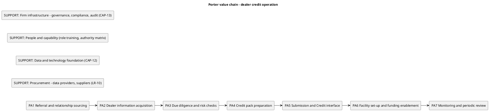

| ID | Activity | Type | VA / NVA | Capability | Requirements | Linkage |
|---|---|---|---|---|---|---|
| PA1 | Referral and relationship sourcing (OEM, bank, field, dealer) | Primary | VA | CAP-01 | REQ-001..REQ-007 | Feeds PA2; case source tracked |
| PA2 | Dealer information acquisition | Primary | VA for first capture; NVA for repeat gathering (DS-3 F2) | CAP-02, CAP-12 | REQ-008..REQ-019, REQ-079..REQ-083 | Feeds PA3 and PA4 |
| PA3 | Due diligence and risk checks | Primary | BNVA (regulatory necessity) | CAP-03, CAP-04 | REQ-020..REQ-037 | Gate to PA5 |
| PA4 | Credit pack preparation | Primary | VA (analysis and narrative); NVA (re-keying) | CAP-05, CAP-06, CAP-07 | REQ-038..REQ-059 | Feeds PA5 |
| PA5 | Submission and Credit interface | Primary | VA | CAP-08, CAP-09 | REQ-060..REQ-067 | Feeds PA6 |
| PA6 | Facility set-up and funding enablement | Primary | VA | CAP-10 | REQ-068..REQ-073 | Feeds PA7 |
| PA7 | Monitoring and periodic review | Primary | BNVA / VA | CAP-11 | REQ-074..REQ-078 | Re-enters PA2 and PA3 |
| SA1 | Firm infrastructure: governance, compliance, audit | Support | BNVA | CAP-13 | REQ-084..REQ-092 | Spans all |
| SA2 | People and capability | Support | BNVA | Not a capability in scope (inferred) | - | Authority matrix for BR-E01, BR-E02 |
| SA3 | Data and technology foundation | Support | Enabler | CAP-12 | REQ-079..REQ-083 | Spans all |
| SA4 | Procurement of data and supplier services | Support | BNVA | Contract terms (LR-10) | REQ-081 | PA2, PA3, PA6 |

**Margin drivers (no figures stated):** effort per case; rework from Credit queries; repeat information gathering; time to decision; exception handling effort; review overdue risk.

**Wider value system:**
| Tier | Participants |
|---|---|
| Suppliers | OEM partners, referring banks, field distribution, credit reference and registry providers, audit and inspection supplier |
| Firm | Dealer credit operation (PA1–PA7), Credit, Compliance, Legal, Operations |
| Channels | Account Managers, Wholesale Managers, OEM channels, email and meetings |
| Buyers | Dealers (franchise, wholesale, fleet, retail) |
| Constraints | Regulators, data protection authority, sanctions authorities |

## P. Value Streams (TOGAF / LEAN VSM)
A value stream is the value delivered to a stakeholder, never a department or system. Metrics are not invented; a stream with no baseline says so.

### P.1 Value stream catalogue
| ID | Value stream | Stakeholder | Value delivered | Entry | Exit | Stages | Metric baseline |
|---|---|---|---|---|---|---|---|
| VST-01 | Dealer receives a funded relationship | Dealer | The dealer gains approved funding with minimal repeated effort | Dealer relationship request received | Dealer holds approved, operational funding | Request received → Information supplied → Parties verified and checked → Pack prepared and submitted → Decision received → Funding operational | Not baselined; capture via REQ-093 to REQ-096 |
| VST-02 | Dealer receives changed borrowing capacity | Dealer | Borrowing capacity matches the dealer's need | Increased borrowing request received | Change approved and set up | Request received → Exposure and cashflow understood → Pack submitted → Decision received → Set-up completed | Not baselined |
| VST-03 | Dealer keeps its relationship through ownership and structure change | Dealer | The relationship continues with verified, current ownership | Director, shareholder, acquisition or disposal event notified | Records, checks and facility reflect the change | Event notified → Change verified → Parties checked → Impact assessed → Records updated | Not baselined |
| VST-04 | Credit Underwriter receives a decision-ready pack | Credit Underwriter | Credit can assess independently without further gathering | Case reaches the pack stage | Credit has a complete evidenced pack | Information complete → Checks evidenced → Analysis complete → Narrative reviewed → Pack authorised | Average effort per submission: more than 90 minutes (indicative, DS-5) |
| VST-05 | Lender receives assured, compliant onboarding | Compliance Oversight | Every dealer is onboarded under evidenced controls | Case requires due diligence | Evidence trail complete | Checks identified → Checks performed → Hits dispositioned → CRA recorded → Evidence retained | Not baselined |
| VST-06 | Credit keeps a current view of the dealer | Credit Underwriter | Credit has a current, changed-since view of each dealer | Review date reached or trigger event | Review complete and next date set | Review due → Data refreshed → Review pack prepared → Review recorded → Next review scheduled | Not baselined; cadence per policy table (OQ-05) |
| VST-07 | OEM and referrer learn the outcome of a referral (inferred) | OEM Partner / Referring Bank | Referrers see progress within permitted disclosure | Referral received | Referrer informed within permission | Referral received → Case registered → Outcome known → Feedback given | Not baselined; permission to be confirmed (OQ-15) |
| VST-08 | Operations receives a case that is ready to fund | Operations and Funding Set-up Team | Operations receive correct approved terms and conditions | Approval recorded | Dealer ready to fund | Approval recorded → Terms transferred → Documents prepared → Mandate and set-up complete → Conditions satisfied | Not baselined |

### P.2 Day in the life — Account Manager (hypothesised; validate in workshops)
| Moment | Activity | Value stream | Friction (from discovery) | Requirements |
|---|---|---|---|---|
| Start | Receives referrals and requests | VST-01, VST-07 | Many entry channels | REQ-001..REQ-003 |
| Mid-morning | Gathers information from dealer, OEM and email | VST-01, VST-04 | All data formats; repeat gathering | REQ-014, REQ-019, REQ-079 |
| Late morning | Chases checks and registry data | VST-05 | Manual checks, no single status | REQ-025..REQ-037 |
| Afternoon | Builds the template and narrative | VST-04 | Re-keying; narrative effort | REQ-046..REQ-054 |
| Late afternoon | Submits and handles Credit queries | VST-04 | Rework | REQ-060..REQ-065 |
| Periodic | Runs reviews and post-approval handoffs | VST-06, VST-08 | Multiple handoffs | REQ-068..REQ-078 |

### P.3 End-to-end value chains (swimlanes with gates)
**Swimlane legend:** Dealer = Dealer Principal / Director, Dealer Shareholder / Beneficial Owner; AM = Account Manager, Wholesale Manager; Field = Field Distribution Team Member; Credit = Credit Underwriter; FCC = Onboarding / Financial Crime Compliance Analyst; Legal = Legal Documentation Team; Ops = Operations and Funding Set-up Team; OEM = OEM Partner; Bank = Referring Bank; Data = Credit Reference and Registry Data Providers (Experian, Equifax, Companies House); Supplier = Audit and Inspection Supplier (Auxiga Smart3); Regulator = Regulator (FCA); Oversight = Compliance and Internal Audit Oversight; Privacy = Data Protection Officer / Privacy Office; Funding = Wholesale Funding Platform (SOPRA Apak); Mgmt = Business Management / Process Owner.

#### VST-01 Dealer receives a funded relationship
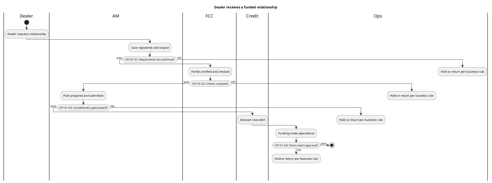

#### VST-02 Dealer receives changed borrowing capacity
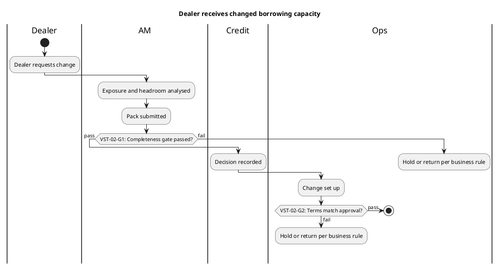

#### VST-03 Dealer keeps its relationship through ownership and structure change
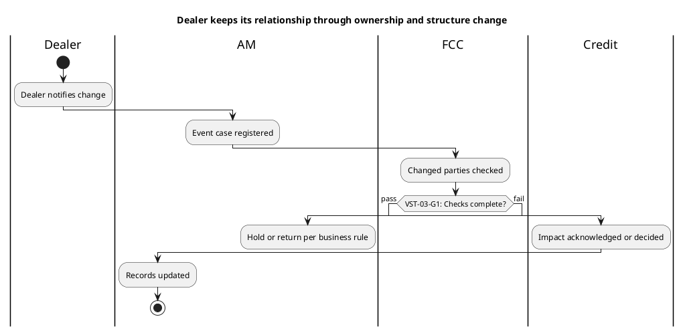

#### VST-04 Credit Underwriter receives a decision-ready pack
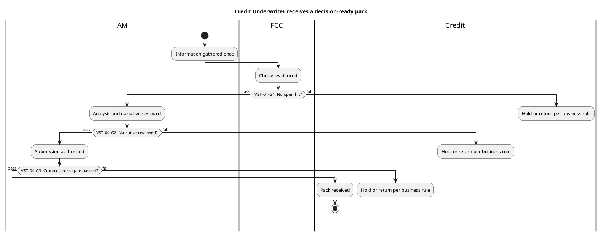

#### VST-05 Lender receives assured, compliant onboarding
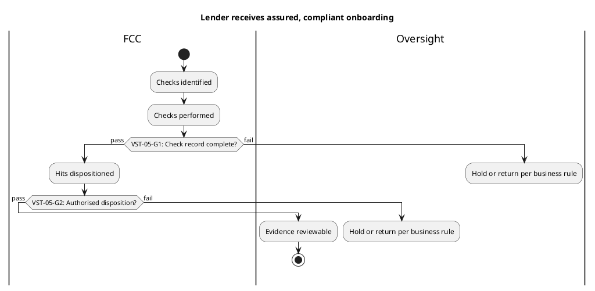

#### VST-06 Credit keeps a current view of the dealer
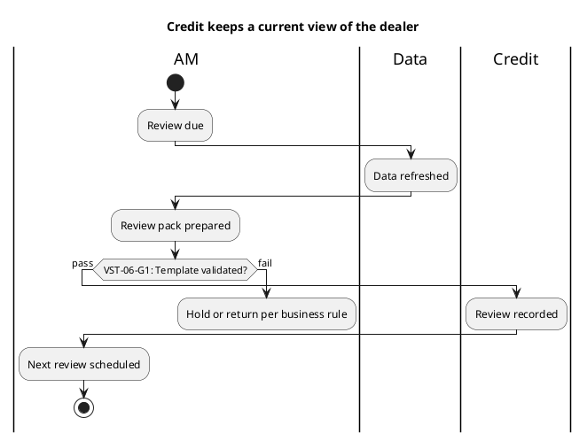

#### VST-07 OEM and referrer learn the outcome of a referral (inferred)
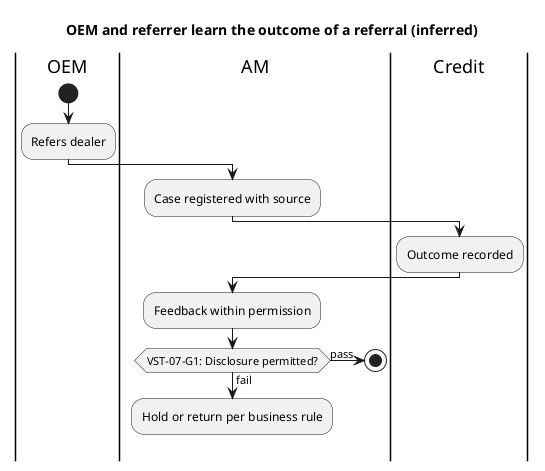

#### VST-08 Operations receives a case that is ready to fund
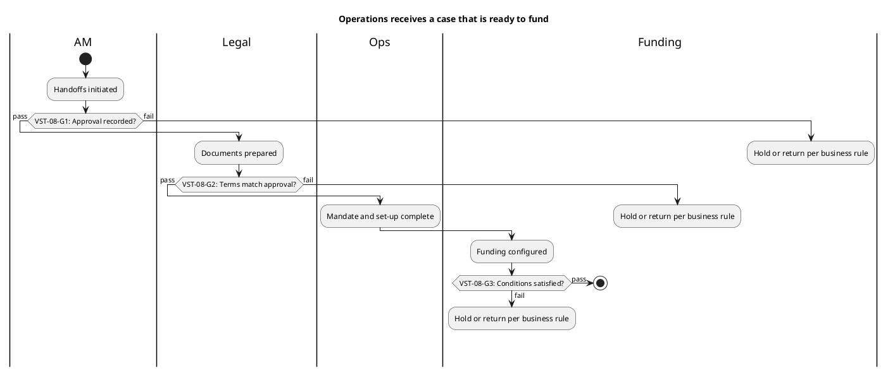

### P.4 Cross-stream map
| L2 process | VST-01 | VST-02 | VST-03 | VST-04 | VST-05 | VST-06 | VST-07 | VST-08 |
|---|---|---|---|---|---|---|---|---|
| P-01 Receive and Triage Request | ● | ● | ● |  |  |  | ● |  |
| P-02 Gather Dealer Information | ● |  | ● | ● |  | ● |  |  |
| P-03 Verify Entities and Ownership | ● |  | ● |  |  |  |  |  |
| P-04 Perform Onboarding and Risk Checks | ● |  | ● | ● | ● |  |  |  |
| P-05 Analyse Dealer Financials | ● | ● |  | ● |  | ● |  |  |
| P-06 Prepare Credit Application (FCA Template) | ● | ● |  | ● |  | ● |  |  |
| P-07 Compile Lending Request, Terms and Pricing | ● | ● |  | ● |  |  |  |  |
| P-08 Submit to Credit and Manage Queries | ● | ● |  | ● |  | ● | ● |  |
| P-09 Execute Post-Approval Handoffs | ● | ● |  |  |  |  |  | ● |
| P-10 Conduct Periodic and Event-Driven Review |  |  | ● |  |  | ● |  |  |
| P-11 Manage Dealer Data and Evidence |  |  |  | ● |  |  |  |  |
| P-12 Govern, Audit and Measure |  |  |  |  | ● |  |  |  |

**Stream handoffs:** VST-07 → VST-01/02 (referral); VST-01/02/03 → VST-04 (pack); VST-04 → VST-08 (approval); VST-08 → VST-06 (review schedule); VST-06/VST-03 → VST-04 (new pack); VST-05 supports VST-01, 02, 03, 06.

### P.5 Value register
| ID | Stakeholder | Value | Metric | Baseline | Requirements |
|---|---|---|---|---|---|
| VST-01 | Dealer | The dealer gains approved funding with minimal repeated effort | As in P.1 | Not baselined; capture via REQ-093 to REQ-096 | REQ-001..REQ-073 |
| VST-02 | Dealer | Borrowing capacity matches the dealer's need | As in P.1 | Not baselined | REQ-038..REQ-073 |
| VST-03 | Dealer | The relationship continues with verified, current ownership | As in P.1 | Not baselined | REQ-020..REQ-037, REQ-075 |
| VST-04 | Credit Underwriter | Credit can assess independently without further gathering | As in P.1 | Average effort per submission: more than 90 minutes (indicative, DS-5) | REQ-038..REQ-067 |
| VST-05 | Compliance Oversight | Every dealer is onboarded under evidenced controls | As in P.1 | Not baselined | REQ-025..REQ-037, REQ-085 |
| VST-06 | Credit Underwriter | Credit has a current, changed-since view of each dealer | As in P.1 | Not baselined; cadence per policy table (OQ-05) | REQ-074..REQ-078 |
| VST-07 | OEM Partner / Referring Bank | Referrers see progress within permitted disclosure | As in P.1 | Not baselined; permission to be confirmed (OQ-15) | REQ-001, REQ-003 |
| VST-08 | Operations and Funding Set-up Team | Operations receive correct approved terms and conditions | As in P.1 | Not baselined | REQ-068..REQ-073 |

## Q. Customer Journey Mapping
Personas: **Dealer Principal** (external customer), **Account Manager / Wholesale Manager** (internal preparer), **Credit Underwriter** (internal receiver). Thoughts and emotion scores are **hypotheses from the discovery's findings** and shall be validated through research. Emotion scale: −2 (very negative) to +2 (very positive).

### CJM-01 — Dealer Principal: Onboarding with the lender (happy path) (Happy)
| Stage | Goal | Actions | Touchpoints | Channel | Thoughts | Emotion | Pain points | Moment of truth | Opportunity |
|---|---|---|---|---|---|---|---|---|---|
| Approach | Start a funding relationship | Contacts OEM or lender | OEM, field distribution team | Phone, in person | Hypothesis: I want to know what is needed | 0 | Unclear information needed | First contact response | Tell the dealer the requirement set up front |
| Provide information | Supply information once | Supplies entity, director, shareholder, financials, consent | Application form, emails, meetings | Email, form, meeting | Hypothesis: why am I asked again? | -1 | Repeated requests | Second request for the same item | Reuse held items; ask only for deltas |
| Checks | Complete identity and checks | Provides identity evidence; answers questions | KYC requests | Email, phone | Hypothesis: this is intrusive but expected | -1 | Delay with no visibility | Waiting for check completion | Show status and next step |
| Decision | Learn the decision | Waits; answers queries | Account Manager | Phone, email | Hypothesis: when will I hear? | -2 | No timeline | Decision communicated | Give a status and expected timing |
| Set-up | Get operational | Signs documents; mandate | Legal, Operations | Email, post, portal | Hypothesis: relief, then admin | +1 | Multiple handoffs | First funding available | One set-up tracker visible to the dealer |

**Emotional curve:** Approach (0) → Provide information (-1) → Checks (-1) → Decision (-2) → Set-up (+1)
```
Approach           ### (0)
Provide informatio ## (-1)
Checks             ## (-1)
Decision           # (-2)
Set-up             #### (+1)
```

### CJM-02 — Account Manager / Wholesale Manager: Building a decision-ready credit pack (happy path) (Happy)
| Stage | Goal | Actions | Touchpoints | Channel | Thoughts | Emotion | Pain points | Moment of truth | Opportunity |
|---|---|---|---|---|---|---|---|---|---|
| Receive and scope | Know what is needed | Registers case; sees checklist | Case record, referral email | Email, system | Hypothesis: I need the full picture quickly | 0 | Fragmented starting point | Seeing what is already held | Show held items and requirement set |
| Gather | Collect information | Collects forms, accounts, notes | Email, PDFs, Excel, calls | Email, phone | Hypothesis: this is the bulk of my time | -2 | All formats; repeated gathering | Dealer sends a scan that is unreadable | Capture once, flag unreadable early |
| Verify and check | Evidence checks | Runs or requests checks; disposes | Registry and credit data, check tools | Tools, manual | Hypothesis: many manual steps | -1 | Manual checks; no single status | A hit appears | Single status of checks and hits |
| Author | Write the analysis and narrative | Populates template; writes narrative | FCA Excel template | Excel | Hypothesis: I own every statement | -1 | Re-keying; narrative effort | Credit may challenge a statement | Evidence links for each assertion |
| Submit | Send a complete pack | Runs completeness; authorises; sends | Email to Credit | Email | Hypothesis: is it complete? | +1 | Unknown completeness | Pack accepted without query | Completeness gate before sending |
| Post-approval | Hand over cleanly | Starts handoffs; tracks | Legal, Operations | Email | Hypothesis: multiple handoffs to chase | -1 | Chasing handoffs | Terms mismatch found late | Tracker with owners and terms transfer |

**Emotional curve:** Receive and scope (0) → Gather (-2) → Verify and check (-1) → Author (-1) → Submit (+1) → Post-approval (-1)
```
Receive and scope  ### (0)
Gather             # (-2)
Verify and check   ## (-1)
Author             ## (-1)
Submit             #### (+1)
Post-approval      ## (-1)
```

### CJM-03 — Credit Underwriter: Receiving and assessing a pack (happy path) (Happy)
| Stage | Goal | Actions | Touchpoints | Channel | Thoughts | Emotion | Pain points | Moment of truth | Opportunity |
|---|---|---|---|---|---|---|---|---|---|
| Receive | Receive a complete pack | Opens the pack | Email, Credit system | Email | Hypothesis: is anything missing? | 0 | Incomplete or inconsistent packs | First read | Pack arrives complete and consistent |
| Assess | Assess independently | Uses own systems and policy | Credit systems | Systems | Hypothesis: I need evidence behind each statement | 0 | Hidden assumptions | Finding a statement without evidence | Evidence links in the pack |
| Decide | Record outcome | Approves, declines or approves with conditions | Credit system | Systems | Hypothesis: the decision is mine | +1 | Pack suggests a decision | Independence kept | Pack contains no decision |

**Emotional curve:** Receive (0) → Assess (0) → Decide (+1)
```
Receive            ### (0)
Assess             ### (0)
Decide             #### (+1)
```

### CJM-04 — Dealer Principal: Recovery: screening hit and information request (negative) (Recovery)
| Stage | Goal | Actions | Touchpoints | Channel | Thoughts | Emotion | Pain points | Moment of truth | Opportunity |
|---|---|---|---|---|---|---|---|---|---|
| Hit raised | Understand the issue | Is contacted about a potential match | Account Manager call | Phone | Hypothesis: am I under suspicion? | -2 | Unclear reason; disclosure limits (verify counsel) | The first call | Scripted, lawful, respectful communication |
| Clarify | Provide clarification | Supplies evidence | Email | Email | Hypothesis: slow and intrusive | -2 | Repeated evidence requests | Second request | Single, consolidated request |
| Resolution | Know the outcome | Is told the case continues or is held | Account Manager | Phone | Hypothesis: I need certainty | -1 | No timeline | Outcome communicated | Status and next steps shown |
| Recovery | Return to normal | Continues onboarding | Account Manager | Phone, email | Hypothesis: trust is damaged | 0 | Lost time | First post-resolution contact | Acknowledge delay; priority handling |

**Emotional curve:** Hit raised (-2) → Clarify (-2) → Resolution (-1) → Recovery (0)
```
Hit raised         # (-2)
Clarify            # (-2)
Resolution         ## (-1)
Recovery           ### (0)
```

### CJM-05 — Account Manager / Wholesale Manager: Recovery: pack returned with Credit queries (negative) (Recovery)
| Stage | Goal | Actions | Touchpoints | Channel | Thoughts | Emotion | Pain points | Moment of truth | Opportunity |
|---|---|---|---|---|---|---|---|---|---|
| Query received | Understand the query | Reads Credit query | Email | Email | Hypothesis: I missed something | -2 | Query late in the cycle | Reading the query | Early completeness gate to prevent |
| Investigate | Find the answer | Finds evidence; asks the dealer | Email, phone | Email, phone | Hypothesis: where is the source? | -2 | Evidence scattered | Searching for evidence | Provenance on every item |
| Amend | Amend and version | Updates pack; authorises resubmission | Template | Excel, email | Hypothesis: which version is current? | -1 | Version confusion | Sending the wrong version | Version control and snapshot |
| Resolve | Close the query | Credit resumes | Email | Email | Hypothesis: relief | +1 | Delay absorbed | Credit accepts the response | Capture reason for rework (REQ-095) |

**Emotional curve:** Query received (-2) → Investigate (-2) → Amend (-1) → Resolve (+1)
```
Query received     # (-2)
Investigate        # (-2)
Amend              ## (-1)
Resolve            #### (+1)
```

### Q.1 Service blueprint — CJM-01 Dealer onboarding
| Stage | Customer action | Frontstage (visible) | Backstage (invisible) | Capability / process | Requirements |
|---|---|---|---|---|---|
| Approach | Contacts OEM or lender | Case registered; requirement set explained | Classification; duplicate check; held-data lookup | CAP-01 / P-01 | REQ-001..REQ-007 |
| Provide information | Supplies information once | Account Manager asks only for missing items | Capture; provenance; gap detection; reuse | CAP-02, CAP-12 / P-02, P-11 | REQ-008..REQ-019, REQ-079 |
| Checks | Supplies identity evidence | Status and next step communicated | Registry comparison; KYC, AML, sanctions, ID&V, adverse media; disposition | CAP-03, CAP-04 / P-03, P-04 | REQ-020..REQ-037 |
| Decision | Waits; answers queries | Account Manager updates dealer | Analysis; narrative; completeness gate; submission; Credit assessment | CAP-05..CAP-09 / P-05..P-08 | REQ-038..REQ-067 |
| Set-up | Signs and returns documents | Documents and mandate request | Terms transfer; configuration; conditions tracking | CAP-10 / P-09 | REQ-068..REQ-073 |

### Q.2 Omni-channel and accessibility
| Channel | Use in process | Requirement |
|---|---|---|
| Email | Primary channel for submissions, evidence, KYC requests (DS-7) | REQ-014, REQ-063 |
| Telephone and meetings | Qualitative information (DS-7) | REQ-017 |
| OEM channels and forms | Referrals and application forms | REQ-003, REQ-014 |
| Excel template | Credit application | REQ-046 |
| Documents, scans, images | Evidence | REQ-014, REQ-083 |

Dealer-facing communications and internal workspaces shall meet the organisation's accessibility standard (OQ-17).

### Q.3 CX KPIs (no targets until baselined)
| Persona | KPI | Baseline |
|---|---|---|
| Dealer Principal | Time from request to decision | Not baselined |
| Dealer Principal | Repeated information requests per case | Not baselined |
| Dealer Principal | Status visibility during checks and decision | Not baselined |
| Account Manager | Effort per case (CALC-013) | More than 90 minutes (indicative) |
| Account Manager | Rework count per case | Not baselined |
| Credit Underwriter | Queries per pack | Not baselined |
| Credit Underwriter | Packs complete at first submission (CALC-011) | Not baselined |

## R. Individual Business Value Chains
The complete catalogue of discrete business value chains. §O is the single firm-level chain; §P is the actor-centric streams; §R is every individual chain by business area and domain.

### R.1 Business areas and domains
| ID | Business area | Basis |
|---|---|---|
| BA-01 | Franchise Lending | Named in discovery (Finding 2) |
| BA-02 | Wholesale Lending | Named in discovery (Finding 2; SOPRA Apak stocking platform) |
| BA-03 | Fleet Lending | Named in discovery (Finding 2) |
| BA-04 | Retail Lending | Named in discovery (Finding 2) |
| BA-05 | Wider Onboarding | Named in discovery (Finding 2) |

| ID | Business domain |
|---|---|
| DOM-01 | Origination and Relationship Management |
| DOM-02 | Due Diligence and Financial Crime Compliance |
| DOM-03 | Credit Analysis and Assessment |
| DOM-04 | Legal and Documentation |
| DOM-05 | Operations and Funding |
| DOM-06 | Data and Evidence Management |
| DOM-07 | Third-Party Supplier Management |
| DOM-08 | Governance, Risk and Regulatory Compliance |

### R.2 Chain catalogue
| ID | Chain | Areas | Primary domain | Triggering actors | Participating actors | Value recipient | L2 processes | Requirements | Capabilities |
|---|---|---|---|---|---|---|---|---|---|
| IBVC-01 | New dealer relationship: from request to approved case | BA-01, BA-02, BA-03, BA-04, BA-05 | DOM-01 (DOM-02, DOM-03, DOM-06, DOM-08) | Dealer, OEM, Bank, Field | AM, Dealer, Data, FCC, Credit | Dealer (funded relationship); Credit Underwriter (decision-ready pack) | P-01, P-02, P-03, P-04, P-05, P-06, P-07, P-08 | REQ-001..REQ-067 | CAP-01..CAP-09 |
| IBVC-02 | New franchise application for an existing dealer | BA-01, BA-02, BA-03, BA-04 | DOM-01 (DOM-02, DOM-03, DOM-06) | OEM, Dealer | OEM, AM, Dealer, FCC, Credit | Dealer (new franchise funded); Credit Underwriter | P-01, P-02, P-03, P-04, P-05, P-06, P-07, P-08 | REQ-001..REQ-019, REQ-025..REQ-067, REQ-079 | CAP-01..CAP-09, CAP-12 |
| IBVC-03 | Increased borrowing request | BA-01, BA-02, BA-03, BA-04 | DOM-03 (DOM-01, DOM-02, DOM-06) | Dealer | Dealer, AM, FCC, Credit | Dealer (higher capacity); Credit Underwriter | P-01, P-02, P-05, P-06, P-07, P-08 | REQ-001..REQ-007, REQ-038..REQ-050, REQ-055..REQ-067 | CAP-01, CAP-05..CAP-09 |
| IBVC-04 | Dealer acquisition | BA-01, BA-02, BA-03, BA-04, BA-05 | DOM-03 (DOM-01, DOM-02, DOM-06) | Dealer | Dealer, AM, FCC, Credit | Dealer; Credit Underwriter | P-01, P-02, P-03, P-04, P-05, P-06, P-07, P-08 | REQ-001..REQ-067 | CAP-01..CAP-09 |
| IBVC-05 | Dealer disposal | BA-01, BA-02, BA-03, BA-04, BA-05 | DOM-03 (DOM-01, DOM-06) | Dealer | Dealer, AM, FCC, Credit | Dealer; Credit Underwriter | P-01, P-02, P-05, P-06, P-07, P-08 | REQ-001..REQ-007, REQ-038..REQ-050, REQ-055..REQ-067 | CAP-01, CAP-05..CAP-09 |
| IBVC-06 | Director change | BA-01, BA-02, BA-03, BA-04, BA-05 | DOM-02 (DOM-01, DOM-06, DOM-08) | Dealer | Dealer, AM, Data, FCC, Credit | Dealer; Credit Underwriter; Compliance Oversight | P-01, P-02, P-03, P-04, P-06, P-10 | REQ-001..REQ-037, REQ-048, REQ-075 | CAP-01..CAP-04, CAP-06, CAP-11 |
| IBVC-07 | Shareholder change | BA-01, BA-02, BA-03, BA-04, BA-05 | DOM-02 (DOM-01, DOM-06, DOM-08) | Dealer | Dealer, AM, Data, FCC, Credit | Dealer; Credit Underwriter; Compliance Oversight | P-01, P-02, P-03, P-04, P-06, P-10 | REQ-001..REQ-037, REQ-075 | CAP-01..CAP-04, CAP-11 |
| IBVC-08 | Periodic dealer credit review | BA-01, BA-02, BA-03, BA-04, BA-05 | DOM-03 (DOM-02, DOM-06) | Mgmt | AM, Dealer, Data, FCC, Credit | Credit Underwriter; Business Management | P-10, P-02, P-04, P-05, P-06, P-08 | REQ-074..REQ-078, REQ-036, REQ-038..REQ-054, REQ-060..REQ-066 | CAP-05, CAP-06, CAP-08, CAP-11 |
| IBVC-09 | Due diligence and screening (cross-cutting) | BA-01, BA-02, BA-03, BA-04, BA-05 | DOM-02 (DOM-06, DOM-08) | AM | FCC, Data, AM | Credit Underwriter; Compliance Oversight | P-04 | REQ-025..REQ-037 | CAP-04 |
| IBVC-10 | Screening hit or adverse finding (exception) | BA-01, BA-02, BA-03, BA-04, BA-05 | DOM-02 (DOM-08) | FCC | FCC, AM, Dealer, Oversight | Compliance Oversight; Credit Underwriter | P-04, P-02 | REQ-032..REQ-034, REQ-037, REQ-091 | CAP-04, CAP-13 |
| IBVC-11 | Information gap resolution | BA-01, BA-02, BA-03, BA-04, BA-05 | DOM-06 (DOM-01) | AM | AM, Dealer, Data | Account Manager; Credit Underwriter | P-02, P-11 | REQ-015, REQ-016, REQ-018, REQ-019 | CAP-02, CAP-12 |
| IBVC-12 | Credit query and rework | BA-01, BA-02, BA-03, BA-04, BA-05 | DOM-03 (DOM-06) | Credit | Credit, AM, Dealer | Credit Underwriter; Account Manager | P-08 | REQ-064, REQ-065, REQ-095 | CAP-08, CAP-09 |
| IBVC-13 | Post-approval legal documentation | BA-01, BA-02, BA-03, BA-04, BA-05 | DOM-04 (DOM-05, DOM-08) | Credit | AM, Legal, Dealer | Dealer; Legal; Operations | P-09 | REQ-066, REQ-068..REQ-073 | CAP-10 |
| IBVC-14 | Direct debit mandate and operational set-up | BA-01, BA-02, BA-03, BA-04, BA-05 | DOM-05 (DOM-04) | Ops | Ops, Dealer, AM | Dealer; Operations | P-09 | REQ-068..REQ-073 | CAP-10 |
| IBVC-15 | Funding system configuration | BA-01, BA-02, BA-03, BA-04 | DOM-05 (DOM-04, DOM-08) | Ops | Ops, Funding, AM | Dealer; Operations | P-09 | REQ-070, REQ-072, REQ-073 | CAP-10 |
| IBVC-16 | Third-party audit and inspection supplier activation | BA-01, BA-02, BA-03, BA-04, BA-05 | DOM-07 (DOM-05) | Ops | Ops, Supplier, AM | Operations; Dealer | P-09 | REQ-068, REQ-069, REQ-073 | CAP-10 |
| IBVC-17 | Referral intake and feedback | BA-01, BA-02, BA-03, BA-04, BA-05 | DOM-01 (DOM-06) | OEM, Bank, Field | OEM, Bank, Field, AM | OEM partner; Referring bank; Field distribution | P-01 | REQ-001, REQ-003 | CAP-01 |
| IBVC-18 | Cross-line dealer information reuse | BA-01, BA-02, BA-03, BA-04, BA-05 | DOM-06 (DOM-01) | AM | AM, Data, Dealer | Dealer; Account Manager | P-11, P-02 | REQ-004, REQ-019, REQ-079..REQ-083 | CAP-12 |
| IBVC-19 | Regulatory and audit evidence retrieval | BA-01, BA-02, BA-03, BA-04, BA-05 | DOM-08 (DOM-06) | Regulator, Oversight | Regulator, Oversight | Regulator; Compliance Oversight | P-12 | REQ-033, REQ-064, REQ-085, REQ-086 | CAP-13 |
| IBVC-20 | Performance baseline and management reporting | BA-01, BA-02, BA-03, BA-04, BA-05 | DOM-08 (DOM-06) | Mgmt | AM, Mgmt | Business Management | P-12 | REQ-093..REQ-097 | CAP-14 |
| IBVC-21 | Personal data rights and retention | BA-01, BA-02, BA-03, BA-04, BA-05 | DOM-08 (DOM-06) | Privacy | Privacy, Oversight | Data subjects; Data Protection Officer | P-12 | REQ-084, REQ-086, REQ-087, REQ-089 | CAP-13 |

### R.3 Chain detail
**Swimlane legend:** Dealer = Dealer Principal / Director, Dealer Shareholder / Beneficial Owner; AM = Account Manager, Wholesale Manager; Field = Field Distribution Team Member; Credit = Credit Underwriter; FCC = Onboarding / Financial Crime Compliance Analyst; Legal = Legal Documentation Team; Ops = Operations and Funding Set-up Team; OEM = OEM Partner; Bank = Referring Bank; Data = Credit Reference and Registry Data Providers (Experian, Equifax, Companies House); Supplier = Audit and Inspection Supplier (Auxiga Smart3); Regulator = Regulator (FCA); Oversight = Compliance and Internal Audit Oversight; Privacy = Data Protection Officer / Privacy Office; Funding = Wholesale Funding Platform (SOPRA Apak); Mgmt = Business Management / Process Owner.

#### IBVC-01 — New dealer relationship: from request to approved case
| Attribute | Value |
|---|---|
| Business areas | BA-01, BA-02, BA-03, BA-04, BA-05 |
| Domain (primary; secondary) | DOM-01; DOM-02, DOM-03, DOM-06, DOM-08 |
| Triggering actors | Dealer, OEM, Bank, Field |
| Value recipient | Dealer (funded relationship); Credit Underwriter (decision-ready pack) |
| Processes L1–L3 | L1 Dealer Credit Pack Assessment; L2 P-01, P-02, P-03, P-04, P-05, P-06, P-07, P-08; L3 Register; gather; verify; check; analyse; author; request and price; submit; receive outcome |
| Trigger | New dealer relationship request received |
| Value delivered | Credit receives a complete, evidenced pack and the dealer receives a decision |
| Source requirements | REQ-001..REQ-067 |
| Capabilities | CAP-01..CAP-09 |

| Link | Actor lane | Activity | Control gate |
|---|---|---|---|
| 1 | AM | Register case, classify as new dealer relationship, build applicable requirement set | IBVC-01-G1: Case type and requirement set confirmed |
| 2 | Dealer | Provide entity, director, shareholder, financial, authority, consent and data protection information | - |
| 3 | Data | Return registry and credit reference data for entity and parties | - |
| 4 | FCC | Perform KYC, AML, sanctions, ID&V, CRA, FCA checks and adverse media review; dispose hits | IBVC-01-G2: All mandatory checks complete and hits dispositioned |
| 5 | AM | Analyse financials, populate and author the FCA template; review every narrative statement | IBVC-01-G3: Template validated and narrative reviewed |
| 6 | AM | Record lending request, terms and pricing; obtain authorisation; authorise submission | IBVC-01-G4: Submission authorised by accountable role |
| 7 | Credit | Perform independent assessment in Credit systems; record outcome | - |
| 8 | AM | Pass approved case to post-approval chain IBVC-13 | - |

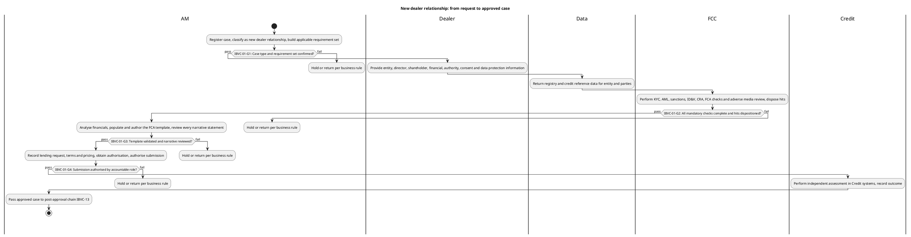

#### IBVC-02 — New franchise application for an existing dealer
| Attribute | Value |
|---|---|
| Business areas | BA-01, BA-02, BA-03, BA-04 |
| Domain (primary; secondary) | DOM-01; DOM-02, DOM-03, DOM-06 |
| Triggering actors | OEM, Dealer |
| Value recipient | Dealer (new franchise funded); Credit Underwriter |
| Processes L1–L3 | L1 Dealer Credit Pack Assessment; L2 P-01, P-02, P-03, P-04, P-05, P-06, P-07, P-08; L3 Register; reuse held data; confirm unchanged items; refresh expired checks; franchise analysis; submit |
| Trigger | OEM application form or dealer request for a new franchise |
| Value delivered | The existing relationship is extended without repeating valid gathering |
| Source requirements | REQ-001..REQ-019, REQ-025..REQ-067, REQ-079 |
| Capabilities | CAP-01..CAP-09, CAP-12 |

| Link | Actor lane | Activity | Control gate |
|---|---|---|---|
| 1 | OEM | Submit OEM application form for the new franchise | - |
| 2 | AM | Register case, classify as new franchise, retrieve held relationship information | IBVC-02-G1: Held information reused and gaps listed |
| 3 | Dealer | Confirm unchanged entity and party data; supply only the missing items | - |
| 4 | FCC | Re-perform expired checks only; dispose hits | IBVC-02-G2: Expired or missing checks complete |
| 5 | AM | Update financial and franchise-specific analysis; author narrative; record request, terms and pricing | IBVC-02-G3: Completeness gate passed |
| 6 | Credit | Perform independent assessment; record outcome | - |
| 7 | AM | Pass approved case to post-approval chain IBVC-13 | - |

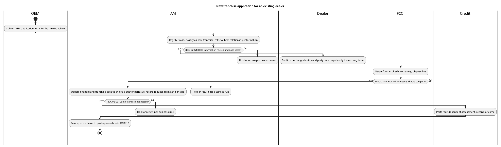

#### IBVC-03 — Increased borrowing request
| Attribute | Value |
|---|---|
| Business areas | BA-01, BA-02, BA-03, BA-04 |
| Domain (primary; secondary) | DOM-03; DOM-01, DOM-02, DOM-06 |
| Triggering actors | Dealer |
| Value recipient | Dealer (higher capacity); Credit Underwriter |
| Processes L1–L3 | L1 Dealer Credit Pack Assessment; L2 P-01, P-02, P-05, P-06, P-07, P-08; L3 Register; borrowing profile; cashflow and headroom; security review; terms and pricing; submit |
| Trigger | Dealer requests higher borrowing |
| Value delivered | Credit receives the change request with current exposure context |
| Source requirements | REQ-001..REQ-007, REQ-038..REQ-050, REQ-055..REQ-067 |
| Capabilities | CAP-01, CAP-05..CAP-09 |

| Link | Actor lane | Activity | Control gate |
|---|---|---|---|
| 1 | Dealer | Request higher borrowing with purpose and amount | - |
| 2 | AM | Register case; show current borrowing across lending lines | IBVC-03-G1: Borrowing profile complete across lines |
| 3 | AM | Analyse cashflow, trading performance and headroom; review security | - |
| 4 | FCC | Refresh checks only where expired or trigger event applies | IBVC-03-G2: Checks current |
| 5 | AM | Record request, terms and pricing; authorise submission | IBVC-03-G3: Submission authorised |
| 6 | Credit | Assess and record outcome | - |
| 7 | AM | Pass approved change to post-approval chain IBVC-13 | - |

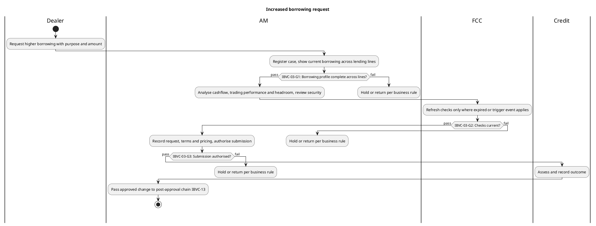

#### IBVC-04 — Dealer acquisition
| Attribute | Value |
|---|---|
| Business areas | BA-01, BA-02, BA-03, BA-04, BA-05 |
| Domain (primary; secondary) | DOM-03; DOM-01, DOM-02, DOM-06 |
| Triggering actors | Dealer |
| Value recipient | Dealer; Credit Underwriter |
| Processes L1–L3 | L1 Dealer Credit Pack Assessment; L2 P-01, P-02, P-03, P-04, P-05, P-06, P-07, P-08; L3 Register; acquisition information; verify new structure; checks on new parties; impact analysis; submit |
| Trigger | Dealer notifies an intended acquisition |
| Value delivered | Credit sees the changed structure, parties and exposure before the acquisition |
| Source requirements | REQ-001..REQ-067 |
| Capabilities | CAP-01..CAP-09 |

| Link | Actor lane | Activity | Control gate |
|---|---|---|---|
| 1 | Dealer | Notify acquisition and supply target and structure information | - |
| 2 | AM | Register case; capture acquisition information; retrieve held data | - |
| 3 | AM | Verify new or affected entities and ownership structure; identify connected parties | IBVC-04-G1: Ownership structure verified |
| 4 | FCC | Run checks on new or affected parties; dispose hits | IBVC-04-G2: Checks complete |
| 5 | AM | Analyse impact on financials, borrowing and security; author narrative | IBVC-04-G3: Template validated |
| 6 | AM | Record request, terms and pricing; authorise submission | IBVC-04-G4: Submission authorised |
| 7 | Credit | Assess and record outcome | - |
| 8 | AM | Pass to post-approval chain IBVC-13 | - |

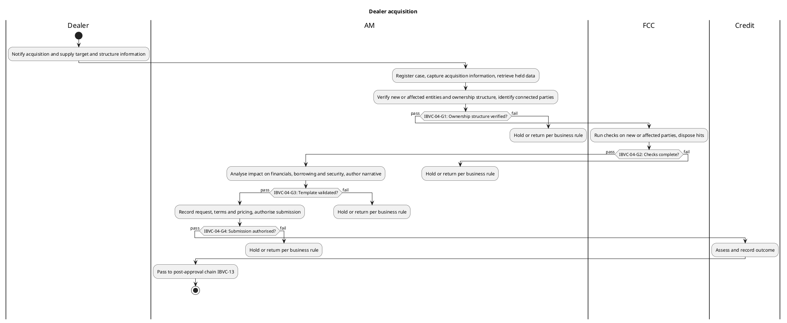

#### IBVC-05 — Dealer disposal
| Attribute | Value |
|---|---|
| Business areas | BA-01, BA-02, BA-03, BA-04, BA-05 |
| Domain (primary; secondary) | DOM-03; DOM-01, DOM-06 |
| Triggering actors | Dealer |
| Value recipient | Dealer; Credit Underwriter |
| Processes L1–L3 | L1 Dealer Credit Pack Assessment; L2 P-01, P-02, P-05, P-06, P-07, P-08; L3 Register; disposal information; borrowing and security impact; submit |
| Trigger | Dealer notifies a disposal |
| Value delivered | Credit sees the effect on exposure and security |
| Source requirements | REQ-001..REQ-007, REQ-038..REQ-050, REQ-055..REQ-067 |
| Capabilities | CAP-01, CAP-05..CAP-09 |

| Link | Actor lane | Activity | Control gate |
|---|---|---|---|
| 1 | Dealer | Notify disposal and supply disposal information | - |
| 2 | AM | Register case; capture disposal information; retrieve held data | - |
| 3 | AM | Analyse impact on financials, borrowing profile and security | IBVC-05-G1: Analysis complete |
| 4 | FCC | Refresh checks where trigger or expiry applies | IBVC-05-G2: Checks current |
| 5 | AM | Record lending request change; authorise submission | IBVC-05-G3: Submission authorised |
| 6 | Credit | Assess and record outcome | - |
| 7 | AM | Pass to post-approval chain IBVC-13 | - |

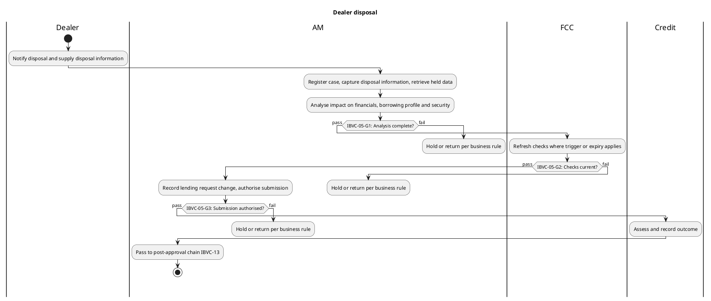

#### IBVC-06 — Director change
| Attribute | Value |
|---|---|
| Business areas | BA-01, BA-02, BA-03, BA-04, BA-05 |
| Domain (primary; secondary) | DOM-02; DOM-01, DOM-06, DOM-08 |
| Triggering actors | Dealer |
| Value recipient | Dealer; Credit Underwriter; Compliance Oversight |
| Processes L1–L3 | L1 Dealer Credit Pack Assessment; L2 P-01, P-02, P-03, P-04, P-06, P-10; L3 Register event; verify against registry; checks on changed persons; update management assessment |
| Trigger | Dealer or registry shows a director change |
| Value delivered | Control integrity: every director is verified and checked |
| Source requirements | REQ-001..REQ-037, REQ-048, REQ-075 |
| Capabilities | CAP-01..CAP-04, CAP-06, CAP-11 |

| Link | Actor lane | Activity | Control gate |
|---|---|---|---|
| 1 | Dealer | Notify director appointment or resignation | - |
| 2 | AM | Register event-driven case; capture changed director details | - |
| 3 | Data | Return registry record for the change | - |
| 4 | FCC | Perform ID&V, sanctions, KYC, AML, adverse media on the changed person; dispose hits | IBVC-06-G1: Checks complete for changed persons |
| 5 | AM | Update management assessment and ownership view; submit to Credit where required | IBVC-06-G2: Submission authorised where required |
| 6 | Credit | Record acknowledgement or outcome | - |
| 7 | AM | Update dealer records and review schedule | - |

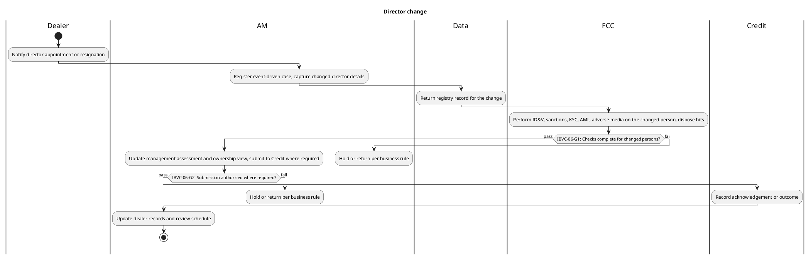

#### IBVC-07 — Shareholder change
| Attribute | Value |
|---|---|
| Business areas | BA-01, BA-02, BA-03, BA-04, BA-05 |
| Domain (primary; secondary) | DOM-02; DOM-01, DOM-06, DOM-08 |
| Triggering actors | Dealer |
| Value recipient | Dealer; Credit Underwriter; Compliance Oversight |
| Processes L1–L3 | L1 Dealer Credit Pack Assessment; L2 P-01, P-02, P-03, P-04, P-06, P-10; L3 Register event; verify ownership; checks on new owners and beneficial owners; update structure |
| Trigger | Dealer or registry shows a shareholder change |
| Value delivered | Ownership transparency: owners and beneficial owners are verified and checked |
| Source requirements | REQ-001..REQ-037, REQ-075 |
| Capabilities | CAP-01..CAP-04, CAP-11 |

| Link | Actor lane | Activity | Control gate |
|---|---|---|---|
| 1 | Dealer | Notify shareholder change and supply ownership information | - |
| 2 | AM | Register event-driven case; capture ownership detail | - |
| 3 | Data | Return registry and control data | - |
| 4 | AM | Rebuild ownership structure; identify beneficial owners and connected parties | IBVC-07-G1: Ownership structure reconciles |
| 5 | FCC | Perform sanctions, ID&V, KYC, AML, adverse media on new owners; dispose hits | IBVC-07-G2: Checks complete |
| 6 | Credit | Record acknowledgement or outcome | - |
| 7 | AM | Update dealer records and review schedule | - |

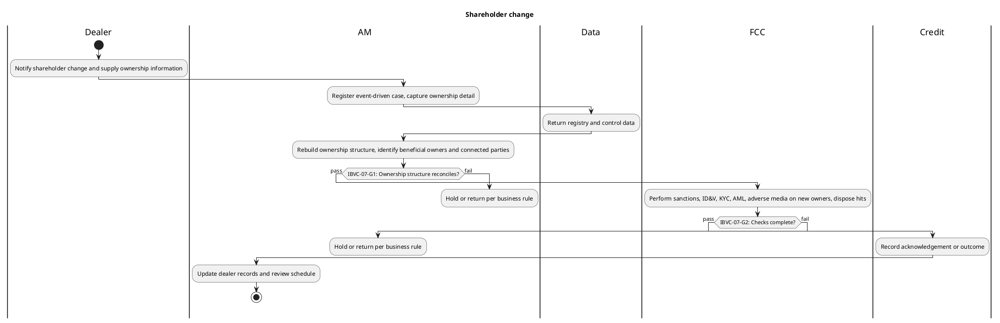

#### IBVC-08 — Periodic dealer credit review
| Attribute | Value |
|---|---|
| Business areas | BA-01, BA-02, BA-03, BA-04, BA-05 |
| Domain (primary; secondary) | DOM-03; DOM-02, DOM-06 |
| Triggering actors | Mgmt |
| Value recipient | Credit Underwriter; Business Management |
| Processes L1–L3 | L1 Dealer Credit Pack Assessment; L2 P-10, P-02, P-04, P-05, P-06, P-08; L3 Schedule; refresh data and checks; change view; review pack; submit; reset schedule |
| Trigger | Review due date reached (monthly, quarterly, half-yearly or annual) |
| Value delivered | Credit holds a current credit view; reviews are not missed |
| Source requirements | REQ-074..REQ-078, REQ-036, REQ-038..REQ-054, REQ-060..REQ-066 |
| Capabilities | CAP-05, CAP-06, CAP-08, CAP-11 |

| Link | Actor lane | Activity | Control gate |
|---|---|---|---|
| 1 | AM | Receive due-review notification; open review case | - |
| 2 | Dealer | Supply updated financial and management information | - |
| 3 | Data | Return refreshed registry and credit data | - |
| 4 | FCC | Re-perform checks that have expired | IBVC-08-G1: Checks current |
| 5 | AM | Prepare review pack with change view; author narrative | IBVC-08-G2: Template validated |
| 6 | Credit | Review and record outcome | - |
| 7 | AM | Set next review date from policy cadence | - |

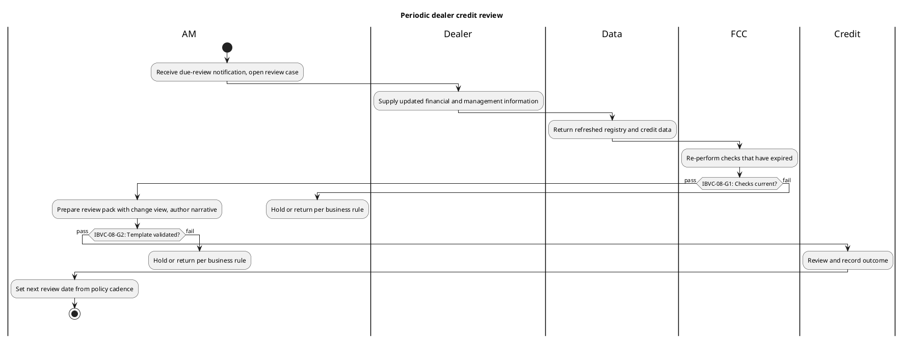

#### IBVC-09 — Due diligence and screening (cross-cutting)
| Attribute | Value |
|---|---|
| Business areas | BA-01, BA-02, BA-03, BA-04, BA-05 |
| Domain (primary; secondary) | DOM-02; DOM-06, DOM-08 |
| Triggering actors | AM |
| Value recipient | Credit Underwriter; Compliance Oversight |
| Processes L1–L3 | L1 Dealer Credit Pack Assessment; L2 P-04; L3 Determine applicable checks; run; evidence; dispose; CRA |
| Trigger | A case needs due diligence |
| Value delivered | Evidenced, current due diligence for every party |
| Source requirements | REQ-025..REQ-037 |
| Capabilities | CAP-04 |

| Link | Actor lane | Activity | Control gate |
|---|---|---|---|
| 1 | FCC | Determine applicable checks from the requirement set | - |
| 2 | Data | Provide data for KYC, AML, sanctions and adverse media | - |
| 3 | FCC | Run or record checks; capture evidence | IBVC-09-G1: Check record complete |
| 4 | FCC | Dispose hits with rationale; produce CRA | IBVC-09-G2: No undispositioned hit; CRA recorded |
| 5 | AM | Receive completion status; proceed or hold | - |

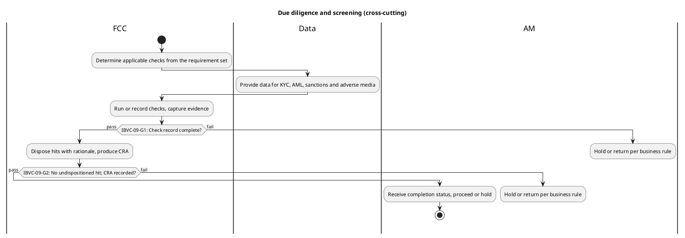

#### IBVC-10 — Screening hit or adverse finding (exception)
| Attribute | Value |
|---|---|
| Business areas | BA-01, BA-02, BA-03, BA-04, BA-05 |
| Domain (primary; secondary) | DOM-02; DOM-08 |
| Triggering actors | FCC |
| Value recipient | Compliance Oversight; Credit Underwriter |
| Processes L1–L3 | L1 Dealer Credit Pack Assessment; L2 P-04, P-02; L3 Triage hit; clarify with dealer; dispose or escalate; record |
| Trigger | A check returns a potential match or adverse finding |
| Value delivered | Hits are resolved by authorised people with rationale |
| Source requirements | REQ-032..REQ-034, REQ-037, REQ-091 |
| Capabilities | CAP-04, CAP-13 |

| Link | Actor lane | Activity | Control gate |
|---|---|---|---|
| 1 | FCC | Triage the hit and assess relevance | - |
| 2 | AM | Request clarification from the dealer where needed | - |
| 3 | Dealer | Provide clarification or evidence | - |
| 4 | FCC | Dispose as false positive or escalate | IBVC-10-G1: Disposition authorised or escalation made |
| 5 | Oversight | Review escalation and decide per policy | - |
| 6 | AM | Case released, held or halted as decided | - |

```plantuml
@startuml
title Screening hit or adverse finding (exception)
skinparam shadowing false
|FCC|
start
:Triage the hit and assess relevance;
|AM|
:Request clarification from the dealer where needed;
|Dealer|
:Provide clarification or evidence;
|FCC|
:Dispose as false positive or escalate;
if (IBVC-10-G1: Disposition authorised or escalation made?) then (pass)
|Oversight|
:Review escalation and decide per policy;
|AM|
:Case released, held or halted as decided;
stop
else (fail)
:Hold or return per business rule;
detach
endif
@enduml
```

#### IBVC-11 — Information gap resolution
| Attribute | Value |
|---|---|
| Business areas | BA-01, BA-02, BA-03, BA-04, BA-05 |
| Domain (primary; secondary) | DOM-06; DOM-01 |
| Triggering actors | AM |
| Value recipient | Account Manager; Credit Underwriter |
| Processes L1–L3 | L1 Dealer Credit Pack Assessment; L2 P-02, P-11; L3 Detect gap; request; receive; validate; close |
| Trigger | A gap is detected against the requirement set |
| Value delivered | Gaps close before submission or are closed with reason |
| Source requirements | REQ-015, REQ-016, REQ-018, REQ-019 |
| Capabilities | CAP-02, CAP-12 |

| Link | Actor lane | Activity | Control gate |
|---|---|---|---|
| 1 | AM | Detect gap against the requirement set | - |
| 2 | Dealer | Receive the request and supply the item | - |
| 3 | AM | Validate the item and its source | IBVC-11-G1: Item validated or closed with reason |
| 4 | Data | Supply external confirmation where relevant | - |

```plantuml
@startuml
title Information gap resolution
skinparam shadowing false
|AM|
start
:Detect gap against the requirement set;
|Dealer|
:Receive the request and supply the item;
|AM|
:Validate the item and its source;
if (IBVC-11-G1: Item validated or closed with reason?) then (pass)
|Data|
:Supply external confirmation where relevant;
stop
else (fail)
:Hold or return per business rule;
detach
endif
@enduml
```

#### IBVC-12 — Credit query and rework
| Attribute | Value |
|---|---|
| Business areas | BA-01, BA-02, BA-03, BA-04, BA-05 |
| Domain (primary; secondary) | DOM-03; DOM-06 |
| Triggering actors | Credit |
| Value recipient | Credit Underwriter; Account Manager |
| Processes L1–L3 | L1 Dealer Credit Pack Assessment; L2 P-08; L3 Raise query; triage; amend; version; resubmit |
| Trigger | Credit raises a query on a submitted pack |
| Value delivered | Credit gets answers fast and every version is provable |
| Source requirements | REQ-064, REQ-065, REQ-095 |
| Capabilities | CAP-08, CAP-09 |

| Link | Actor lane | Activity | Control gate |
|---|---|---|---|
| 1 | Credit | Raise a query on the submitted pack | - |
| 2 | AM | Triage and assign the query | - |
| 3 | Dealer | Provide additional information where needed | - |
| 4 | AM | Amend the pack as a new version; authorise resubmission | IBVC-12-G1: Resubmission authorised |
| 5 | Credit | Resume assessment and record outcome | - |

```plantuml
@startuml
title Credit query and rework
skinparam shadowing false
|Credit|
start
:Raise a query on the submitted pack;
|AM|
:Triage and assign the query;
|Dealer|
:Provide additional information where needed;
|AM|
:Amend the pack as a new version, authorise resubmission;
if (IBVC-12-G1: Resubmission authorised?) then (pass)
|Credit|
:Resume assessment and record outcome;
stop
else (fail)
:Hold or return per business rule;
detach
endif
@enduml
```

#### IBVC-13 — Post-approval legal documentation
| Attribute | Value |
|---|---|
| Business areas | BA-01, BA-02, BA-03, BA-04, BA-05 |
| Domain (primary; secondary) | DOM-04; DOM-05, DOM-08 |
| Triggering actors | Credit |
| Value recipient | Dealer; Legal; Operations |
| Processes L1–L3 | L1 Dealer Credit Pack Assessment; L2 P-09; L3 Initiate; prepare legal documents from approved terms; execute; confirm |
| Trigger | Approval recorded |
| Value delivered | Documentation matches approved terms |
| Source requirements | REQ-066, REQ-068..REQ-073 |
| Capabilities | CAP-10 |

| Link | Actor lane | Activity | Control gate |
|---|---|---|---|
| 1 | AM | Initiate handoffs on recorded approval | IBVC-13-G1: Approval recorded |
| 2 | Legal | Prepare legal documentation from approved terms | IBVC-13-G2: Terms match approval |
| 3 | Dealer | Review and execute documentation | - |
| 4 | Legal | Confirm execution; update handoff status | - |
| 5 | AM | Continue to IBVC-14 and IBVC-15 | - |

```plantuml
@startuml
title Post-approval legal documentation
skinparam shadowing false
|AM|
start
:Initiate handoffs on recorded approval;
if (IBVC-13-G1: Approval recorded?) then (pass)
|Legal|
:Prepare legal documentation from approved terms;
if (IBVC-13-G2: Terms match approval?) then (pass)
|Dealer|
:Review and execute documentation;
|Legal|
:Confirm execution, update handoff status;
|AM|
:Continue to IBVC-14 and IBVC-15;
stop
else (fail)
:Hold or return per business rule;
detach
endif
else (fail)
:Hold or return per business rule;
detach
endif
@enduml
```

#### IBVC-14 — Direct debit mandate and operational set-up
| Attribute | Value |
|---|---|
| Business areas | BA-01, BA-02, BA-03, BA-04, BA-05 |
| Domain (primary; secondary) | DOM-05; DOM-04 |
| Triggering actors | Ops |
| Value recipient | Dealer; Operations |
| Processes L1–L3 | L1 Dealer Credit Pack Assessment; L2 P-09; L3 Request mandate; set up operations; confirm |
| Trigger | Documentation progressing after approval |
| Value delivered | Dealer is operationally ready |
| Source requirements | REQ-068..REQ-073 |
| Capabilities | CAP-10 |

| Link | Actor lane | Activity | Control gate |
|---|---|---|---|
| 1 | Ops | Request direct debit mandate from the dealer | - |
| 2 | Dealer | Complete and return the mandate | - |
| 3 | Ops | Establish mandate and operational set-up | IBVC-14-G1: Mandate established |
| 4 | AM | Receive milestone notice | - |

```plantuml
@startuml
title Direct debit mandate and operational set-up
skinparam shadowing false
|Ops|
start
:Request direct debit mandate from the dealer;
|Dealer|
:Complete and return the mandate;
|Ops|
:Establish mandate and operational set-up;
if (IBVC-14-G1: Mandate established?) then (pass)
|AM|
:Receive milestone notice;
stop
else (fail)
:Hold or return per business rule;
detach
endif
@enduml
```

#### IBVC-15 — Funding system configuration
| Attribute | Value |
|---|---|
| Business areas | BA-01, BA-02, BA-03, BA-04 |
| Domain (primary; secondary) | DOM-05; DOM-04, DOM-08 |
| Triggering actors | Ops |
| Value recipient | Dealer; Operations |
| Processes L1–L3 | L1 Dealer Credit Pack Assessment; L2 P-09; L3 Configure approved terms in funding platform; verify; release |
| Trigger | Legal documentation and conditions are progressing |
| Value delivered | Funding platform reflects the approved terms |
| Source requirements | REQ-070, REQ-072, REQ-073 |
| Capabilities | CAP-10 |

| Link | Actor lane | Activity | Control gate |
|---|---|---|---|
| 1 | Ops | Configure approved terms in the funding platform | IBVC-15-G1: Conditions satisfied before dependent step |
| 2 | Funding | Hold funding, charging and payment set-up | - |
| 3 | Ops | Verify configuration against approved terms | IBVC-15-G2: Terms match approval |
| 4 | AM | Confirm readiness and close handoff | - |

```plantuml
@startuml
title Funding system configuration
skinparam shadowing false
|Ops|
start
:Configure approved terms in the funding platform;
if (IBVC-15-G1: Conditions satisfied before dependent step?) then (pass)
|Funding|
:Hold funding, charging and payment set-up;
|Ops|
:Verify configuration against approved terms;
if (IBVC-15-G2: Terms match approval?) then (pass)
|AM|
:Confirm readiness and close handoff;
stop
else (fail)
:Hold or return per business rule;
detach
endif
else (fail)
:Hold or return per business rule;
detach
endif
@enduml
```

#### IBVC-16 — Third-party audit and inspection supplier activation
| Attribute | Value |
|---|---|
| Business areas | BA-01, BA-02, BA-03, BA-04, BA-05 |
| Domain (primary; secondary) | DOM-07; DOM-05 |
| Triggering actors | Ops |
| Value recipient | Operations; Dealer |
| Processes L1–L3 | L1 Dealer Credit Pack Assessment; L2 P-09; L3 Instruct supplier; supplier performs; results recorded |
| Trigger | Post-approval supplier activity is required |
| Value delivered | Supplier activity starts and results are recorded |
| Source requirements | REQ-068, REQ-069, REQ-073 |
| Capabilities | CAP-10 |

| Link | Actor lane | Activity | Control gate |
|---|---|---|---|
| 1 | Ops | Instruct the audit and inspection supplier | - |
| 2 | Supplier | Perform audit or vehicle inspection activity | - |
| 3 | Ops | Record results and update handoff status | IBVC-16-G1: Results recorded |
| 4 | AM | Receive milestone notice | - |

```plantuml
@startuml
title Third-party audit and inspection supplier activation
skinparam shadowing false
|Ops|
start
:Instruct the audit and inspection supplier;
|Supplier|
:Perform audit or vehicle inspection activity;
|Ops|
:Record results and update handoff status;
if (IBVC-16-G1: Results recorded?) then (pass)
|AM|
:Receive milestone notice;
stop
else (fail)
:Hold or return per business rule;
detach
endif
@enduml
```

#### IBVC-17 — Referral intake and feedback
| Attribute | Value |
|---|---|
| Business areas | BA-01, BA-02, BA-03, BA-04, BA-05 |
| Domain (primary; secondary) | DOM-01; DOM-06 |
| Triggering actors | OEM, Bank, Field |
| Value recipient | OEM partner; Referring bank; Field distribution |
| Processes L1–L3 | L1 Dealer Credit Pack Assessment; L2 P-01; L3 Receive referral; register source; confirm; feedback within permission |
| Trigger | Referral received |
| Value delivered | Referrals are tracked and no lead is lost |
| Source requirements | REQ-001, REQ-003 |
| Capabilities | CAP-01 |

| Link | Actor lane | Activity | Control gate |
|---|---|---|---|
| 1 | OEM | Refer a dealer | - |
| 2 | Bank | Refer a dealer | - |
| 3 | Field | Refer a dealer or relay dealer contact | - |
| 4 | AM | Register case with source; confirm receipt | IBVC-17-G1: Source recorded |
| 5 | AM | Provide outcome feedback where permitted (OQ-15) | - |

```plantuml
@startuml
title Referral intake and feedback
skinparam shadowing false
|OEM|
start
:Refer a dealer;
|Bank|
:Refer a dealer;
|Field|
:Refer a dealer or relay dealer contact;
|AM|
:Register case with source, confirm receipt;
if (IBVC-17-G1: Source recorded?) then (pass)
|AM|
:Provide outcome feedback where permitted (OQ-15);
stop
else (fail)
:Hold or return per business rule;
detach
endif
@enduml
```

#### IBVC-18 — Cross-line dealer information reuse
| Attribute | Value |
|---|---|
| Business areas | BA-01, BA-02, BA-03, BA-04, BA-05 |
| Domain (primary; secondary) | DOM-06; DOM-01 |
| Triggering actors | AM |
| Value recipient | Dealer; Account Manager |
| Processes L1–L3 | L1 Dealer Credit Pack Assessment; L2 P-11, P-02; L3 Resolve identity; offer held items; obtain deltas; record reuse |
| Trigger | A second lending line needs dealer information |
| Value delivered | The dealer is asked once |
| Source requirements | REQ-004, REQ-019, REQ-079..REQ-083 |
| Capabilities | CAP-12 |

| Link | Actor lane | Activity | Control gate |
|---|---|---|---|
| 1 | AM | Open a case for another lending line | - |
| 2 | Data | Resolve single dealer identity | - |
| 3 | AM | Review held items offered for reuse | IBVC-18-G1: Items valid and permitted for reuse |
| 4 | Dealer | Supply only deltas | - |

```plantuml
@startuml
title Cross-line dealer information reuse
skinparam shadowing false
|AM|
start
:Open a case for another lending line;
|Data|
:Resolve single dealer identity;
|AM|
:Review held items offered for reuse;
if (IBVC-18-G1: Items valid and permitted for reuse?) then (pass)
|Dealer|
:Supply only deltas;
stop
else (fail)
:Hold or return per business rule;
detach
endif
@enduml
```

#### IBVC-19 — Regulatory and audit evidence retrieval
| Attribute | Value |
|---|---|
| Business areas | BA-01, BA-02, BA-03, BA-04, BA-05 |
| Domain (primary; secondary) | DOM-08; DOM-06 |
| Triggering actors | Regulator, Oversight |
| Value recipient | Regulator; Compliance Oversight |
| Processes L1–L3 | L1 Dealer Credit Pack Assessment; L2 P-12; L3 Request; retrieve trail; verify completeness; provide |
| Trigger | Regulator or oversight requests evidence |
| Value delivered | Evidence is provided complete and fast |
| Source requirements | REQ-033, REQ-064, REQ-085, REQ-086 |
| Capabilities | CAP-13 |

| Link | Actor lane | Activity | Control gate |
|---|---|---|---|
| 1 | Regulator | Request evidence for a case or sample | - |
| 2 | Oversight | Retrieve case audit trail, check records and pack snapshots | - |
| 3 | Oversight | Verify the evidence is complete | IBVC-19-G1: Evidence complete |
| 4 | Regulator | Receive evidence | - |

```plantuml
@startuml
title Regulatory and audit evidence retrieval
skinparam shadowing false
|Regulator|
start
:Request evidence for a case or sample;
|Oversight|
:Retrieve case audit trail, check records and pack snapshots;
|Oversight|
:Verify the evidence is complete;
if (IBVC-19-G1: Evidence complete?) then (pass)
|Regulator|
:Receive evidence;
stop
else (fail)
:Hold or return per business rule;
detach
endif
@enduml
```

#### IBVC-20 — Performance baseline and management reporting
| Attribute | Value |
|---|---|
| Business areas | BA-01, BA-02, BA-03, BA-04, BA-05 |
| Domain (primary; secondary) | DOM-08; DOM-06 |
| Triggering actors | Mgmt |
| Value recipient | Business Management |
| Processes L1–L3 | L1 Dealer Credit Pack Assessment; L2 P-12; L3 Record; aggregate; review; decide |
| Trigger | Reporting period ends |
| Value delivered | Management can see volume, effort, rework and exceptions |
| Source requirements | REQ-093..REQ-097 |
| Capabilities | CAP-14 |

| Link | Actor lane | Activity | Control gate |
|---|---|---|---|
| 1 | AM | Case activity records effort, volume, rework and exceptions | - |
| 2 | Mgmt | Review operational reports | IBVC-20-G1: Data complete for the period |
| 3 | Mgmt | Decide improvement actions | - |

```plantuml
@startuml
title Performance baseline and management reporting
skinparam shadowing false
|AM|
start
:Case activity records effort, volume, rework and exceptions;
|Mgmt|
:Review operational reports;
if (IBVC-20-G1: Data complete for the period?) then (pass)
|Mgmt|
:Decide improvement actions;
stop
else (fail)
:Hold or return per business rule;
detach
endif
@enduml
```

#### IBVC-21 — Personal data rights and retention
| Attribute | Value |
|---|---|
| Business areas | BA-01, BA-02, BA-03, BA-04, BA-05 |
| Domain (primary; secondary) | DOM-08; DOM-06 |
| Triggering actors | Privacy |
| Value recipient | Data subjects; Data Protection Officer |
| Processes L1–L3 | L1 Dealer Credit Pack Assessment; L2 P-12; L3 Receive request or retention trigger; locate; act; record |
| Trigger | A subject request or retention end is reached |
| Value delivered | Privacy duties are met |
| Source requirements | REQ-084, REQ-086, REQ-087, REQ-089 |
| Capabilities | CAP-13 |

| Link | Actor lane | Activity | Control gate |
|---|---|---|---|
| 1 | Privacy | Receive a data subject request or retention trigger | - |
| 2 | Oversight | Locate personal data across cases | - |
| 3 | Privacy | Decide action; apply legal hold where required | IBVC-21-G1: Action authorised |
| 4 | Privacy | Record the action | - |

```plantuml
@startuml
title Personal data rights and retention
skinparam shadowing false
|Privacy|
start
:Receive a data subject request or retention trigger;
|Oversight|
:Locate personal data across cases;
|Privacy|
:Decide action, apply legal hold where required;
if (IBVC-21-G1: Action authorised?) then (pass)
|Privacy|
:Record the action;
stop
else (fail)
:Hold or return per business rule;
detach
endif
@enduml
```

### R.4 Cross-chain map
```plantuml
@startuml
title Cross-chain map
skinparam shadowing false
rectangle "IBVC-01" as IBVC01
rectangle "IBVC-02" as IBVC02
rectangle "IBVC-03" as IBVC03
rectangle "IBVC-04" as IBVC04
rectangle "IBVC-05" as IBVC05
rectangle "IBVC-06" as IBVC06
rectangle "IBVC-07" as IBVC07
rectangle "IBVC-08" as IBVC08
rectangle "IBVC-09" as IBVC09
rectangle "IBVC-10" as IBVC10
rectangle "IBVC-11" as IBVC11
rectangle "IBVC-12" as IBVC12
rectangle "IBVC-13" as IBVC13
rectangle "IBVC-14" as IBVC14
rectangle "IBVC-15" as IBVC15
rectangle "IBVC-16" as IBVC16
rectangle "IBVC-17" as IBVC17
rectangle "IBVC-18" as IBVC18
rectangle "IBVC-19" as IBVC19
rectangle "IBVC-20" as IBVC20
rectangle "IBVC-21" as IBVC21
IBVC17 --> IBVC01 : Referral becomes new dealer case
IBVC17 --> IBVC02 : Referral becomes franchise case
IBVC01 --> IBVC09 : Due diligence
IBVC02 --> IBVC09 : Due diligence on expired items
IBVC04 --> IBVC09 : Due diligence on new parties
IBVC06 --> IBVC09 : Due diligence on changed person
IBVC07 --> IBVC09 : Due diligence on new owners
IBVC08 --> IBVC09 : Refresh of expired checks
IBVC09 --> IBVC10 : Hit raised
IBVC01 --> IBVC11 : Gap found
IBVC02 --> IBVC18 : Reuse of held data
IBVC01 --> IBVC12 : Credit query
IBVC03 --> IBVC12 : Credit query
IBVC01 --> IBVC13 : Approval
IBVC02 --> IBVC13 : Approval
IBVC03 --> IBVC13 : Approval
IBVC04 --> IBVC13 : Approval
IBVC05 --> IBVC13 : Approval
IBVC13 --> IBVC14 : Documentation progressing
IBVC13 --> IBVC15 : Documentation progressing
IBVC13 --> IBVC16 : Supplier activity
IBVC14 --> IBVC08 : Review schedule set
IBVC15 --> IBVC08 : Review schedule set
IBVC06 --> IBVC08 : Schedule updated
IBVC08 --> IBVC12 : Credit query
IBVC01 --> IBVC19 : Evidence on request
IBVC01 --> IBVC20 : Performance data
IBVC01 --> IBVC21 : Personal data in scope
@enduml
```

| From | To | Handover |
|---|---|---|
| IBVC-17 | IBVC-01 | Referral becomes new dealer case |
| IBVC-17 | IBVC-02 | Referral becomes franchise case |
| IBVC-01 | IBVC-09 | Due diligence |
| IBVC-02 | IBVC-09 | Due diligence on expired items |
| IBVC-04 | IBVC-09 | Due diligence on new parties |
| IBVC-06 | IBVC-09 | Due diligence on changed person |
| IBVC-07 | IBVC-09 | Due diligence on new owners |
| IBVC-08 | IBVC-09 | Refresh of expired checks |
| IBVC-09 | IBVC-10 | Hit raised |
| IBVC-01 | IBVC-11 | Gap found |
| IBVC-02 | IBVC-18 | Reuse of held data |
| IBVC-01 | IBVC-12 | Credit query |
| IBVC-03 | IBVC-12 | Credit query |
| IBVC-01 | IBVC-13 | Approval |
| IBVC-02 | IBVC-13 | Approval |
| IBVC-03 | IBVC-13 | Approval |
| IBVC-04 | IBVC-13 | Approval |
| IBVC-05 | IBVC-13 | Approval |
| IBVC-13 | IBVC-14 | Documentation progressing |
| IBVC-13 | IBVC-15 | Documentation progressing |
| IBVC-13 | IBVC-16 | Supplier activity |
| IBVC-14 | IBVC-08 | Review schedule set |
| IBVC-15 | IBVC-08 | Review schedule set |
| IBVC-06 | IBVC-08 | Schedule updated |
| IBVC-08 | IBVC-12 | Credit query |
| IBVC-01 | IBVC-19 | Evidence on request |
| IBVC-01 | IBVC-20 | Performance data |
| IBVC-01 | IBVC-21 | Personal data in scope |

### R.5 Coverage Matrix (business area × domain × process × actor)
**R.5.1 Business area × domain** (cells list chains where the area is served and the domain is primary or secondary).
| Area \ Domain | DOM-01 | DOM-02 | DOM-03 | DOM-04 | DOM-05 | DOM-06 | DOM-07 | DOM-08 |
|---|---|---|---|---|---|---|---|---|
| BA-01 Franchise Lending | 01, 02, 03, 04, 05, 06, 07, 11, 17, 18 | 01, 02, 03, 04, 06, 07, 08, 09, 10 | 01, 02, 03, 04, 05, 08, 12 | 13, 14, 15 | 13, 14, 15, 16 | 01, 02, 03, 04, 05, 06, 07, 08, 09, 11, 12, 17, 18, 19, 20, 21 | 16 | 01, 06, 07, 09, 10, 13, 15, 19, 20, 21 |
| BA-02 Wholesale Lending | 01, 02, 03, 04, 05, 06, 07, 11, 17, 18 | 01, 02, 03, 04, 06, 07, 08, 09, 10 | 01, 02, 03, 04, 05, 08, 12 | 13, 14, 15 | 13, 14, 15, 16 | 01, 02, 03, 04, 05, 06, 07, 08, 09, 11, 12, 17, 18, 19, 20, 21 | 16 | 01, 06, 07, 09, 10, 13, 15, 19, 20, 21 |
| BA-03 Fleet Lending | 01, 02, 03, 04, 05, 06, 07, 11, 17, 18 | 01, 02, 03, 04, 06, 07, 08, 09, 10 | 01, 02, 03, 04, 05, 08, 12 | 13, 14, 15 | 13, 14, 15, 16 | 01, 02, 03, 04, 05, 06, 07, 08, 09, 11, 12, 17, 18, 19, 20, 21 | 16 | 01, 06, 07, 09, 10, 13, 15, 19, 20, 21 |
| BA-04 Retail Lending | 01, 02, 03, 04, 05, 06, 07, 11, 17, 18 | 01, 02, 03, 04, 06, 07, 08, 09, 10 | 01, 02, 03, 04, 05, 08, 12 | 13, 14, 15 | 13, 14, 15, 16 | 01, 02, 03, 04, 05, 06, 07, 08, 09, 11, 12, 17, 18, 19, 20, 21 | 16 | 01, 06, 07, 09, 10, 13, 15, 19, 20, 21 |
| BA-05 Wider Onboarding | 01, 04, 05, 06, 07, 11, 17, 18 | 01, 04, 06, 07, 08, 09, 10 | 01, 04, 05, 08, 12 | 13, 14 | 13, 14, 16 | 01, 04, 05, 06, 07, 08, 09, 11, 12, 17, 18, 19, 20, 21 | 16 | 01, 06, 07, 09, 10, 13, 19, 20, 21 |

Cell values are chain numbers (IBVC-nn). Domains are listed in R.1. Chains that apply to BA-03 and BA-04 reuse the shared core; area-specific differences, including whether supplier activation (IBVC-16) applies to each area, are unknown (OQ-11).

**R.5.2 Actor × chains**
| Actor | Chains | Count |
|---|---|---|
| ACT-01 Dealer Principal / Director | 01, 02, 03, 04, 05, 06, 07, 08, 10, 11, 12, 13, 14, 18 | 14 |
| ACT-02 Dealer Shareholder / Beneficial Owner | 01, 02, 03, 04, 05, 06, 07, 08, 10, 11, 12, 13, 14, 18 | 14 |
| ACT-03 Account Manager | 01, 02, 03, 04, 05, 06, 07, 08, 09, 10, 11, 12, 13, 14, 15, 16, 17, 18, 20 | 19 |
| ACT-04 Wholesale Manager | 01, 02, 03, 04, 05, 06, 07, 08, 09, 10, 11, 12, 13, 14, 15, 16, 17, 18, 20 | 19 |
| ACT-05 Field Distribution Team Member | 17 | 1 |
| ACT-06 Credit Underwriter | 01, 02, 03, 04, 05, 06, 07, 08, 12 | 9 |
| ACT-07 Onboarding / Financial Crime Compliance Analyst | 01, 02, 03, 04, 05, 06, 07, 08, 09, 10 | 10 |
| ACT-08 Legal Documentation Team | 13 | 1 |
| ACT-09 Operations and Funding Set-up Team | 14, 15, 16 | 3 |
| ACT-10 OEM Partner | 02, 17 | 2 |
| ACT-11 Referring Bank | 17 | 1 |
| ACT-12 Credit Reference and Registry Data Providers (Experian, Equifax, Companies House) | 01, 06, 07, 08, 09, 11, 18 | 7 |
| ACT-13 Audit and Inspection Supplier (Auxiga Smart3) | 16 | 1 |
| ACT-14 Regulator (FCA) | 19 | 1 |
| ACT-15 Compliance and Internal Audit Oversight | 10, 19, 21 | 3 |
| ACT-16 Data Protection Officer / Privacy Office | 21 | 1 |
| ACT-17 Wholesale Funding Platform (SOPRA Apak) | 15 | 1 |
| ACT-18 Business Management / Process Owner | 20 | 1 |

**R.5.3 L2 process × chains**
| L2 process | Chains | Count |
|---|---|---|
| P-01 Receive and Triage Request | 01, 02, 03, 04, 05, 06, 07, 17 | 8 |
| P-02 Gather Dealer Information | 01, 02, 03, 04, 05, 06, 07, 08, 10, 11, 18 | 11 |
| P-03 Verify Entities and Ownership | 01, 02, 04, 06, 07 | 5 |
| P-04 Perform Onboarding and Risk Checks | 01, 02, 04, 06, 07, 08, 09, 10 | 8 |
| P-05 Analyse Dealer Financials | 01, 02, 03, 04, 05, 08 | 6 |
| P-06 Prepare Credit Application (FCA Template) | 01, 02, 03, 04, 05, 06, 07, 08 | 8 |
| P-07 Compile Lending Request, Terms and Pricing | 01, 02, 03, 04, 05 | 5 |
| P-08 Submit to Credit and Manage Queries | 01, 02, 03, 04, 05, 08, 12 | 7 |
| P-09 Execute Post-Approval Handoffs | 13, 14, 15, 16 | 4 |
| P-10 Conduct Periodic and Event-Driven Review | 06, 07, 08 | 3 |
| P-11 Manage Dealer Data and Evidence | 11, 18 | 2 |
| P-12 Govern, Audit and Measure | 19, 20, 21 | 3 |

**R.5.4 Domain × chains**
| Domain | Chains | Count |
|---|---|---|
| DOM-01 Origination and Relationship Management | 01, 02, 03, 04, 05, 06, 07, 11, 17, 18 | 10 |
| DOM-02 Due Diligence and Financial Crime Compliance | 01, 02, 03, 04, 06, 07, 08, 09, 10 | 9 |
| DOM-03 Credit Analysis and Assessment | 01, 02, 03, 04, 05, 08, 12 | 7 |
| DOM-04 Legal and Documentation | 13, 14, 15 | 3 |
| DOM-05 Operations and Funding | 13, 14, 15, 16 | 4 |
| DOM-06 Data and Evidence Management | 01, 02, 03, 04, 05, 06, 07, 08, 09, 11, 12, 17, 18, 19, 20, 21 | 16 |
| DOM-07 Third-Party Supplier Management | 16 | 1 |
| DOM-08 Governance, Risk and Regulatory Compliance | 01, 06, 07, 09, 10, 13, 15, 19, 20, 21 | 10 |

**Coverage proof:** actors without a chain: none · L2 processes without a chain: none · domains without a chain: none · business areas without a chain: none · empty area×domain cells: 0.

## Handoff
This pack is design-independent. The next dimension (experience, estimation, planning, architecture §TSA, technical specification §TSD) shall consume: requirements (§C), stories (§J), rules and decision tables (§K), regulatory mapping (§L), calculations (§N) and open questions (§0.4). Closure of OQ-01, OQ-02, OQ-03, OQ-05 and OQ-06 is required before the build baseline.

## Version History
| Version | Date | Changes |
|---|---|---|
| 1.0 | 2026-10-23 | Initial BA pack generated from Credit assessment.docx under BA SME meta-prompt v1.2 (§A–§R). |

